# TrustChain — Technical Design Document (TDD)

**Blockchain-Based Certificate Verification Platform**

| Field | Value |
|---|---|
| Document | Technical Design Document v1.0 |
| Date | July 2026 |
| Status | Implementation-ready baseline (Gate 1 input) |
| Upstream sources of truth | [Planning set](../planning/00-README.md) · [PRD + SRS](../specs/TRUSTCHAIN-PRD-SRS.md) |
| Traceability | FR/NFR/BR IDs referenced throughout map to the SRS |

---

## Table of Contents

1. [Executive Technical Overview](#1-executive-technical-overview)
2. [System Architecture](#2-system-architecture)
3. [Complete Technology Stack](#3-complete-technology-stack)
4. [Application Architecture (Repository Structure)](#4-application-architecture-repository-structure)
5. [Database Architecture](#5-database-architecture)
6. [Database Design (Table Specifications)](#6-database-design-table-specifications)
7. [Smart Contract Architecture](#7-smart-contract-architecture)
8. [Blockchain Design](#8-blockchain-design)
9. [API Architecture](#9-api-architecture)
10. [Authentication Architecture](#10-authentication-architecture)
11. [Frontend Architecture](#11-frontend-architecture)
12. [UI Component Library & Design System](#12-ui-component-library--design-system)
13. [Certificate Workflow (Sequence Diagrams)](#13-certificate-workflow-sequence-diagrams)
14. [Security Architecture](#14-security-architecture)
15. [Performance Architecture](#15-performance-architecture)
16. [Logging & Monitoring](#16-logging--monitoring)
17. [DevOps Architecture](#17-devops-architecture)
18. [Deployment Architecture](#18-deployment-architecture)
19. [Testing Architecture](#19-testing-architecture)
20. [Implementation Roadmap](#20-implementation-roadmap)

---

# 1. Executive Technical Overview

## 1.1 Overall Architecture

TrustChain is a **multi-tenant SaaS platform built as a modular monolith with satellite workers**, fronted by four Next.js applications, backed by PostgreSQL (row-level-security tenancy), and anchored to **Polygon PoS** through three minimal smart contracts. The blockchain is a *trust layer*, not a data layer: only salted hashes, Merkle roots, issuer key hashes, and status-list roots ever go on-chain.

```
Four web apps ──► API layer (REST /v1 + GraphQL) ──► Modular core services ──► PostgreSQL / Redis / S3+IPFS
                                                            │
                                              async queues (BullMQ)
                                                            │
                                    Workers: anchoring (relayer) · rendering · notifications
                                                            │
                                              Polygon PoS (3 contracts)
                                                            │
                            Public verifiability: The Graph subgraph + open-source verifier CLI
```

## 1.2 Design Philosophy

1. **The chain stores trust, not data.** Zero PII on-chain — permanent constraint (SRS C-1). Everything on-chain is a commitment; everything human-readable is off-chain and proves itself against those commitments.
2. **Fail closed on trust, fail soft on reads.** Signing, audit logging, and anchoring block on failure; verification degrades gracefully to cached finalized chain state, and never guesses a verdict (BR-20).
3. **Survive our own death.** Any credential must verify with only public data + the open-source verifier (NFR-AVL-07). Every architectural choice is tested against the "vendor death drill."
4. **Boring where possible, novel only at the trust boundary.** TypeScript everywhere off-chain, PostgreSQL, Kubernetes, OpenZeppelin — innovation budget is spent exclusively on the anchoring/verification model.
5. **Crypto invisible.** Users never see wallets, gas, or seed phrases; the relayer and KMS absorb all chain mechanics (C-4).
6. **Multi-tenancy as defense in depth.** Tenant isolation enforced twice: application guards *and* database RLS.
7. **Evolve without rewrites.** Modular monolith with enforced boundaries → extraction-ready; chain-adapter abstraction → migration-ready; schema-driven credentials → new types without deploys.

## 1.3 Architectural Goals

| Goal | Mechanism | Verification |
|---|---|---|
| Independent verifiability | Public chain anchors + OSS verifier + subgraph | Annual vendor-death drill |
| Sub-3s verification | SSR/ISR + CDN + internal chain indexer | k6 load gates per release |
| 50k-row batch issuance | Queue-based async pipeline, idempotent steps | CI pipeline test at scale |
| Tenant isolation | RLS + app guards + scoped keys | Negative cross-tenant test suite |
| Auditability | Append-only logs, daily on-chain roots, tracing | Quarterly tamper drill |
| Extensibility | Schemas, adapters, flags, module boundaries | New credential type < 1 day, no deploy |

## 1.4 Scalability Goals

50M certificates without re-architecture (500M headroom via partitioning); 500 RPS sustained / 5,000 RPS burst verification (NFR-SCA-02); 100 concurrent anchoring tenants; O(1) chain cost per batch regardless of batch size (Merkle); all services stateless and horizontally scalable; heavy work (validation, rendering, anchoring, webhooks) queue-buffered so spikes stretch latency, never lose work.

## 1.5 Security Goals

OWASP ASVS L2 across web surfaces; zero PII on-chain enforced by pre-anchor linting; all signing keys in KMS/HSM, non-exportable; two-person rules on revocation and destructive admin ops; two independent contract audits + fuzz/invariant coverage before mainnet; fail-closed audit with tamper-evident on-chain roots; blast-radius design — relayer compromise can only spam anchors (authority lives in issuer signatures), platform-admin compromise cannot silently alter certificates or logs.

## 1.6 Maintainability Goals

Onboard-to-merged-PR < 5 days (devcontainer + seeds); ≥ 80% unit coverage on core modules; ADR for every significant decision; module boundaries lint-enforced (public interfaces only); runbooks for the top-10 failure modes, drilled monthly; feature flags + kill switches for every risky subsystem (chain writes, AI, webhooks); backward-compatible migrations across one deploy generation.

---

# 2. System Architecture

## 2.1 High-Level Architecture

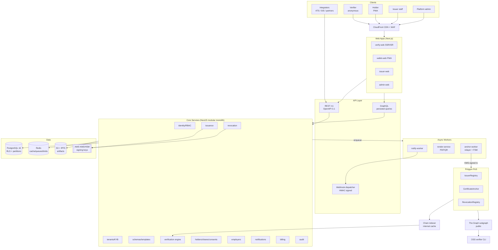

## 2.2 Component Architecture

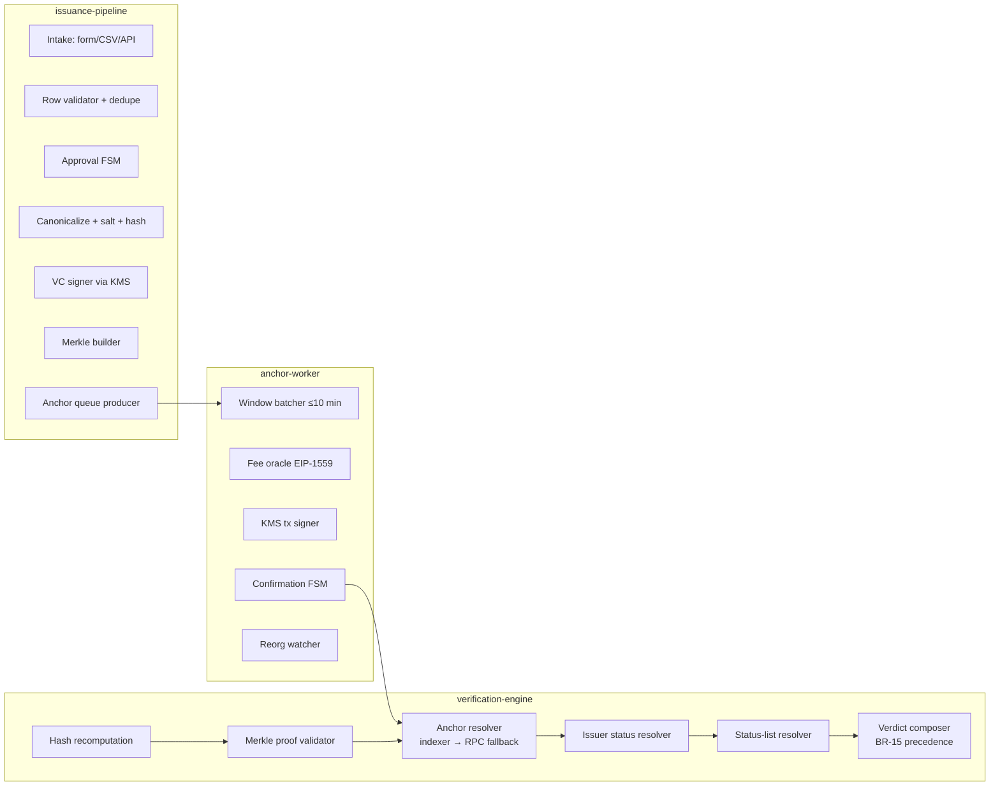

Component contracts: each core module exposes a public TypeScript interface; cross-module calls go through those interfaces only (ESLint-enforced), keeping future service extraction mechanical.

## 2.3 Layered Architecture

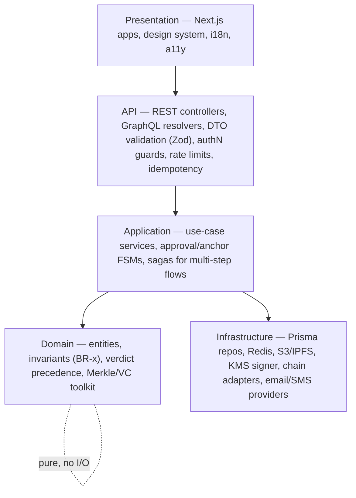

Rules: dependencies point downward only; the domain layer is pure (no I/O) — the VC/Merkle toolkit is a standalone package reused by the OSS verifier; infrastructure implementations are swappable behind ports (chain, mail, SMS, storage).

## 2.4 Service Architecture

| Service | Type | Scaling | State |
|---|---|---|---|
| `api` (modular monolith) | HTTP | HPA on CPU/RPS, 3+ replicas | Stateless |
| `anchor-worker` | Queue consumer | **Singleton-leader per chain** (nonce discipline) + warm standby | Stateless (state in PG/Redis) |
| `render-service` | Queue consumer | HPA on queue depth; spot instances | Stateless |
| `notify-worker` | Queue consumer | HPA on queue depth | Stateless |
| `ai-service` (Phase 3) | HTTP + queue (Python) | Isolated node pool | Stateless |
| `chain-indexer` | Event listener | Active/passive pair | Cursor in PG |

## 2.5 Microservice vs Monolith Analysis

| Criterion | Microservices | Modular monolith | Decision driver |
|---|---|---|---|
| Team size (6–8 eng) | High ops tax per service | One deployable + 3 workers | **Monolith wins** — team can't feed 12 services |
| Transactional integrity (batch → certs → events) | Distributed transactions/sagas everywhere | Local ACID transactions | **Monolith wins** — issuance is deeply transactional |
| Independent scaling needs | Fine-grained | Only 3 hot spots (verify reads, rendering, anchoring) | **Hybrid** — those 3 are already separate workers/paths |
| Fault isolation | Strong | Weaker | Mitigated: workers isolated; verification read path can run degraded on cache |
| Future extraction | N/A | Module boundaries lint-enforced; queues already decouple | Extraction path preserved |

**Decision:** modular monolith (`services/api`) + three dedicated workers + read-optimized verification path. Revisit at >20 engineers or when a module's deploy cadence diverges materially (ADR-003).

## 2.6 Deployment Architecture

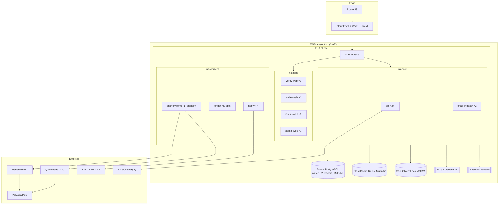

Admin console reachable only via IP-allowlisted ingress + MFA (FR-ADM-001). Full environment topology in [Section 18](#18-deployment-architecture).

## 2.7 Request Flow (generic authenticated API request)

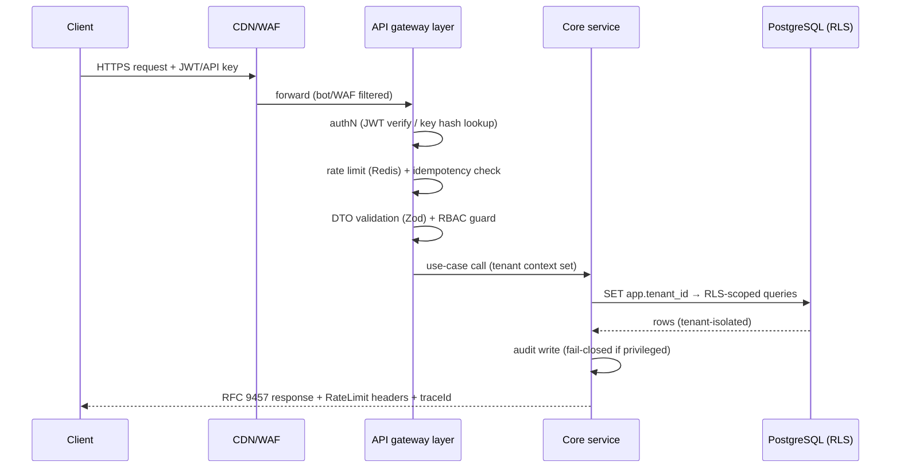

## 2.8 Certificate Issuance Flow

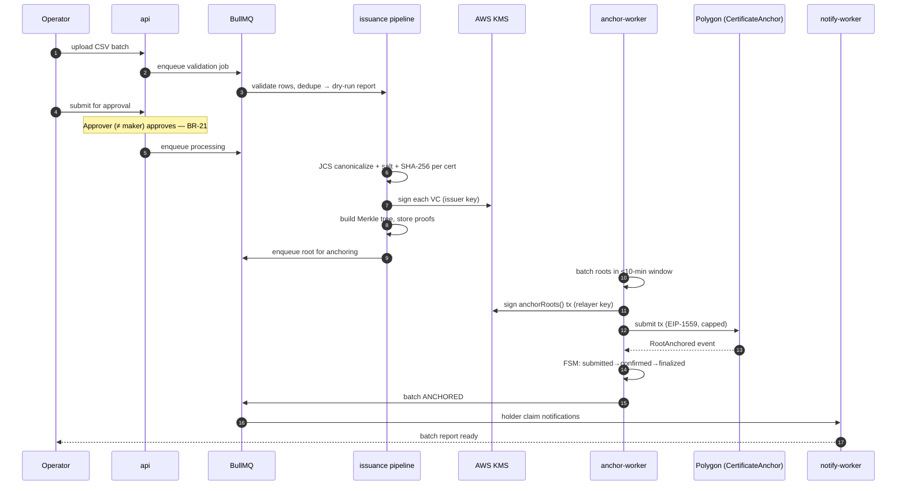

## 2.9 Certificate Verification Flow

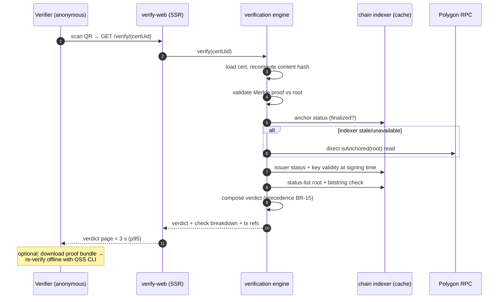

## 2.10 Authentication Flow

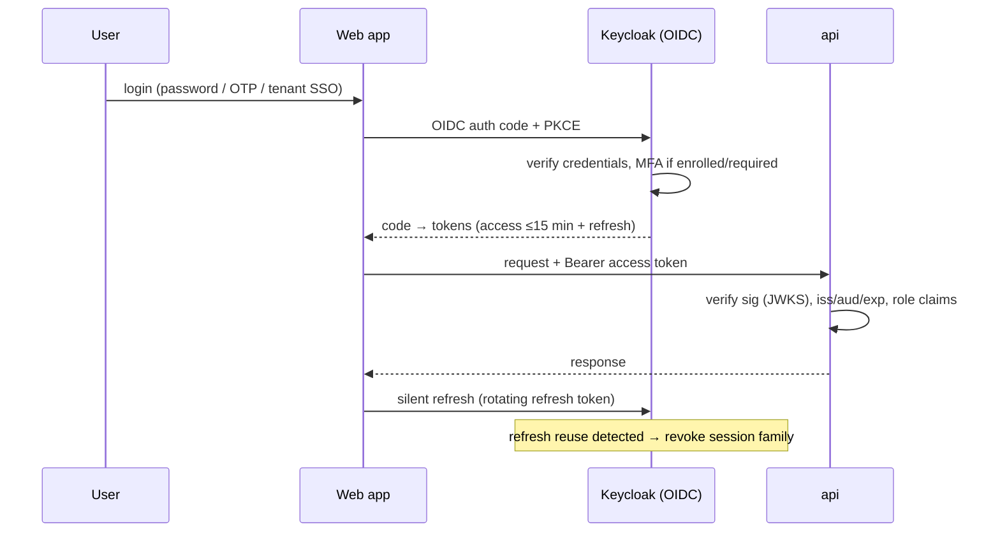

## 2.11 Blockchain Transaction Flow (relayer)

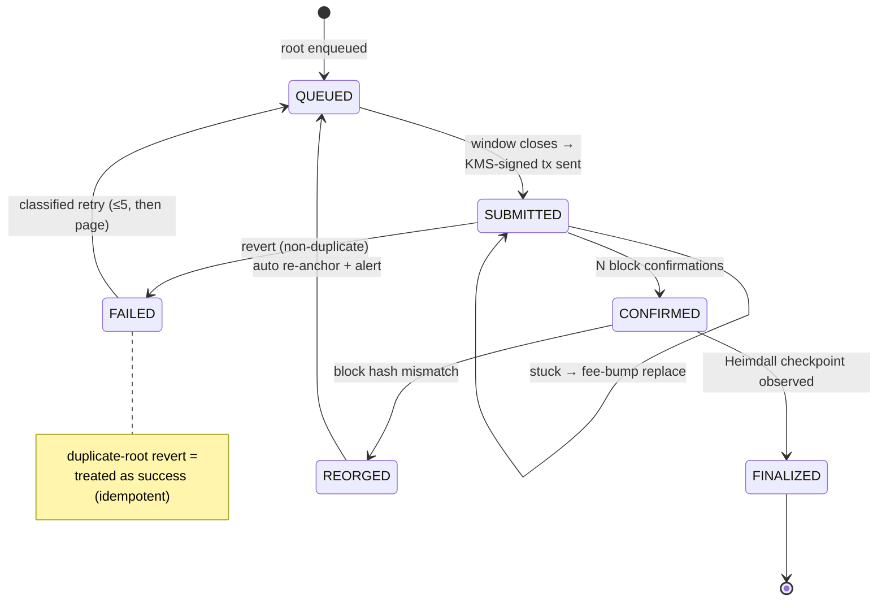

---

# 3. Complete Technology Stack

Full rationale in [planning doc 11](../planning/11-tech-stack.md); this section is the implementation-binding summary with selection reasoning.

| Layer | Technology | Why selected |
|---|---|---|
| **Frontend** | Next.js 15 + React 19 + TypeScript | SSR/ISR is essential for the < 3 s cacheable public verdict page; one framework serves all four apps; TS types shared end-to-end |
| Frontend UI | Tailwind CSS + shadcn/ui (Radix) + design tokens | Accessible primitives (WCAG 2.2 AA requirement) with full visual control; token-driven theming incl. dark mode |
| Frontend data/state | TanStack Query + Zustand; React Hook Form + Zod | Server-cache-first model fits a CRUD+dashboard product; Zod schemas shared with backend = one validation truth |
| **Backend** | Node.js 22 LTS + NestJS (TypeScript) | Structured DI/modules enforce the modular-monolith boundaries; largest hiring pool; TypeChain shares contract types |
| Async | BullMQ on Redis | Right-sized for launch volume; migration path to SQS/Kafka documented (port abstraction) |
| Credential crypto | @digitalbazaar/vc, SD-JWT libs, JCS, Node crypto | Standards conformance (W3C VC 2.0/SD-JWT) over homegrown crypto — non-negotiable |
| Rendering | Playwright HTML→PDF farm | Pixel-faithful template designer output; sandboxed containers |
| **Blockchain** | Polygon PoS (Amoy testnet) | Decision record: [planning doc 09](../planning/09-technology-comparison.md) — public verifiability + sub-cent fees + EVM tooling + Indian-market credibility (scored 89/100 vs alternatives) |
| Contracts | Solidity 0.8.x + OpenZeppelin + **Foundry** (+ Hardhat deploy scripts) | Foundry fuzz/invariant testing is the strongest available; OZ = audited primitives only |
| Chain client | viem + TypeChain | Typed, modern, testable; no legacy web3.js |
| RPC | Alchemy (primary) + QuickNode (secondary) | NFR-AVL-04 dual-provider failover |
| Indexing | The Graph (public) + internal Postgres indexer | Open data for independent verification; internal cache for the hot path |
| **Database** | PostgreSQL 16 (Aurora) | RLS for tenancy defense-in-depth, partitioning for scale, boring reliability |
| ORM | Prisma + reviewed raw SQL migrations | Type safety without ceding DDL control |
| Cache | Redis (ElastiCache) | Sessions, rate limits, verification hot cache, queues — one engine, four jobs |
| **Storage** | S3 (+ Object Lock WORM for audit) + IPFS (Pinata) optional pinning | Durable artifacts; WORM for compliance; IPFS supports the vendor-independence narrative for public artifacts |
| **Authentication** | Keycloak (self-hosted OIDC) | Tenant SSO brokering (SAML/OIDC), no per-MAU cost at student scale, in-region data control |
| Keys/secrets | AWS KMS + CloudHSM + Secrets Manager | Non-exportable signing keys (SEC-KEY-1/2); FIPS 140-2 validated |
| **API** | REST /v1 (OpenAPI 3.1) + GraphQL (Apollo, persisted) + signed webhooks | REST = complete public contract; GraphQL = dashboard ergonomics only |
| **Testing** | Vitest, Foundry (+Slither/Echidna), Playwright, k6, Schemathesis, axe-core | Full pyramid per [Section 19](#19-testing-architecture) |
| **Logging** | Structured JSON → Loki; PII redaction at logger; Sentry errors | 7-year WORM archival for audit class |
| **Monitoring** | Prometheus + Grafana + OpenTelemetry tracing + PagerDuty + Checkly synthetics | SLO/burn-rate model; chain-specific dashboards |
| **Cloud** | AWS ap-south-1 (Mumbai) | India data residency (C-6); Aurora/EKS/KMS maturity |
| **Deployment** | EKS (Kubernetes) + Karpenter, CloudFront + WAF | Autoscaling, spot for render/OCR, edge caching for verification |
| **CI/CD** | GitHub Actions → cosign-signed images → ArgoCD (GitOps) | Supply-chain integrity (OWASP A08); declarative rollback |
| IaC | Terraform + Terragrunt + OPA/Conftest policies | Reproducible envs; policy-as-code enforces residency/security rules |

---

# 4. Application Architecture (Repository Structure)

Production monorepo (pnpm + Turborepo) — authoritative layout (expands [planning doc 12](../planning/12-folder-structure.md)):

```
trustchain/
├── .github/workflows/            # ci.yml · contracts.yml · e2e.yml · security.yml · deploy.yml · release.yml
├── .devcontainer/                # one-command onboarding
├── apps/                         # ── FRONTEND ──
│   ├── verify-web/               # public verdict pages (SSR/ISR)
│   │   └── src/
│   │       ├── app/              # routes: /v/[certUid] · /share/[token] · /upload · /status
│   │       ├── features/verify/  # verdict view, check breakdown, proof-bundle download
│   │       ├── components/       # app-specific compositions
│   │       └── lib/              # api client, i18n, analytics
│   ├── wallet-web/               # holder PWA: claim, wallet, shares, disputes, profile
│   ├── issuer-web/               # console: dashboard, batches, templates, revocation, analytics, settings
│   └── admin-web/                # platform ops: KYB, tenants, anchoring, cases, DSR, flags
├── services/                     # ── BACKEND ──
│   ├── api/
│   │   ├── src/modules/          # identity · tenants · schemas · issuance · anchoring · verification
│   │   │                         # revocation · holders · employers · notifications · webhooks
│   │   │                         # analytics · billing · audit · admin
│   │   ├── src/common/           # guards, interceptors, rate-limit, idempotency, problem-details
│   │   ├── src/config/           # typed env, feature flags
│   │   ├── prisma/               # schema.prisma + migrations/ (raw SQL)
│   │   └── test/
│   ├── anchor-worker/            # relayer: window batcher, fee oracle, KMS signer, FSM, reorg watcher
│   ├── render-service/           # sandboxed HTML→PDF/QR farm
│   ├── notify-worker/            # email/SMS/webhook delivery + retries
│   ├── chain-indexer/            # event listener → PG cache (confirmation-depth aware)
│   └── ai-service/               # (Phase 3) Python FastAPI: OCR, forgery, anomaly
├── contracts/                    # ── BLOCKCHAIN ──
│   ├── src/                      # IssuerRegistry.sol · CertificateAnchor.sol · RevocationRegistry.sol
│   │   ├── interfaces/           # IIssuerRegistry · ICertificateAnchor · IRevocationRegistry
│   │   └── libraries/            # MerkleLib (domain-separated)
│   ├── test/                     # unit/ · fuzz/ · invariant/ · fork/
│   ├── script/                   # Deploy.s.sol per env · Upgrade.s.sol · KeyCeremony checklist
│   ├── audits/                   # reports + remediation log
│   └── foundry.toml · hardhat.config.ts
├── packages/                     # shared libraries
│   ├── core-types/               # zod schemas + TS types (FE/BE contract)
│   ├── vc-toolkit/               # VC sign/verify, JCS, SD-JWT, salt+hash, merkle proofs (pure)
│   ├── chain-client/             # viem wrappers, chain adapters, TypeChain output
│   ├── verifier/                 # OSS standalone verifier lib + CLI (published npm)
│   ├── ui/                       # design system (Section 12)
│   ├── api-client/               # generated OpenAPI client / SDK source
│   └── config/                   # eslint/tsconfig/prettier presets
├── infra/                        # ── INFRASTRUCTURE ──
│   ├── terraform/{modules,envs/{dev,staging,prod}}/
│   ├── k8s/{base,overlays/{dev,staging,prod}}/   # kustomize + ArgoCD Application manifests
│   └── policies/                 # OPA: residency, encryption, tagging, no-public-buckets
├── docker/                       # ── DOCKER ──
│   ├── api.Dockerfile · worker.Dockerfile · web.Dockerfile · render.Dockerfile
│   ├── docker-compose.yml        # local: pg, redis, keycloak, anvil, localstack, mailpit
│   └── docker-compose.e2e.yml
├── e2e/                          # ── TESTING ── Playwright suites (golden path + personas)
├── load/                         # k6: verify-burst.js · bulk-issuance.js · api-soak.js
├── scripts/                      # dev-up · seed · fixtures · gen-sdk · chain-local-deploy
├── assets/                       # ── ASSETS ── brand/ · email-templates/ · cert-template-defaults/ · fonts/ (licensed)
└── docs/                         # ── DOCUMENTATION ──
    ├── planning/ · specs/ · architecture/   # (this document)
    ├── adr/                      # ADR-001…N
    ├── api/                      # openapi.yaml (source of truth) + changelog
    ├── runbooks/                 # anchor-failure · gas-spike · rpc-outage · key-compromise · breach
    ├── security/                 # threat model, DPIA, key ceremonies
    └── compliance/               # SOC2 mapping, DPDP/GDPR artifacts
```

Conventions: dependency direction `apps → packages ← services`; module-boundary lint rules; `packages/verifier` open-source with separate license; migrations append-only; every operational directory carries a README + ADR link.

---

# 5. Database Architecture

## 5.1 Complete ER Diagram

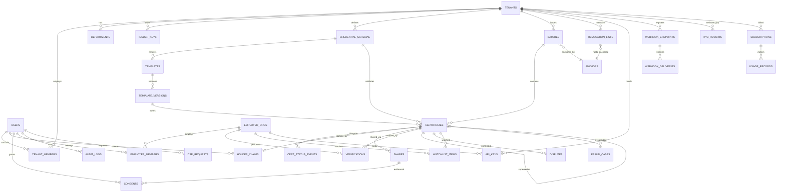

## 5.2 Normalization

Schema is **3NF** with three deliberate, documented denormalizations:
1. `certificates.vc_document` (jsonb) stores the signed VC verbatim — signatures require byte-exact preservation; recomposition from normalized columns would be a correctness hazard.
2. `certificates.merkle_proof` (jsonb) — immutable evidence, never queried relationally.
3. `verifications.checks` (jsonb) — verdict snapshot at verification time (BR-19); historical truth must not change when reference data changes.

Schema/template versioning tables keep certificate references immutable (pinned versions) instead of denormalizing template content into each certificate.

## 5.3 Keys, Constraints & Indexes (architecture rules)

- **Primary keys:** UUIDv7 everywhere (time-ordered → index-friendly inserts at partition scale).
- **Foreign keys:** `ON DELETE RESTRICT` platform-wide; the only cascade is share-cleanup on PII-shredding paths. No orphaning, ever.
- **Unique keys:** `certificates.cert_uid`; `(chain_id, merkle_root)` on anchors; `lower(email)` on users; `api_keys.key_hash`; `shares.token_hash`; `(tenant_id, user_id)` membership; `(tenant_id, name, version)` schemas.
- **Composite keys/indexes:** `(tenant_id, status)` and `(tenant_id, batch_id)` on certificates; `(certificate_id, created_at DESC)` on verifications; `(status, next_retry_at)` on webhook deliveries; `(owner_id, metric, period)` on usage; BRIN on `verifications.created_at`.
- **Check constraints:** FSM status enums; `view_count <= max_views`; `expires_at > issued_at`; `supersedes_id <> id`; two-person rule `actor_user_id <> actor2_user_id` on revocation events.
- **RLS:** every tenant-scoped table carries `USING (tenant_id = current_setting('app.tenant_id')::uuid)`; platform-admin bypass is an explicit, audited role.

## 5.4 Audit & History Tables

- `audit_logs`: append-only (REVOKE UPDATE/DELETE + BEFORE trigger raising exception); daily hash chain column; day-root anchored on-chain (FR-AUD-002); streamed to S3 Object Lock.
- `cert_status_events`: the certificate **history table** — every lifecycle transition with actor(s), reason, tx refs. Certificates table holds only current state; history is event-sourced here.
- `webhook_deliveries`, `verifications`, `consents`: append-only operational history classes.
- Reference-data history: `template_versions` / schema versions are immutable snapshots (no separate history table needed — versions *are* history).

## 5.5 Soft Delete Strategy

| Class | Strategy |
|---|---|
| Certificates | **Never deleted.** Erasure = PII-shred: null `subject_data_enc` + destroy `salt_enc` (renders on-chain hash unlinkable, BR-26); status/skeleton persists |
| Users | Soft delete (`deleted_at`) + PII-shred of encrypted columns; UID retained for audit referential integrity |
| Tenants | `offboarded` status + PII purge per contract; registry history persists on-chain |
| Shares/API keys/webhooks | Revocation timestamps (`revoked_at`), never hard-deleted inside retention window |
| Operational rows (notifications, deliveries) | Hard-deleted by retention jobs after class-specific windows with purge certificates (FR-AUD-007) |

Uniqueness with soft deletes handled via partial unique indexes (`WHERE deleted_at IS NULL`).

## 5.6 Migration Strategy & Database Versioning

- Raw SQL migrations (numbered, append-only) reviewed like code; Prisma schema follows migrations, not vice versa.
- **Expand → migrate → contract** pattern: every migration backward-compatible with the previous app version (zero-downtime deploys, NFR-AVL-06); contraction steps ship ≥ 1 release later.
- Destructive DDL requires: rehearsal on staging snapshot + documented rollback + PITR checkpoint gate in the deploy pipeline.
- Version tracking: `schema_migrations` table + migration hash verification at boot (app refuses to start on drift).
- Partition management automated (`pg_partman`-style jobs): monthly `verifications` partitions, yearly `certificates` partitions, created ahead of need, alarmed if missing.

---

# 6. Database Design (Table Specifications)

Tier-1 tables specified in full; Tier-2 summarized (columns follow the same conventions: `id uuid pk (v7)`, `created_at/updated_at timestamptz`, tenant scoping where marked ※RLS). Encryption: ⛨ = AES-GCM envelope-encrypted field.

### 6.1 `tenants` ※RLS-exempt (root of tenancy)

| Aspect | Specification |
|---|---|
| Purpose | Institution master record; tenancy root |
| Columns | id uuid PK · legal_name text NOT NULL · slug citext UNIQUE · type enum(university,college,certifier,enterprise) · status enum(pending_kyb,active,suspended,offboarded) · accreditation_body text · accreditation_ref text · domain citext · domain_verified_at tstz · issuer_did text UNIQUE · region text NOT NULL DEFAULT 'ap-south-1' · settings jsonb · timestamps |
| PK / FKs | id / — |
| Constraints | status CHECK; slug format `^[a-z0-9-]{3,40}$`; UNIQUE(issuer_did) |
| Indexes | slug UNIQUE; status; domain |
| Relationships | 1—N: members, departments, keys, schemas, batches, api_keys, webhooks, revocation_lists, kyb_reviews, subscriptions |
| Validation | Legal name 3–200 chars; accreditation_ref required before activation |
| Growth / storage | Hundreds–low thousands of rows; negligible. Settings jsonb ≤ 16 KB guarded |

### 6.2 `users`

| Aspect | Specification |
|---|---|
| Purpose | All human principals (staff + holders + employer members) |
| Columns | id PK · email ⛨ + email_bi (blind index, UNIQUE) · phone ⛨ · password_hash text NULL (argon2id) · mfa_secret ⛨ NULL · mfa_enrolled bool · status enum(active,locked,deleted) · locale text · holder_did text NULL · deleted_at tstz NULL · timestamps |
| Constraints | Partial UNIQUE(email_bi) WHERE deleted_at IS NULL; password_hash XOR otp-only policy at app layer |
| Indexes | email_bi UNIQUE; holder_did; status |
| Validation | Email RFC-5322; phone E.164; locale BCP-47 |
| Growth | Dominated by holders: ~1.2× certificates issued (≈120k yr-1, millions later). Row ≈ 1 KB |

### 6.3 `certificates` ※RLS · partitioned (HASH tenant_id × RANGE issued_at yearly)

| Aspect | Specification |
|---|---|
| Purpose | The core credential record: current state + cryptographic evidence |
| Columns | id PK · tenant_id FK · batch_id FK · schema_id FK · template_version_id FK · cert_uid text UNIQUE NOT NULL · subject_data_enc ⛨ jsonb · name_bi/roll_bi/dob_bi bytea (blind indexes) · content_hash bytea(32) NOT NULL · salt_enc ⛨ bytea · merkle_leaf_index int · merkle_proof jsonb · vc_document jsonb NOT NULL · artifact_s3_key text · artifact_ipfs_cid text NULL · status enum(issued,claimed,revoked,superseded,suspended,expired) · status_list_index bigint · holder_claim_id FK NULL · supersedes_id FK NULL · superseded_by_id FK NULL · expires_at tstz NULL · legacy_attested bool DEFAULT false · issued_at tstz NOT NULL |
| PK / FKs | (id, tenant_id, issued_at) physical PK on partitions; logical identity = cert_uid. FKs → tenants, batches, schemas, template_versions, holder_claims, self×2 |
| Constraints | UNIQUE(cert_uid); CHECK(status enum); CHECK(expires_at > issued_at); CHECK(supersedes_id <> id) |
| Indexes | cert_uid UNIQUE (hot path); (tenant_id,batch_id); (tenant_id,status); content_hash; holder_claim_id; partial (expires_at) WHERE NOT NULL; blind indexes per tenant |
| Relationships | 1—N status_events, shares, verifications, watchlist_items, disputes; 0..1 claim; supersede chain |
| Validation | subject data validated against pinned schema version at write; vc_document must carry valid proof (verified pre-insert) |
| Growth / storage | 100k yr-1 → 10M+ yr-5 design point; row ≈ 6–10 KB (VC + proof jsonb) → plan ~100 GB at 10M; yearly partitions keep indexes bounded; PII-shredded rows shrink on vacuum |

### 6.4 `batches` ※RLS

| Aspect | Specification |
|---|---|
| Purpose | Issuance unit + approval/anchoring state machine |
| Columns | id PK · tenant_id FK · template_version_id FK · schema_id FK · name · status enum(draft,validating,validated,pending_approval,approved,signing,anchoring,anchored,failed,partially_failed) · row_count int · error_report jsonb · source enum(ui,api,sftp) · scheduled_at NULL · anchor_id FK NULL · created_by FK · approvals jsonb (ordered approver ids + timestamps) · timestamps |
| Constraints | Status FSM transitions enforced by app + trigger guard; CHECK(row_count ≤ 50000·1.0 configurable) |
| Indexes | (tenant_id, status); anchor_id; scheduled_at partial |
| Growth | ~1–5k rows/yr/tenant; small |

### 6.5 `anchors`

| Aspect | Specification |
|---|---|
| Purpose | On-chain anchor records + confirmation FSM (mirror of chain truth) |
| Columns | id PK · chain_id int · contract_addr bytea · merkle_root bytea(32) · anchor_type enum(issuance,status_list,audit_log) · tx_hash bytea NULL · block_number bigint NULL · block_hash bytea NULL · block_time tstz NULL · status enum(queued,submitted,confirmed,finalized,reorged,failed) · gas_used bigint · gas_cost_wei numeric · submitted_at/finalized_at tstz |
| Constraints | UNIQUE(chain_id, merkle_root); status FSM CHECK |
| Indexes | UNIQUE(chain_id,merkle_root); (status, submitted_at); tx_hash |
| Growth | ~100–500/day at scale → ~200k/yr; tiny rows |

### 6.6 `cert_status_events` ※RLS · append-only

Purpose: full lifecycle history (the history table). Columns: id PK · certificate_id FK · event enum(issued,claimed,share_created,verified_snapshot,revocation_initiated,revoked,suspended,unsuspended,superseded,expired,corrected,erased) · reason_code · reason_visibility enum(public,verifier,private) · actor_user_id FK · actor2_user_id FK NULL · evidence_ref · chain_tx_hash NULL · created_at. Constraints: **CHECK(actor_user_id <> actor2_user_id)** (two-person rule, BR-21); append-only trigger. Indexes: (certificate_id, created_at). Growth: ~4–8× certificates.

### 6.7 `shares` · `holder_claims` · `consents` (holder cluster)

- **shares**: id · certificate_id FK · created_by FK · token_hash UNIQUE · disclosed_fields text[] · expires_at · max_views int · view_count int DEFAULT 0 · pin_hash NULL · revoked_at NULL. CHECK(view_count ≤ max_views). Partial index (certificate_id) WHERE revoked_at IS NULL. Growth ~2× certificates.
- **holder_claims**: id · certificate_id FK UNIQUE · user_id FK · method enum(otp_email,otp_sms) · identity_fields_matched jsonb · claimed_at. One claim per certificate (BR-05). Growth ≤ certificates.
- **consents** (append-only): id · user_id FK · subject_type enum(share,credential_request,digilocker_push) · subject_id · scope jsonb · purpose text · granted_at · expires_at · revoked_at. Index (user_id, granted_at). Growth ~shares + requests. Retention: disclosure life + 7 y.

### 6.8 `verifications` · partitioned monthly · append-only

Purpose: verification event log + verdict snapshots (BR-19). Columns: id · certificate_id FK · share_id FK NULL · employer_org_id FK NULL · channel enum(qr,url,file,api,bulk) · verdict enum(7 states) · checks jsonb · verifier_meta jsonb (volunteered only) · geo_coarse text · created_at. Indexes: (certificate_id, created_at DESC); BRIN(created_at). Growth: highest-volume table — 250k yr-1 → 10M+/yr later; monthly partitions → Parquet after 24 months. Row ≈ 1.5 KB.

### 6.9 `audit_logs` · append-only · RLS-scoped viewer

Columns: id · tenant_id FK NULL · actor_type enum(user,api_key,system) · actor_id · action text · resource_type/resource_id · before jsonb · after jsonb · ip inet · user_agent · trace_id · day_hash_chain bytea · created_at. Enforcement: REVOKE UPDATE/DELETE + trigger; daily chain job computes day root → anchored (anchor_type=audit_log). Indexes: (tenant_id, created_at DESC); (actor_id, created_at DESC); (resource_type, resource_id). Growth: ~10× privileged actions; WORM export keeps hot table ≤ 13 months.

### 6.10 Tier-2 tables (condensed)

| Table | Purpose / notable columns | Keys & constraints | Growth |
|---|---|---|---|
| `departments` ※ | Sub-org tree: name, parent_id self-FK | UNIQUE(tenant_id, name, parent_id) | Tiny |
| `tenant_members` ※ | user_id, role enum(owner,issuer_admin,operator,approver,viewer), department_id, status | UNIQUE(tenant_id,user_id) | Tiny |
| `issuer_keys` ※ | kms_key_ref, public_key_jwk, algorithm, status(active,rotating,revoked), valid_from/until, chain_tx_hash | One `active` per tenant (partial unique) | Tiny |
| `credential_schemas` ※ | name, version, json_schema, vc_context, disclosure_flags, status | UNIQUE(tenant_id,name,version); published rows immutable (trigger) | Small |
| `templates` / `template_versions` ※ | layout jsonb, assets, published_at/by | Versions immutable once published | Small |
| `employer_orgs` / `employer_members` | Mirror of tenant/member for verifier side; roles(admin,verifier) | UNIQUE(org,user) | Small |
| `watchlist_items` | employer_org_id, certificate_id | UNIQUE(org, cert) | Moderate |
| `disputes` ※ | category, description, evidence_s3_keys, status FSM, sla_due_at, resolution_event_id FK | Status CHECK | ~1–2% of certs |
| `revocation_lists` ※ | list_uri, bitstring_s3_key, current_root, size, version int, anchor_id FK | Monotonic version CHECK | 1–5/tenant |
| `api_keys` | owner polymorphic (tenant/employer), key_hash UNIQUE, scopes text[], environment enum(sandbox,prod), rate_limit_override, last_used_at, revoked_at | Hash-only storage | Small |
| `webhook_endpoints` / `webhook_deliveries` | url, secret ⛨, events[]; delivery: attempt, status(pending,delivered,failed,dlq), response_code, next_retry_at | (status,next_retry_at) index | Deliveries: high, 90-day retention |
| `notifications` | user_id, channel, template, payload, status(queued,sent,delivered,bounced), provider_ref | (user_id, created_at) | High, 12-month retention |
| `kyb_reviews` ※ | documents jsonb, status, reviewer_id, decision_reason, sla_due_at | One open review per tenant (partial unique) | Tiny |
| `fraud_cases` | source enum(flag,ai,admin), certificate_id NULL, tenant_id NULL, risk_score, status FSM, assignee_id, outcome, notes | (status,assignee) | Small |
| `feature_flags` | key PK, default_value, overrides jsonb | — | Tiny |
| `subscriptions` / `usage_records` | plan, provider(stripe,razorpay), provider_ref, period; usage: metric, quantity, period | UNIQUE(owner,metric,period) on usage | Usage: moderate |
| `dsr_requests` | user_id, type(erasure,access,correction), status, due_at, evidence jsonb | SLA index (due_at) | Small |
| `chain_wallets` | purpose(relayer), kms_key_ref, address, min/last_balance_wei, last_checked_at | UNIQUE(address) | Tiny |

---

# 7. Smart Contract Architecture

## 7.1 Contract Suite & Name Mapping

The baseline contract set (planning doc 15) implements every capability the classic five-contract decomposition asks for, with a smaller audited surface. Mapping:

| Requested concept | Realized in | Notes |
|---|---|---|
| InstitutionRegistry | **IssuerRegistry** | Issuer admission, key history, status, regulator attestation |
| CertificateRegistry | **CertificateAnchor** | Per-certificate on-chain records deliberately avoided — Merkle roots anchor unbounded batches at O(1) cost |
| CertificateRevocation | **RevocationRegistry** | Bitstring status-list roots; monotonic versions |
| CertificateVerifier | **Off-chain by design** + view functions | Verification = pure reads (`isAnchored`, `isKeyValidAt`, `getStatusRoot`) — no verifier contract needed; OSS verifier consumes views + events |
| AccessControl / Ownership / Pause | **Shared base** (OZ AccessControl + Pausable + UUPS) inherited by all three | Roles below |

## 7.2 UML Class Diagram

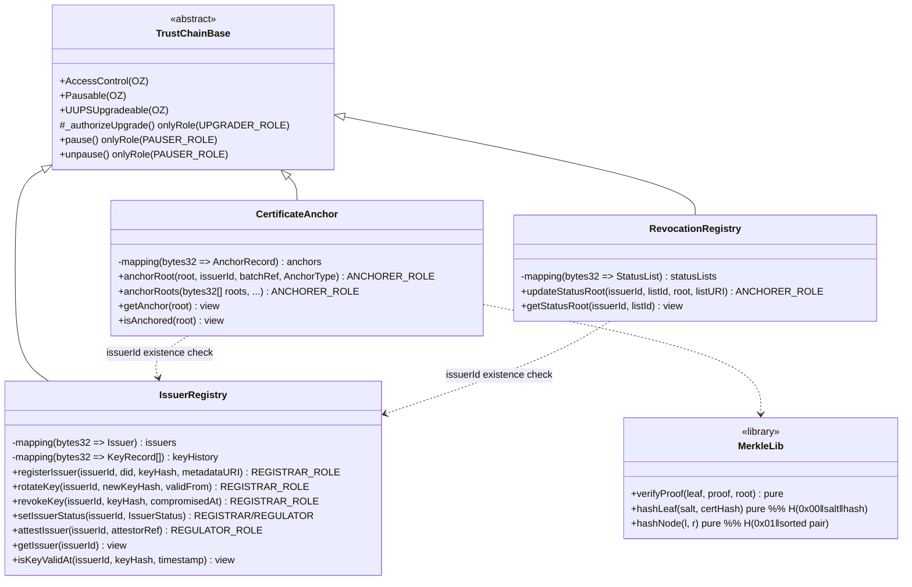

## 7.3 Structs, Enums, Mappings & Storage Layout

```text
// ── Enums ──
enum IssuerStatus { None, Active, Suspended, Retired }
enum AnchorType   { Issuance, StatusList, AuditLog }
enum KeyStatus    { Active, Rotated, Revoked }

// ── Structs (packed) ──
struct Issuer {                    // slot-packed
    IssuerStatus status;           // uint8
    uint40  registeredAt;
    uint40  statusChangedAt;
    bytes32 didHash;               // keccak256(did string)
    string  metadataURI;           // separate slots (dynamic)
}
struct KeyRecord {
    bytes32 keyHash;
    uint40  validFrom;
    uint40  validUntil;            // 0 = open-ended
    uint40  compromisedAt;         // 0 = never
    KeyStatus status;              // uint8 — packs with the uint40s
}
struct AnchorRecord {              // SINGLE SLOT after root key
    uint64  issuerId;
    uint40  timestamp;
    AnchorType anchorType;         // uint8
}                                  // 64+40+8 = 112 bits < 256
struct StatusList {
    bytes32 root;
    uint32  version;               // monotonic
    uint40  updatedAt;
    string  listURI;
}

// ── Mappings ──
IssuerRegistry:      mapping(uint64 issuerId => Issuer)
                     mapping(uint64 issuerId => KeyRecord[])
CertificateAnchor:   mapping(bytes32 merkleRoot => AnchorRecord)
RevocationRegistry:  mapping(uint64 issuerId => mapping(bytes32 listId => StatusList))

// ── Storage layout discipline (UUPS) ──
Each contract reserves: uint256[50] private __gap;
Upgrades: append-only storage; layout diff checked by OZ upgrades plugin in CI.
```

## 7.4 Roles, Modifiers & Admin Controls

| Role | Held by | Powers |
|---|---|---|
| DEFAULT_ADMIN_ROLE | TimelockController (48 h) ← Gnosis Safe 3-of-5 | Grant/revoke roles |
| UPGRADER_ROLE | Timelock ← Safe | UUPS upgrades (after delay + public notice) |
| REGISTRAR_ROLE | Platform registrar service (KMS key), dual-controlled ops | Issuer admission, key rotation/revocation, status |
| ANCHORER_ROLE | Relayer service key (hot, KMS) | **Append-only**: anchorRoot(s), updateStatusRoot |
| REGULATOR_ROLE | Optional regulator multisig | attestIssuer, suspend issuer |
| PAUSER_ROLE | Safe (fast path, no timelock) | Emergency pause of writes (reads unaffected) |

Modifiers: `onlyRole(x)`, `whenNotPaused` on all state changes, `validIssuer(issuerId)` (exists + not None), `nonZeroRoot(root)`, `monotonicVersion(listId)`. Custom errors throughout (no revert strings).

## 7.5 Events

| Event | Contract | Indexed fields |
|---|---|---|
| `IssuerRegistered(issuerId, didHash, keyHash, metadataURI)` | IssuerRegistry | issuerId, didHash |
| `KeyRotated(issuerId, oldKeyHash, newKeyHash, validFrom)` | IssuerRegistry | issuerId |
| `KeyRevoked(issuerId, keyHash, compromisedAt)` | IssuerRegistry | issuerId, keyHash |
| `IssuerStatusChanged(issuerId, status)` | IssuerRegistry | issuerId |
| `IssuerAttested(issuerId, attestor, attestorRef)` | IssuerRegistry | issuerId, attestor |
| `RootAnchored(root, issuerId, batchRef, anchorType, timestamp)` | CertificateAnchor | root, issuerId |
| `StatusRootUpdated(issuerId, listId, root, version, listURI)` | RevocationRegistry | issuerId, listId |
| `Paused(account)` / `Unpaused(account)` | all | — |

## 7.6 Contract Interaction Diagram

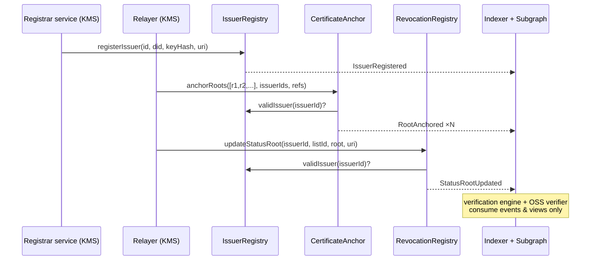

## 7.7 Gas Optimization

1. Merkle batching (dominant win: unbounded certs per 32-byte root); 2. multi-root `anchorRoots` (≤100 roots/tx, amortizes 21k base); 3. single-slot packed `AnchorRecord`; 4. events-over-storage for history (key history detail queried via subgraph); 5. custom errors, `calldata` params, unchecked loop counters where provably safe; 6. no unbounded loops in state-changing paths; 7. `forge snapshot` gas regression gate in CI (NFR-BC-03). Budget: `anchorRoots` ≈ 50k + 25k/root; `updateStatusRoot` ≈ 60k; registry ops ≈ 100k.

## 7.8 Upgrade Strategy & Versioning

- **UUPS proxies**; upgrade path: proposal → 48 h timelock (status-page notice) → Safe execution → fork-test invariant re-run → monitored bake.
- **Invariant-protected history:** tests assert anchored roots and key-history records can never change across upgrades; an upgrade violating this cannot pass CI or audit scope.
- **Semantic changes** (e.g., new hash algorithm) ship as **versioned sibling contracts** (`CertificateAnchorV2`); verifiers dual-read; old anchors verify against old code forever.
- Version registry: `docs/api` publishes contract addresses + semver + ABI per environment; Sourcify/Polygonscan verification in the deploy pipeline.
- Emergency: `pause()` via Safe fast path stops writes; verification (reads) is architecturally unpausable.

---

# 8. Blockchain Design

## 8.1 Certificate Lifecycle (on/off-chain views)

```mermaid
stateDiagram-v2
    [*] --> Drafted: batch row validated
    Drafted --> Signed: VC signed (KMS, off-chain)
    Signed --> Anchored: Merkle root on-chain
    Anchored --> Claimed: holder binds (off-chain)
    Anchored --> Expired: expires_at passes
    Anchored --> Suspended: status list bit set (reversible)
    Suspended --> Anchored: unsuspended
    Anchored --> Revoked: status list bit + root anchored
    Anchored --> Superseded: successor anchored, link recorded
    Revoked --> [*]
    Superseded --> [*]
    note right of Anchored: on-chain fact = root membership;<br/>status = latest anchored status root
```

## 8.2 Transaction Lifecycle

Covered by the relayer FSM ([§2.11](#211-blockchain-transaction-flow-relayer)): window batching → EIP-1559 fee estimation (oracle + cap) → KMS signature → submission → confirmation depth N (chain-config) → checkpoint finality → indexer commit. Nonce management: single-leader anchor-worker holds a Redis-locked nonce sequence with gap detection; stuck transactions replaced via same-nonce fee bump after T minutes.

## 8.3 Wallet Interactions & MetaMask Workflow

| Wallet | Owner | Interaction |
|---|---|---|
| Relayer hot wallet(s) | Platform (KMS) | Only wallet that ever sends transactions; minimal balance; threshold alerts; top-up runbook (cold → hot) |
| Registrar ops key | Platform (KMS, dual-control) | Rare registry transactions |
| Gnosis Safe 3-of-5 | Founders/security officers (hardware wallets) | Governance: upgrades, role grants, pause. **This is the only MetaMask/hardware-wallet workflow in the system** — Safe signers connect via MetaMask/Ledger to the Safe UI; procedure documented in the key-ceremony runbook |
| Holder BYO wallet (P3) | End user | Challenge-response signature to link a DID — read/sign-message only; the platform never requests transactions or funds from user wallets |

End users (issuers, holders, verifiers) have **no wallet requirement whatsoever** (constraint C-4).

## 8.4 Hash Generation & Digital Signatures

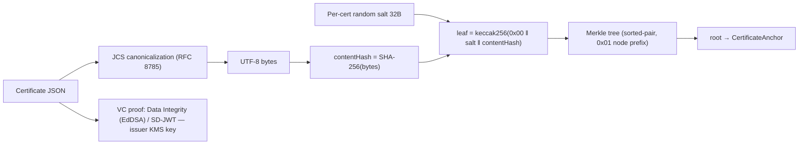

Two independent proofs per certificate: **signature** (issuer authenticity — validated against IssuerRegistry key validity at signing time) and **anchor** (existence + integrity at time T). Verification requires both; revocation status is a third, current-time check.

## 8.5 Gas Estimation

Fee oracle samples `eth_feeHistory` percentiles → maxFeePerGas = min(cap, p75 + buffer); maxPriorityFee = p50; cap breaches alert rather than silently overpay (FR-BC-008). Pre-submission `eth_estimateGas` with +20% margin; anchor cost model re-verified monthly against explorer data (NFR-SCA-06). Revocation roots use a priority lane (higher fee percentile, ≤5-min coalescing).

## 8.6 Network Configuration, Testnet vs Mainnet

| Parameter | Production | Sandbox/Staging |
|---|---|---|
| Network | Polygon PoS mainnet, chainId **137** | Polygon Amoy, chainId **80002** |
| Confirmation depth (confirmed) | 32 blocks | 16 blocks |
| Finality | Heimdall checkpoint observed | Checkpoint or 128 blocks |
| RPC | Alchemy primary / QuickNode secondary, health-checked failover | Same providers, testnet endpoints |
| Contracts | Verified, timelock-governed | Redeployable per test cycle |
| Faucet/funding | Cold-wallet top-up procedure | Faucet automation |
| Data | Real anchors only — **sandbox tenants can never write to mainnet** (env-bound keys, FR-API-014) | Watermarked certs |

## 8.7 Security: Replay Protection & Chain ID Validation

- **Transaction replay:** EIP-155 chain-ID-bound signatures (enforced by viem/KMS signer); nonce discipline via single-leader relayer; duplicate-root rejection makes even a replayed anchor call harmless (idempotent revert-as-success).
- **Cross-environment replay:** contract addresses + chainId pinned in config per environment; verification engine validates `(chainId, contractAddr)` tuple before trusting any event/read; proof bundles embed chainId + contract address so the OSS verifier rejects wrong-network proofs.
- **Signature replay (off-chain):** VC proofs bind issuer DID + issuance date; share tokens single-purpose; OIDC nonce/PKCE on auth; webhook HMAC includes timestamp (±5 min window).
- **Front-running:** not economically meaningful — anchor transactions carry no extractable value and are commutative; nevertheless roots reveal nothing (hashes of salted hashes), so mempool observation leaks zero information. No MEV-sensitive operations exist.
- **Event trust:** indexer only commits events at confirmation depth; verification distinguishes confirmed vs finalized (verdict note), eliminating reorg-window spoofing.

---

# 9. API Architecture

## 9.1 Global Conventions (apply to every endpoint)

| Concern | Convention |
|---|---|
| Base URL | `https://api.trustchain.io/v1` (prod) · `https://api.sandbox.trustchain.io/v1` |
| AuthN | `Authorization: Bearer <JWT>` (humans) or `X-Api-Key` (machines, scoped) — per-endpoint below |
| Validation | Zod DTOs at boundary; unknown fields rejected on privileged endpoints; errors are field-level |
| Errors | RFC 9457 problem+json: `{type, title, status, code, detail, errors[], traceId}`; stable `code` catalog |
| Status codes | 200 OK · 201 Created · 202 Accepted (async) · 204 No Content · 400 validation · 401 authN · 403 authZ · 404 not found · 409 conflict/idempotency · 422 semantic · 429 rate limit · 5xx server |
| Idempotency | `Idempotency-Key` header mandatory on all state-creating POSTs; 24 h dedupe window; conflict → 409 with original result reference |
| Pagination | Cursor: `?cursor=&limit=` (max 100); response `{data[], nextCursor}` |
| Rate limits | Default tiers below; headers `RateLimit-Limit/Remaining/Reset`, `Retry-After` on 429 |
| Async jobs | 202 + `{jobId}` → `GET /jobs/{jobId}` → completion webhook |
| Versioning | URI `/v1`; `Sunset` + `Deprecation` headers ≥ 6 months before removal |

Default rate-limit tiers: public verification 60/min/IP (burst 120); authenticated UI 600/min/user; API keys per plan: Starter 60/min, Institution 600/min, Enterprise 3,000/min (per-tenant override FR-ADM-007).

## 9.2 Authentication APIs

| Method & Route | Purpose | Auth | Request (key fields) | Success / Errors |
|---|---|---|---|---|
| POST `/auth/register` | Create user account | None (captcha) | email, password, locale | 201 · 400, 409 `EMAIL_TAKEN` |
| POST `/auth/verify-email` | Confirm email token | None | token | 204 · 400 `TOKEN_EXPIRED` |
| POST `/auth/login` | Password login → OIDC session | None | email, password | 200 tokens · 401, 423 `ACCOUNT_LOCKED` |
| POST `/auth/otp/request` | Holder passwordless OTP | None | email\|phone | 202 · 429 `OTP_RATE_LIMITED` |
| POST `/auth/otp/verify` | Exchange OTP for tokens | None | contact, otp | 200 · 401 `OTP_INVALID` (≤5 tries) |
| POST `/auth/mfa/enroll` · POST `/auth/mfa/verify` | TOTP enrollment | Bearer | totp code | 200 + recovery codes · 401 |
| POST `/auth/token/refresh` | Rotate refresh token | Refresh cookie/body | refresh_token | 200 new pair · 401 `REFRESH_REUSED` (family revoked) |
| POST `/auth/logout` · GET/DELETE `/auth/sessions[/{id}]` | Session management | Bearer | — | 200/204 |
| POST `/auth/password/forgot` · `/auth/password/reset` | Reset flow | None | email / token+password | 202 / 204 · 400 |
| GET `/auth/sso/{tenantSlug}` | Tenant SSO entry (OIDC redirect) | None | — | 302 → IdP |

## 9.3 Institution APIs (tenant-scoped; roles per row)

| Method & Route | Purpose | Authorization | Request | Success / Errors |
|---|---|---|---|---|
| POST `/tenants` | Create tenant + start KYB | Bearer (any user) | legal_name, type, accreditation | 201 pending_kyb |
| GET/PATCH `/tenants/me` | Profile & settings | Viewer / Issuer Admin | settings, branding | 200 · 403 |
| POST `/tenants/me/domain-verification` | Issue + check DNS TXT | Issuer Admin | domain | 200 verified:bool |
| POST `/tenants/me/members` · PATCH/DELETE `/members/{id}` | Invite/manage staff | Owner/Issuer Admin | email, role, department | 201/200/204 · 409 `ALREADY_MEMBER` |
| POST `/schemas` · GET `/schemas[/{id}]` · POST `/schemas/{id}/publish` | Schema lifecycle | Operator (publish: Issuer Admin) | fields[], disclosure flags | 201/200 · 422 `VC_MAPPING_INVALID` |
| POST `/templates` · `/templates/{id}/versions` · `/versions/{id}/publish` | Template lifecycle | Operator/Admin | layout, assets | 201 · 422 |
| POST `/batches` | Create batch (file upload URL or inline ≤1k rows) | Operator | schema_id, template_version_id, source | 201 draft |
| POST `/batches/{id}/validate` | Dry-run validation | Operator | — | 202 job · report via `GET /batches/{id}/report` |
| POST `/batches/{id}/submit` | Send to approval | Operator | — | 200 pending_approval · 422 `VALIDATION_INCOMPLETE` |
| POST `/batches/{id}/approve` \| `/reject` | Maker-checker decision | Approver (≠ creator, enforced) | comment | 200 · 403 `SELF_APPROVAL_FORBIDDEN` |
| GET `/batches[/{id}]` | List/status (FSM) | Viewer+ | filters | 200 |
| POST `/certificates` | Single issuance (batch-of-1) | Operator | subject data | 201 (follows approval policy) |
| GET `/certificates[/{uid}]` | Search/detail (tenant-scoped) | Viewer+ | filters, cursor | 200 · 404 |
| POST `/certificates/{uid}/revoke` | Initiate revocation | Approver | reason_code, visibility | 202 awaiting second approver |
| POST `/revocations/{id}/confirm` | Second-person confirmation | Approver #2 (≠ #1) | — | 200 · 403 `SAME_ACTOR` |
| POST `/certificates/{uid}/supersede` | Correct & reissue | Operator→Approver | corrected fields (diff shown) | 201 new cert · 422 `IDENTITY_FIELD_CHANGE` |
| GET `/analytics/issuer/*` | Dashboard metrics | Viewer+ | range, cohort | 200 |
| GET `/audit-logs` | Tenant audit viewer | Issuer Admin | filters | 200 (export 202) |

## 9.4 Student (Holder) APIs

| Method & Route | Purpose | Authorization | Request | Success / Errors |
|---|---|---|---|---|
| POST `/claims/initiate` | Start claim from link | None → OTP | claim_token | 202 OTP sent |
| POST `/claims/complete` | Bind cert to account | OTP-verified session | otp, identity_fields | 200 · 403 `IDENTITY_MISMATCH` (dispute offered) |
| GET `/wallet/credentials[/{uid}]` | List/detail own credentials | Holder | cursor | 200 |
| GET `/wallet/credentials/{uid}/download?format=pdf\|vc\|ob3` | Export artifact/VC | Holder | format | 200 file · 422 `FORMAT_UNAVAILABLE` |
| GET `/wallet/credentials/{uid}/proof-bundle` | Portable evidence pack | Holder | — | 200 |
| POST `/shares` | Create share link | Holder | cert_uid, fields[], expiry, max_views, pin | 201 {url,qr} |
| GET `/shares` · DELETE `/shares/{id}` | List / revoke shares | Holder | — | 200/204 (dead ≤ 60 s) |
| GET `/shares/{id}/activity` | View events on my share | Holder | — | 200 |
| POST `/disputes` · GET `/disputes[/{id}]` | Raise/track corrections | Holder | cert_uid, category, evidence | 201/200 |
| GET `/me` · PATCH `/me` | Profile (email change re-verifies) | Holder | — | 200 · 409 |
| POST `/me/export` | DSR data export | Holder | — | 202 (≤72 h delivery) |
| POST `/me/erasure` | DSR erasure request | Holder + re-auth | confirmation | 202 · workflow via DSR console |

## 9.5 Employer APIs

| Method & Route | Purpose | Authorization | Request | Success / Errors |
|---|---|---|---|---|
| POST `/employer-orgs` · members CRUD | Org + team management | Bearer / org admin | name, invites | 201 |
| GET `/employer/verifications` | Org verification history (snapshots) | Org member | filters | 200 |
| POST `/employer/verifications/bulk` | CSV bulk verify | `verify:read` key or member | file ref / list ≤5k | 202 job → report |
| POST `/watchlist` · DELETE `/watchlist/{id}` | Watch verified certs | Org member | cert_uid | 201/204 · 409 duplicate |
| POST `/flags` | Report suspicious certificate | Org member or public+captcha | cert_uid, reason | 201 case ref |
| GET `/employer/usage` | Quota/usage dashboard data | Org admin | period | 200 |
| POST `/credential-requests` | Consent-gated request to holder (P2) | Org member | type, fields, purpose, retention | 201 pending consent |

## 9.6 Verification APIs (public + keyed)

| Method & Route | Purpose | Auth | Request | Success / Errors | Rate limit |
|---|---|---|---|---|---|
| GET `/verify/{certUid}` | Full verdict object | None | — | 200 verdict · 404 neutral | 60/min/IP |
| GET `/verify/share/{token}` | Verdict for share link (disclosed fields only) | None (+PIN if set) | pin? | 200 · 410 `SHARE_EXPIRED` · 401 `PIN_REQUIRED` | 60/min/IP |
| POST `/verify/file` | Upload PDF/VC → recompute & verify | None (captcha at volume) | multipart file ≤10 MB | 200 verdict (TAMPERED on mismatch) | 20/min/IP |
| POST `/verify/batch` | Bulk verification | `verify:read` key | items[] ≤5k | 202 job | plan tier |
| GET `/verify/{certUid}/proof-bundle` | Machine-readable evidence | None | — | 200 | 30/min/IP |
| GET `/status-lists/{issuerId}/{listId}` | Bitstring status list credential | None | — | 200 (cacheable, ETag) | CDN |
| GET `/.well-known/did.json` (per issuer domain) | did:web resolution | None | — | 200 | CDN |

Verdict object (all channels identical): `{verdict, checks:{integrity, merkleProof, anchor:{txHash,block,finality}, issuer:{status,accreditation}, revocation:{listVersion}, expiry, binding}, certificate:{disclosedFields}, meta:{verifiedAt, staleness?, traceId}}`.

## 9.7 Admin APIs (platform console; MFA + IP allowlist + JIT elevation)

| Method & Route | Purpose | Authorization |
|---|---|---|
| GET `/admin/kyb` · POST `/admin/kyb/{id}/approve\|reject\|request-info` | KYB queue & decisions | PLATFORM_ADMIN |
| POST `/admin/tenants/{id}/suspend\|restore\|limit` | Tenant lifecycle (verification unaffected) | PLATFORM_ADMIN (dual-control on suspend) |
| GET `/admin/anchoring/queue\|wallets\|failures` · POST `/admin/anchoring/{id}/retry` | Anchoring ops | PLATFORM_ADMIN / SRE |
| POST `/admin/chain/pause` · `/unpause` | Emergency kill switch (writes only) | SECURITY (dual-control) |
| GET/POST `/admin/cases[/{id}]` | Fraud/abuse case management | FRAUD_ANALYST |
| GET/PUT `/admin/flags` · `/admin/quotas/{tenantId}` | Feature flags, rate overrides | PLATFORM_ADMIN |
| GET/POST `/admin/dsr[/{id}]` | DSR console (erasure/access) | COMPLIANCE (dual-control on erasure execute) |
| GET `/admin/analytics/*` · `/admin/regulator/aggregates` | Platform + regulator reporting (PII-free) | PLATFORM_ADMIN / REGULATOR (read-only) |

## 9.8 Health & System APIs

| Method & Route | Purpose | Auth | Notes |
|---|---|---|---|
| GET `/health/live` | Liveness (process up) | None | 200 static |
| GET `/health/ready` | Readiness (DB, Redis, KMS reachable) | None | 200/503; used by K8s |
| GET `/health/chain` | RPC health, indexer lag, wallet balances (coarse) | Internal token | Feeds ops dashboard |
| GET `/system/openapi.yaml` · `/system/changelog` | Contract + deprecations | None | CI-published |
| GET `/system/contracts` | Chain addresses + ABIs + versions per env | None | Public (FR-BC-015) |
| GET `/jobs/{jobId}` | Async job status | Owner of job | 200 {status, result?} |
| Webhook events (outbound) | `certificate.issued/claimed/revoked/superseded`, `batch.validated/anchored/failed`, `share.viewed`, `verification.completed`, `watchlist.revoked`, `issuer.updated`, `dispute.opened/resolved` | HMAC-signed | Retry ≤ 24 h → DLQ |

---

# 10. Authentication Architecture

## 10.1 JWT Flow & Token Design

```mermaid
sequenceDiagram
    participant B as Browser/App
    participant KC as Keycloak
    participant API as api
    participant R as Redis (session registry)
    B->>KC: OIDC code + PKCE (password/OTP/SSO/MFA)
    KC-->>B: access JWT (≤15 min) + rotating refresh (≤30 d absolute)
    B->>API: Bearer access JWT
    API->>API: verify RS256 via cached JWKS; iss/aud/exp/nbf
    API->>R: session not revoked? (jti family check)
    API-->>B: 200
    B->>KC: refresh (token rotates every use)
    KC->>KC: reuse detection → revoke family, alert
```

Access-token claims (no PII beyond IDs): `sub`, `sid` (session), `tenant_id?`, `org_id?`, `roles[]`, `scopes[]`, `amr` (mfa/otp/sso), `iat/exp/iss/aud/jti`. Refresh tokens: httpOnly secure cookies for web; rotation with family-revocation on reuse (SEC-JWT-2). Remote logout: session registry lookup on privileged routes; ≤ 60 s propagation via Redis pub/sub.

## 10.2 Password Hashing & Credential Storage

Argon2id (memory 64 MB, iterations 3, parallelism 4 — tuned to ~100 ms server budget, reviewed annually); per-user salt; breach-corpus check (k-anonymity range query) at set/change; password history 5; TOTP secrets and recovery codes encrypted (KMS envelope), recovery codes stored hashed.

## 10.3 MetaMask / Wallet Signature Verification (scoped)

Per constraint C-4, wallet auth is **not** a login method for core flows. Two bounded uses: (a) **Safe governance** — hardware wallets/MetaMask sign Safe transactions (off-product, runbook-governed); (b) **BYO-DID linking (P3)** — `personal_sign` challenge: server issues nonce (single-use, 5-min TTL, bound to user + origin), user signs, server recovers address/DID key, verifies EIP-191 signature + nonce freshness, stores linked DID. Replay-safe (nonce), phishing-mitigated (origin-bound message text states purpose), never grants session authentication by itself.

## 10.4 RBAC & Permission Matrix

| Permission ↓ / Role → | Holder | Verifier (org) | Viewer | Operator | Approver | Issuer Admin | Owner | Platform Admin |
|---|---|---|---|---|---|---|---|---|
| View own wallet / share | ✔ | — | — | — | — | — | — | — |
| Verify certificates | ✔ | ✔ | ✔ | ✔ | ✔ | ✔ | ✔ | ✔ |
| View tenant certs/analytics | — | — | ✔ | ✔ | ✔ | ✔ | ✔ | scoped |
| Draft batches / issue | — | — | — | ✔ | — | ✔ | ✔ | — |
| Approve batches | — | — | — | — | ✔ | ✔ | ✔ | — |
| Initiate revocation | — | — | — | — | ✔ | ✔ | ✔ | — |
| Confirm revocation (2nd) | — | — | — | — | ✔(≠1st) | ✔(≠1st) | ✔(≠1st) | — |
| Manage schemas/templates | — | — | — | draft | — | ✔ | ✔ | — |
| Manage members/keys/webhooks | — | — | — | — | — | ✔ | ✔ | — |
| Billing | — | — | — | — | — | — | ✔ | — |
| KYB / tenant lifecycle / flags | — | — | — | — | — | — | — | ✔ |
| Chain kill switch / DSR execute | — | — | — | — | — | — | — | ✔ (dual) |

Enforcement: deny-by-default guard chain (authN → tenant context → role → scope → resource ownership) + DB RLS as the second wall. API-key scopes are intersections: a key can never exceed its owner's role matrix.

## 10.5 Authorization Flow

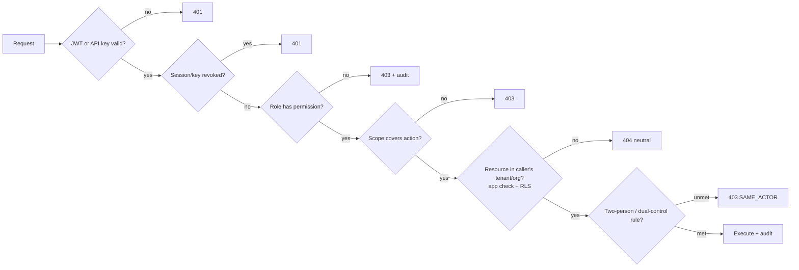

Session management summary: sliding UI sessions capped at 12 h (privileged: 4 h) with absolute refresh ceiling 30 d; concurrent-session listing + remote revocation (FR-AUTH-018); step-up re-auth (fresh MFA ≤ 5 min) required for: key rotation, member role changes, revocation confirmation, DSR erasure, billing changes.

---

# 11. Frontend Architecture

## 11.1 Routing

Next.js App Router per app; route groups by auth state.

| App | Key routes | Rendering |
|---|---|---|
| verify-web | `/v/[certUid]` · `/share/[token]` · `/upload` · `/lookup` | **SSR + ISR(60 s) for verdict shell**, live checks streamed; static marketing pages |
| wallet-web | `/claim/[token]` · `/wallet` · `/wallet/[uid]` · `/shares` · `/disputes` · `/settings` | CSR behind auth; PWA with offline route for cached artifacts |
| issuer-web | `/dashboard` · `/batches[/new,/[id]]` · `/certificates` · `/templates` · `/schemas` · `/revocations` · `/analytics` · `/settings/*` | CSR + server components for heavy tables |
| admin-web | `/kyb` · `/tenants` · `/anchoring` · `/cases` · `/dsr` · `/flags` | CSR, allowlisted origin |

Guards: middleware checks session + role before route entry; deep-link preservation on login redirect; tenant slug resolved server-side (no tenant data in URL beyond slug).

## 11.2 State Management

- **Server state:** TanStack Query — cache keys namespaced `[tenant, resource, params]`; stale-while-revalidate; optimistic updates only for non-trust mutations (never for revocation/approval).
- **Client state:** Zustand slices — `session` (user, roles, tenant), `ui` (theme, sidebar, locale), `batchWizard` (multi-step draft, persisted to IndexedDB for crash recovery per FR-ISS-016).
- **Form state:** React Hook Form + Zod resolvers from `packages/core-types` (same schemas as backend).
- **URL state:** filters/pagination in searchParams (shareable dashboards).

## 11.3 API & Authentication Layers

Generated typed client from OpenAPI (`packages/api-client`); interceptor chain: attach token → traceId → 401 → silent refresh (single-flight) → retry once → logout on failure; 429 honors Retry-After with jittered backoff; RFC 9457 errors mapped to typed `ApiError` consumed by forms (field errors) and toasts (global errors). Auth layer wraps Keycloak OIDC (PKCE), exposes `useSession()`, `usePermission(perm)` hooks; permission checks in UI are cosmetic only — the server is authoritative (SEC-AUTHZ-1).

## 11.4 Components, Layouts, Forms, Errors, Loading

- **Layout system:** `PublicLayout` (verify), `WalletLayout` (mobile-first bottom nav), `ConsoleLayout` (sidebar + topbar + breadcrumbs), `AdminLayout` (dense, keyboard-first). All responsive from 320 px.
- **Forms:** schema-driven — credential-schema JSON renders the issuance form automatically (field registry per type); wizard pattern for batches (upload → dry-run → fix → review → submit) with autosaved steps.
- **Validation UX:** inline on blur, summarized on submit, server field-errors merged into the same display path; dry-run reports rendered as an errors-first virtualized table with row deep-links.
- **Error handling:** route-level error boundaries with traceId display + "report" action; global toast for transient errors; explicit degraded-mode banners (e.g., "showing cached chain state as of 12:03 UTC", BR-20).
- **Loading:** skeletons for layout-stable loads; progress + step labels for jobs (validating 3/5…); suspense streaming on verdict page so the shell paints < 1 s while checks resolve.

## 11.5 Theme, Dark Mode, Accessibility

Design tokens (Section 12) as CSS variables; `data-theme="light|dark"` set pre-hydration from system preference + user override (no flash); WCAG 2.2 AA program: Radix primitives, focus-visible rings, skip links, landmark structure, `prefers-reduced-motion` honored, axe-core in CI + manual NVDA/VoiceOver passes on claim/share/verify each release (NFR-ACC-01..04); i18n via message catalogs (ICU), locale routing, pseudo-locale CI check; verdicts always icon + text + color (NFR-ACC-03).

---

# 12. UI Component Library & Design System

Package `packages/ui` — single source for all four apps. Built on Radix primitives + Tailwind; every component ships with stories, a11y tests, and both themes.

## 12.1 Design Tokens

```text
--tc-color-*        primary (trust blue 600 #1D4ED8 scale 50–950) · neutral (slate) ·
                    success #15803D · danger #B91C1C · warning #B45309 · info #0369A1
--tc-verdict-*      valid=success · revoked=danger · superseded=info · expired=warning ·
                    tampered=danger-emphatic · unknown/suspended=warning  (each pairs icon+label)
--tc-font-sans      Inter (Latin) + Noto Sans Devanagari (fallback chain)
--tc-font-mono      JetBrains Mono (hashes, IDs, code)
--tc-text-*         12/14/16/18/20/24/30/36/48 px scale, 1.5 line-height body
--tc-space-*        4-px base scale: 1..24 (4→96 px)
--tc-radius-*       sm 4 · md 8 · lg 12 · full
--tc-shadow-*       sm/md/lg elevations (reduced in dark theme)
--tc-motion-*       120 ms micro / 200 ms standard / 300 ms overlay · ease-out; disabled under reduced-motion
```

Color rules: all text pairs ≥ 4.5:1 contrast (checked in CI); verdict colors never the sole signal; dark mode = token remap, not component forks.

## 12.2 Component Inventory

| Category | Components & key specs |
|---|---|
| **Buttons** | `Button` (primary/secondary/outline/ghost/danger × sm/md/lg; loading state with spinner + disabled; icon slots) · `IconButton` (44 px min touch target) · `SplitButton` (batch actions) |
| **Inputs** | `TextField`, `TextArea`, `Select`/`Combobox` (typeahead, async), `DatePicker` (locale-aware), `FileDrop` (CSV/PDF, progress, type/size validation messaging), `OTPInput` (6-digit, paste-aware, SR-announced), `PinInput`, `Toggle`, `Checkbox/Radio`, `FieldSelector` (disclosure picker with "hidden from verifier" preview) |
| **Cards** | `Card` (header/body/footer) · **`CertificateCard`** (artifact thumbnail, issuer chip, status badge, QR affordance, timeline link — wallet + issuer variants) · `StatCard` (KPI + delta + sparkline) |
| **Dialogs** | `Dialog` (focus-trapped) · `ConfirmDialog` (danger variant requires typed confirmation for revocation — BR-11) · `Drawer` (mobile filters) · `CommandPalette` (admin, ⌘K) |
| **Navigation** | `Navbar` (app switcher, tenant switcher, notification bell, avatar menu) · `Sidebar` (collapsible, role-filtered items, active states) · `Footer` (public: legal, status page, language) · `Breadcrumbs` (auto from route tree) · `Tabs`, `Pagination` (cursor-aware: prev/next + page size), `Stepper` (batch wizard) |
| **Tables** | `DataTable` (TanStack Table: virtualized ≥ 1k rows, column pinning, sortable, row selection, bulk action bar, CSV export, empty/loading/error states) · `DiffTable` (supersede review) · `ErrorsTable` (dry-run: errors-first, row deep-link) |
| **Charts** | Recharts wrappers themed by tokens: `TimeSeries` (verifications), `BarBreakdown` (verdicts, channels), `FunnelChart` (issue→claim→share), `GeoList` (coarse geo), `GasCostChart` — all with table-fallback toggle for screen readers |
| **Badges & status** | `Badge` (neutral/info/success/warning/danger) · **`VerdictBadge`** (7 states: icon + label + tooltip explanation) · `StatusDot` (batch FSM) · `ChainStatusChip` (queued/submitted/confirmed/finalized with block link) |
| **Alerts & feedback** | `Alert` (inline, 4 severities, dismissible) · `Toast` (queued, 5 s, action slot, SR-polite) · `Banner` (degraded mode / maintenance / sandbox watermark) · `EmptyState` (illustration + primary action) · `Skeleton` primitives |
| **QR components** | `QRDisplay` (SVG, download PNG, print-safe ≥ 2 cm) · `QRScanner` (camera + file fallback, permission UX) · `ShareSheet` (link + QR + PIN setup + expiry presets) |
| **Verification components** | `VerdictPanel` (hero verdict + plain-language summary) · `CheckList` (7 checks with pass/fail/pending streaming) · `AnchorProofViewer` (tx hash, block, explorer link, Merkle path visual) · `IssuerIdentityCard` (accreditation, registry status, did) · `DisclosureNotice` ("holder shared 4 of 9 fields") · `ProofBundleButton` |
| **Misc** | `Timeline` (certificate lifecycle) · `CopyField` (hashes/IDs with confirm) · `Avatar`, `Tooltip`, `Kbd`, `Icon` (lucide set + custom chain/cert icons, always with accessible names) |

## 12.3 Governance

Contribution flow: proposal → story + a11y checklist → visual regression (Chromatic) → release via changesets; no app may ship a one-off primitive that exists in the library (lint rule); tokens are the only source of color/spacing (no raw hex in apps).

---

# 13. Certificate Workflow (Sequence Diagrams)

## 13.1 Institution Login → Certificate Creation → Blockchain → QR

Covered end-to-end in [§2.8](#28-certificate-issuance-flow); the QR is embedded at render time (step: render-service generates PDF with `https://verify.trustchain.io/v/{certUid}` QR before anchoring completes; artifact released to holder only after batch = ANCHORED).

## 13.2 Student Access (Claim)

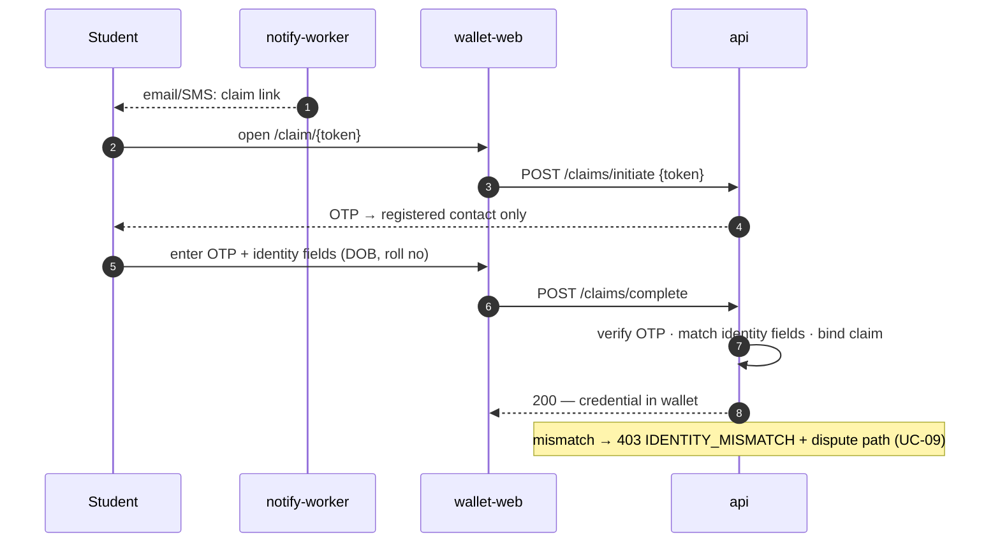

## 13.3 Employer Verification (QR + watch list)

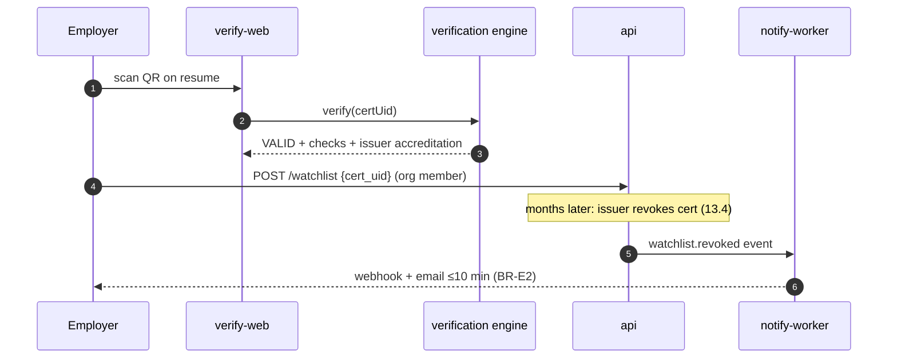

## 13.4 Certificate Revocation (two-person)

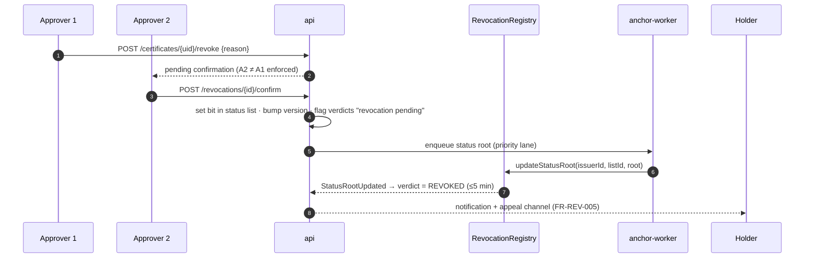

## 13.5 Certificate Expiration & Renewal

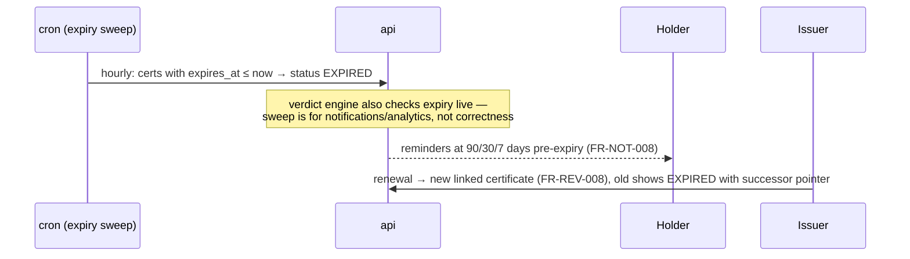

---

# 14. Security Architecture

## 14.1 Threat Model (STRIDE summary)

| Threat | Vector | Controls |
|---|---|---|
| **S**poofing | Fake verify site (phishing clone); fake issuer onboarding; forged VC | Canonical-domain signals + proof bundles verifiable off-platform; KYB + accreditation cross-check + on-chain registry; signatures bound to registry key history |
| **T**ampering | Certificate edit; DB manipulation; log editing; contract upgrade abuse | Hash/anchor mismatch = self-announcing (TAMPERED); RLS + least-priv DB roles; append-only + on-chain log roots; timelock + multisig + invariant CI |
| **R**epudiation | "I never approved that batch/revocation" | Fail-closed audit with actor identity, MFA-backed sessions, two-person records, s.65B-ready evidence bundles |
| **I**nformation disclosure | PII on chain; PII in logs; cross-tenant leak; share-link scraping | Pre-anchor PII lint (hard gate); logger redaction; RLS + negative tests; hashed tokens + expiry/views/PIN + anti-enumeration |
| **D**enial of service | Verification floods; anchor queue starvation; OTP bombing | CDN + WAF + rate tiers + static verdict fallback; per-tenant queue fairness; per-contact OTP limits |
| **E**levation of privilege | Role escalation; scope creep; admin abuse | Deny-by-default matrix + step-up MFA; scope intersection with owner role; JIT elevation + dual control + watermarked impersonation |

Abuse cases maintained in `docs/security/threat-model.md`; re-reviewed each quarter and on any trust-path change.

## 14.2 Control Map (condensed; full detail in SRS §S7)

| Domain | Binding controls |
|---|---|
| OWASP Top 10 | Mapping table SRS §7.11 — verified by pentest before GA |
| Blockchain security | §7.4 roles, §7.7–7.8 gas/upgrade discipline, §8.7 replay/chainId; 2 audits + Slither/Echidna/Foundry gates; pause drills |
| API security | Scoped keys, idempotency, rate tiers, RFC 9457 (no stack traces), egress-proxied webhooks, OpenAPI-validated inputs |
| AuthN/AuthZ | §10 flows; Argon2id; MFA; session registry; permission matrix + RLS |
| Encryption & keys | TLS 1.3-preferred; AES-256 + field-level envelope (⛨ columns); KMS/HSM non-exportable signing keys; key ceremonies dual-controlled; quarterly secret rotation |
| Replay/front-running | §8.7 — EIP-155, nonces, duplicate-root idempotency, valueless txs (no MEV surface) |
| Injection/XSS/CSRF | Parameterized queries only; CSP nonce-based; sandboxed render farm; SameSite + CSRF tokens on cookie flows; SSRF egress proxy |
| Rate limiting & validation | Layered per-IP/key/account; Zod boundary validation; magic-byte + AV file checks |
| Logging/monitoring | SIEM correlation ≤ 5 min alerts on authZ anomalies, key usage, tamper verdicts, enumeration patterns |
| Secrets | Secrets Manager only; CI scanning; no secrets in env files/repos; break-glass dual-controlled + alarmed |

## 14.3 Disaster Recovery (security-relevant)

| Scenario | Response (runbook) | RTO |
|---|---|---|
| Issuer key compromise | Emergency on-chain key revocation with compromise timestamp; certs signed after fence flagged for reissue; holder/verifier notice | < 4 h |
| Relayer key compromise | Rotate KMS key + wallet; pause ANCHORER role grant; blast radius = spam anchors only (no forgery possible) | < 2 h |
| Contract vulnerability | `pause()` writes (verification reads unaffected); patch via timelocked upgrade or sibling deploy | pause < 15 min |
| PII breach | DPDP/GDPR breach workflow: contain → assess → notify Board/authority + principals per statutory clock → postmortem | notify ≤ 72 h |
| Region failure | Cross-region restore from encrypted backups + IaC re-provision (chain state is globally durable by nature) | ≤ 24 h (documented DR tier) |
| Platform death (existential) | Vendor-independence guarantee: credentials remain verifiable via OSS verifier + public chain — pre-drilled annually | 0 (by design) |

---

# 15. Performance Architecture

## 15.1 Caching Strategy (layered)

| Layer | What | TTL / invalidation |
|---|---|---|
| CDN (CloudFront) | Verdict page shell (ISR), status lists (ETag), static assets, contract docs | 60 s ISR; ETag revalidation |
| Redis hot cache | Verdict objects keyed by cert_uid + status-list version | Invalidate on status event; 5 min cap |
| Chain indexer (PG) | Anchors, issuer registry, status roots at confirmation depth | Event-driven; staleness surfaced in verdicts |
| App-level | JWKS, feature flags, tenant settings | 5 min / pub-sub bust |
| Client | TanStack Query SWR; PWA artifact cache | Per-resource stale times |

Rule: anything cached on the trust path carries an explicit `as-of` timestamp surfaced to users (BR-20).

## 15.2 Database Optimization

Read replicas serve verification + analytics; partitioning per §5.6; covering indexes on hot paths (`cert_uid`, `(tenant_id,status)`); blind indexes for encrypted-field search; BRIN for time-scans; connection pooling via PgBouncer (transaction mode; pool sized per service with headroom alarms); slow-query budget: any p95 > 200 ms statement gets an issue automatically (pg_stat_statements → alert).

## 15.3 Blockchain Optimization

Merkle batching (O(1) per batch) + multi-root txs + packed storage (§7.7); indexer serves all verification reads (RPC only as fallback, NFR-BC-06); revocation priority lane ≤ 5 min; gas snapshots gate regressions; monthly cost-model reconciliation (NFR-BC-01: < $0.005/cert amortized).

## 15.4 Async, Batch, and Payload Disciplines

- **Async processing:** everything > 300 ms of work is a queue job (validation, rendering, anchoring, notifications, exports, bulk verify) — API returns 202 + job tracking.
- **Batch processing:** CSV parsed in streams (never loaded whole); row validation parallelized in chunks of 1k; render farm horizontal on spot nodes; anchor windows aggregate across tenants.
- **Lazy loading:** route-level code splitting; virtualized tables; deferred non-critical panels (analytics widgets) — verdict page critical path < 100 KB (NFR-LOC-02).
- **Compression:** Brotli at CDN; gzip API responses > 1 KB; WebP/AVIF images; PDF artifacts optimized at render.
- **Pagination:** cursor-based everywhere (no OFFSET at scale); capped page sizes; exports go async instead of deep pagination.

## 15.5 Performance Targets (binding, from SRS §6.1–6.2)

Verification p50/p95/p99 = 1/3/5 s · API verify p95 500 ms · 50k-row validation < 5 min · anchor p95 < 15 min · revocation propagation ≤ 5 min · 500 RPS sustained / 5k burst · dashboards p95 < 2 s · search p95 < 800 ms @ 10M certs. Load gates run in CI per release candidate ([§19](#19-testing-architecture)).

---

# 16. Logging & Monitoring

## 16.1 Logs

| Class | Content | Sink & retention |
|---|---|---|
| Application | Structured JSON: level, service, traceId, tenantId, event, redacted context | Loki 30 d hot, S3 13 mo |
| Blockchain | Every tx attempt: nonce, fees, root, status transitions, RPC provider, reorg events; indexer cursor health | Loki + dedicated `anchors`/`chain_events` tables (permanent) |
| Audit | §5.4/§6.9 — privileged actions, fail-closed, day-root anchored on-chain | PG + S3 Object Lock WORM 7 y |
| Access | ALB/CDN logs, WAF decisions | S3 90 d (security review) |
| Security | AuthN events, privilege changes, key usage (KMS CloudTrail), tamper verdicts | SIEM, 400 d |

PII policy: redaction at the logger (allowlist of loggable fields); log-scanning job asserts zero PII weekly.

## 16.2 Metrics, Health, Alerting, Tracing

- **Metrics (Prometheus):** RED per endpoint; queue depth/age per worker; anchor FSM counts + time-in-state; wallet balances; RPC latency/error by provider; indexer lag (blocks); verdict distribution (TAMPERED spike = incident signal); business KPIs (issuance, claims, verifications) to Grafana.
- **SLOs:** verification availability 99.9% + p95 latency; issuance 99.5%; burn-rate alerts (2%/1 h page, 5%/6 h ticket).
- **Health checks:** `/health/live`, `/health/ready` (DB/Redis/KMS), `/health/chain` (RPC, lag, balances) — K8s probes + Checkly synthetics from 3 geos hitting a canary certificate end-to-end every minute; public status page.
- **Alerting:** PagerDuty; every page maps to a runbook (NFR-MON-01); alert catalog reviewed monthly for noise.
- **Tracing:** OpenTelemetry SDK across apps → api → queues (context propagated in job payloads) → chain tx (traceId in anchor record); 100% trace coverage requirement (NFR-AUD-03); Grafana Tempo backend.
- **Error tracking:** Sentry (FE + BE) with release tagging + source maps; new-error-in-release gate blocks promotion.

---

# 17. DevOps Architecture

## 17.1 Docker & Compose

Multi-stage Dockerfiles (build → distroless runtime, non-root, read-only FS); pinned digests; image scan (Trivy) + SBOM (syft) + cosign signature in CI. `docker-compose.yml` gives a full local stack: postgres, redis, keycloak, **anvil** (local chain with contracts auto-deployed + seeded issuers), localstack (S3/KMS), mailpit; `scripts/dev-up` = one-command environment (NFR-MNT-05).

## 17.2 Branching, CI, CD

- **Branching:** trunk-based; short-lived feature branches → PR → squash; `release/*` cut per sprint; hotfix branches from tags.
- **CI (GitHub Actions):** on PR — lint + typecheck + unit (affected graph via Turborepo) + contract tests (Foundry: unit/fuzz/invariant + gas snapshot + Slither) + integration (compose services) + OpenAPI contract check + secret scan + SCA + image scan; E2E (Playwright vs ephemeral env + anvil) on label/merge; k6 smoke on release branches.
- **CD (ArgoCD GitOps):** merge to main → build/sign/push images → auto-deploy dev → staging (testnet) with E2E + load gates → production via PR to the prod overlay (2 approvals incl. 1 senior; canary 10% → 100% with automated SLO analysis).
- **Contracts pipeline (separate, high-ceremony):** deploy scripts reviewed → testnet deploy + fork tests → audit gate → mainnet via key ceremony (multisig, recorded) → address registry + Sourcify verification published.

```mermaid
flowchart LR
    PR[PR] --> CI[CI gates]
    CI --> M[main]
    M --> B[build + cosign sign]
    B --> DEV[ArgoCD: dev]
    DEV --> STG[staging + E2E/load gates]
    STG --> APPR{2 approvals}
    APPR --> CAN[prod canary 10%]
    CAN -->|SLO analysis pass| FULL[prod 100%]
    CAN -->|fail| RB[auto-rollback]
```

## 17.3 Environments, Variables, Secrets

Typed config schema (Zod) validated at boot — missing/invalid env = refusal to start; per-env values from SSM/Secrets Manager injected via External Secrets Operator (never in images or repo); `.env.example` documents every variable; secret rotation quarterly + on personnel change; environment promotion changes config only, never code.

## 17.4 Versioning, Release, Rollback

- **Versioning:** semver per package (changesets); API `/v1` URI versioning with Sunset policy; contracts semver + address registry; DB migrations sequential + hash-verified.
- **Release strategy:** weekly train (or on-demand) behind feature flags; risky features dark-launched → canary tenants → GA; release notes auto-generated from changesets.
- **Rollback:** app = ArgoCD revert to previous image (minutes, always safe because migrations are expand/contract); DB = PITR + rehearsed down-paths for the rare forward-only case; contracts = pause → fix-forward via timelock (storage-compatible) or sibling redeploy — **anchored history is never rolled back** (append-only by design).

---

# 18. Deployment Architecture

## 18.1 Environments

| Env | Purpose | Chain | Data | Access |
|---|---|---|---|---|
| Development | Local + shared dev cluster | Anvil / Amoy | Synthetic seeds | Engineers |
| Testing (CI ephemeral) | Per-PR E2E | Anvil (deterministic) | Fixtures | CI only |
| Staging | Release gate, prod-shaped | **Amoy** | Anonymized prod-shaped volume | Team + design partners |
| Production | Live | **Polygon mainnet (137)** | Real | Customers; admin allowlisted |

Sandbox-in-prod: tenant sandbox mode routes anchoring to Amoy with watermarked artifacts (FR-INST-015) — env-bound keys make mainnet writes from sandbox impossible.

## 18.2 Infrastructure & Domain Architecture

Topology diagram in [§2.6](#26-deployment-architecture). Domains:

| Domain | Serves |
|---|---|
| `verify.trustchain.io` | Public verdict pages (the canonical trust domain — printed on certificates) |
| `wallet.trustchain.io` · `issuer.trustchain.io` | Holder PWA · institution console |
| `admin.trustchain.io` | Platform console (IP allowlist + MFA) |
| `api.trustchain.io` / `api.sandbox.trustchain.io` | REST/GraphQL/webhooks |
| `status.trustchain.io` · `docs.trustchain.io` | Status page (off-infra host) · developer docs |

**HTTPS/SSL:** ACM certificates, TLS 1.2+ (1.3 preferred), HSTS preload on all domains, CAA records, certificate-transparency monitoring with alerting (phishing-clone defense); internal traffic mTLS via mesh where supported.

## 18.3 Cloud Services, Storage, Database, Chain Nodes

AWS ap-south-1, 3 AZs: EKS (Karpenter; spot pools for render/AI), Aurora PostgreSQL (writer + 2 readers, Multi-AZ), ElastiCache Redis (Multi-AZ), S3 (versioned; Object Lock WORM bucket for audit; lifecycle → Glacier), CloudFront + WAF + Shield, KMS + CloudHSM, Secrets Manager, SES. Blockchain access via managed RPC (Alchemy primary, QuickNode secondary, health-checked failover); optional self-hosted Polygon full node in Phase 2 as third read path (bor+heimdall on dedicated nodes) — write path stays on managed RPC with the relayer's nonce discipline.

## 18.4 Backup Strategy & Recovery Plan

| Asset | Backup | Restore objective |
|---|---|---|
| Aurora | Continuous PITR (35 d) + daily snapshot + monthly archival | RPO ≤ 5 min; restore drill monthly (NFR-AVL-05) |
| S3 artifacts | Versioning + cross-region replication (non-PII buckets); PII buckets in-region per residency, replicated intra-region | RTO ≤ 4 h |
| Audit WORM | Object Lock (compliance mode) + on-chain day roots | Tamper-proof by construction |
| Redis | Not authoritative — rebuildable (cache/queues re-drained from PG state) | Warm rebuild ≤ 30 min |
| Chain state | Public network — inherently durable; indexer rebuilds from genesis-of-contract scan | Re-index ≤ 6 h |
| Config/IaC | Git (the source of truth) | Re-provision from scratch ≤ 24 h (DR runbook, annually drilled) |

Recovery plan tiers: T1 service restart (auto) → T2 AZ loss (Multi-AZ absorbs) → T3 region DR (cross-region restore, RTO 24 h, leadership decision) → T4 vendor-death (OSS verifier keeps credentials alive — [§14.3](#143-disaster-recovery-security-relevant)).

---

# 19. Testing Architecture

## 19.1 Test Pyramid & Ownership

```mermaid
flowchart TB
    E2E["E2E — Playwright golden paths + persona journeys (QA owns)"]
    INT["Integration — API vs real PG/Redis/anvil (feature teams)"]
    CON["Contract tests — OpenAPI conformance (Schemathesis) + webhook consumer contracts"]
    UNITF["Frontend unit — Vitest + Testing Library + axe"]
    UNITB["Backend unit — Vitest, domain layer 90%+"]
    SOL["Solidity — Foundry unit + fuzz + invariant + fork (contract team)"]
    E2E --> INT --> CON --> UNITB & UNITF & SOL
```

| Layer | Scope & non-negotiables |
|---|---|
| **Unit** | Domain layer (verdict precedence BR-15, Merkle toolkit, FSM transitions, hash pipeline) ≥ 90%; core services ≥ 80% (NFR-MNT-01); vc-toolkit tested against W3C test vectors |
| **Smart contract** | Foundry: unit per function; **fuzz** (roots, key windows, status versions); **invariants** — anchored roots immutable across upgrades, status versions monotonic, no role can rewrite history, pause never blocks reads; fork tests against Amoy; Slither + Echidna in CI; gas snapshots gate regressions; mutation testing (Gambit) pre-audit |
| **Integration** | Each module vs real dependencies in compose: issuance pipeline end-to-end against anvil (assert on-chain root matches DB), RLS negative suite (cross-tenant access = 0 rows), idempotency (duplicate POST/duplicate anchor), webhook retry/DLQ behavior |
| **API** | Schemathesis fuzz from OpenAPI (every endpoint); auth matrix tests generated from the §10.4 permission table (every role × every route); error-catalog snapshot tests (stable codes) |
| **Frontend** | Component tests with a11y assertions (axe zero-violation gate); visual regression (Chromatic) on the design system; i18n pseudo-locale render check |
| **E2E (Playwright)** | Golden path per release: onboard → schema → 1k-row batch → approve → anchor (anvil) → claim → share (selective) → verify (all 7 verdicts forced via fixtures) → revoke (two-person) → supersede; persona smoke suites per app; PWA offline scenario |
| **Performance (k6)** | verify-burst (5k RPS, 10 min), bulk-issuance (50k rows), api-soak (2 h); SLO assertions fail the release; quarterly 10× capacity test (NFR-SCA-05) |
| **Security** | SAST (Semgrep) + SCA + secret scan per PR; DAST (ZAP baseline) nightly on staging; external pentest before GA + annually; contract audits ×2; abuse-case suite (enumeration, OTP bombing, share scraping, self-approval, replay) |
| **UAT** | Design-partner scripts per persona (registrar, operator, student, recruiter) on staging each sprint-end; sign-off gates M4/M6 milestones; usability targets NFR-USE-01/02 measured here |

## 19.2 Automation Strategy & Coverage Goals

All suites in CI (PR: unit+contract+integration ≈ ≤ 12 min via affected-graph; merge: +E2E; release: +load+DAST); flaky tests quarantined within 24 h and fixed within a sprint (flake budget < 1%); test data via factories + seeded fixtures (deterministic anvil chain, frozen clock); coverage gates: domain 90% / services 80% / contracts 90% branch / E2E = 100% of P0 user stories mapped (traceability matrix in QA repo); every bug fix lands with a regression test; the OSS verifier ships its own public test suite (also serves as conformance evidence).

---

# 20. Implementation Roadmap

Six 2-week sprints to GA (13 weeks incl. Sprint 0 week), aligned to [planning doc 16](../planning/16-roadmap.md). Team: 6–8 engineers (2 FE, 2–3 BE, 1 contracts, 1 DevOps/SRE, QA lead) + PM/design.

## Sprint 0 (1 week) — Foundations gate

Monorepo + CI skeleton, devcontainer + compose stack, Terraform dev cluster, ADR baseline, threat-model workshop, audit firms booked. **Exit:** `scripts/dev-up` green for every engineer.

## Sprint 1 — Identity & Tenancy

| | |
|---|---|
| Deliverables | Keycloak integration (password/OTP/MFA), JWT + session registry, RBAC guard chain + permission matrix tests, tenants + RLS + members/invites, KYB queue (admin-web skeleton), audit-log core (fail-closed), design-system tokens + core components |
| Dependencies | Sprint 0 infra |
| Acceptance | Auth matrix suite green; cross-tenant negative suite green; KYB approve/reject E2E; audit rows for every privileged action |
| Risks | Keycloak theming/SSO complexity → time-boxed, SAML deferred to P1 backlog |

## Sprint 2 — Contracts & Issuance Pipeline (testnet)

| | |
|---|---|
| Deliverables | 3 contracts + Foundry suites (fuzz/invariant/gas) deployed to Amoy behind Safe+timelock; relayer + anchor FSM + fee oracle + idempotency; schemas → VC mapping; single + CSV issuance with dry-run, dedupe, maker-checker; KMS signing; Merkle toolkit (vc-toolkit package); render farm v1 (prebuilt templates + QR) |
| Dependencies | Sprint 1 (tenancy, RBAC), KMS provisioning |
| Acceptance | 10k-row batch: validate < 5 min, anchor on Amoy, every cert's proof validates; duplicate-anchor fault injection = exactly one root; Slither clean; ≥ 90% contract branch coverage |
| Risks | KMS signing throughput → pre-tested batch signing pattern; contract scope freeze for audit #1 at sprint end |

## Sprint 3 — Verification & Revocation (trust loop closed)

| | |
|---|---|
| Deliverables | Chain indexer + verdict engine (7 states, precedence, staleness banners); verify-web (SSR, < 100 KB path, QR + file upload + share tokens); status lists + RevocationRegistry flow + two-person revocation + supersede chain; anti-enumeration + rate tiers; proof bundles; **audit firm #1 engagement on frozen contracts** |
| Dependencies | Sprint 2 pipeline + Amoy anchors |
| Acceptance | All 7 verdicts E2E-forced and rendered; p95 < 3 s on staging load test; revocation propagation ≤ 5 min; tampered-file test = TAMPERED; audit kickoff complete |
| Risks | Indexer reorg edge cases → fork-test harness with forced reorgs |

## Sprint 4 — Holder Wallet & Claim (private beta = **M4**)

| | |
|---|---|
| Deliverables | wallet-web PWA: claim (OTP + identity match), wallet, downloads (PDF/VC JSON), share links (expiry/views/PIN), share activity, disputes v1; notifications (email/SMS DLT, batch progress, security); issuer dashboard v1 (claims, unclaimed, bounces); 2 design partners issuing on testnet |
| Dependencies | Sprint 3 verification; DLT sender registration (external, started Sprint 1) |
| Acceptance | Unaided claim ≥ 90% in usability test; share revocation ≤ 60 s; beta partners complete a real batch cycle; a11y audit pass on claim/share/verify |
| Risks | DLT registration delay → email-first fallback for beta |

## Sprint 5 — API Platform, Employer & Hardening

| | |
|---|---|
| Deliverables | Public REST /v1 GA surface + OpenAPI + sandbox + idempotency + async jobs; webhooks platform + management UI; employer portal (orgs, history, bulk verify, flags); OSS verifier CLI + public subgraph published; analytics v1; billing (tiers, metering, Stripe/Razorpay, GST); SSO (OIDC) GA; **pentest + audit #1 remediation + audit #2 scheduled** |
| Dependencies | Sprints 2–4 feature surface |
| Acceptance | Schemathesis suite green; third party verifies a credential with zero TrustChain access (vendor-independence demo); 1k bulk verify < 60 s; billing E2E with test processors |
| Risks | Audit findings → remediation buffer reserved (30% of sprint) |

## Sprint 6 — Mainnet Launch (**M6 = GA**)

| | |
|---|---|
| Deliverables | Audit #2 clean; mainnet key ceremony + contract deploy (Safe + timelock, addresses published); production cutover + canary tenants; localization EN+HI; WCAG audits closed; compliance pack (DPIA, DSR console, breach runbook drill); load gates at GA targets; runbooks + on-call rotation live; status page + docs site |
| Dependencies | All prior sprints; audit sign-offs (hard gate — **no launch with unresolved critical/high**) |
| Acceptance | GA checklist: 3+ institutions live on mainnet; verification SLO green 2 consecutive weeks; DR + vendor-death drills executed; KPI dashboard live |
| Risks | Audit slip → GA date moves, scope does not; gas spike at launch → fee caps + pre-funded reserves |

## Timeline & Milestones

```mermaid
gantt
    dateFormat  YYYY-MM-DD
    title TrustChain — 13 weeks to GA
    section Sprints
    S0 Foundations          :s0, 2026-07-13, 7d
    S1 Identity & Tenancy   :s1, after s0, 14d
    S2 Contracts & Issuance :s2, after s1, 14d
    S3 Verification & Revocation :s3, after s2, 14d
    S4 Wallet & Claim (M4 beta)  :s4, after s3, 14d
    S5 API, Employer, Hardening  :s5, after s4, 14d
    S6 Mainnet GA (M6)      :s6, after s5, 14d
    section External gates
    Contract audit no.1     :a1, after s2, 21d
    Pentest                 :a2, after s4, 14d
    Contract audit no.2     :a3, after s5, 14d
```

Cross-sprint risk factors: audit/pentest scheduling (booked Sprint 0), DLT/SES deliverability lead times, design-partner data quality (mitigated by dry-run tooling), Amoy testnet instability (anvil fallback for CI determinism), scope creep (change control against this TDD; anything not traceable to an SRS requirement is deferred).

---

*End of Technical Design Document v1.0. Traceability chain: TDD sections → SRS features/FRs/NFRs/BRs → PRD modules → planning catalog. Companion artifacts to produce during Sprint 0–1: ADR log, threat model workbook, QA traceability matrix, runbook set.*


