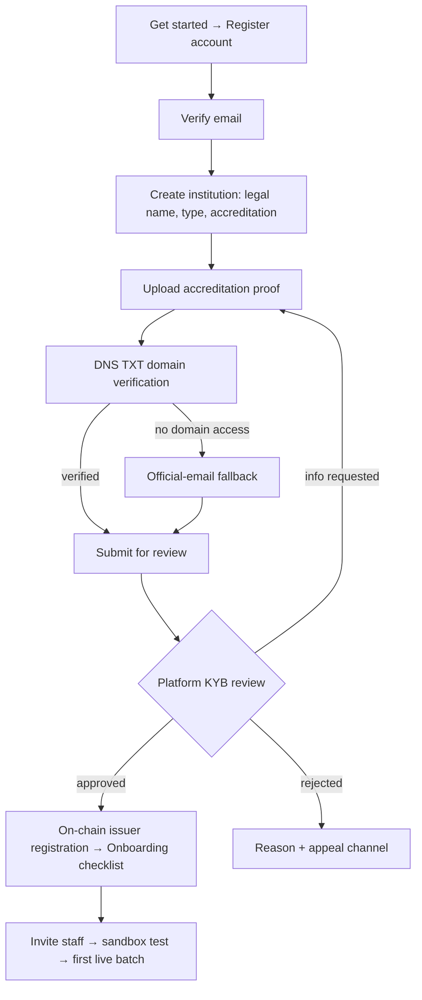
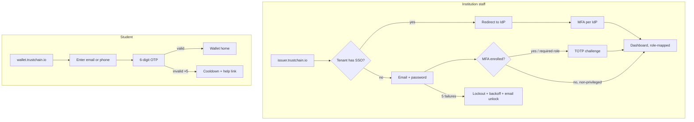
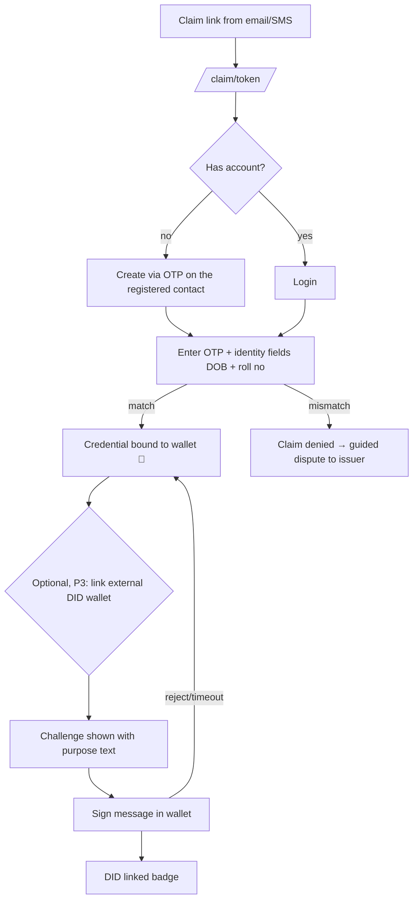
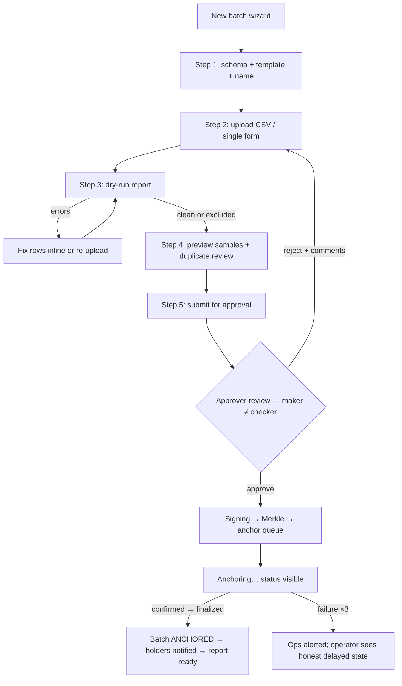
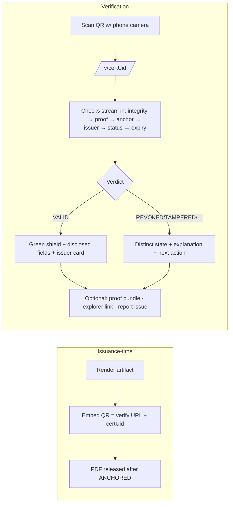
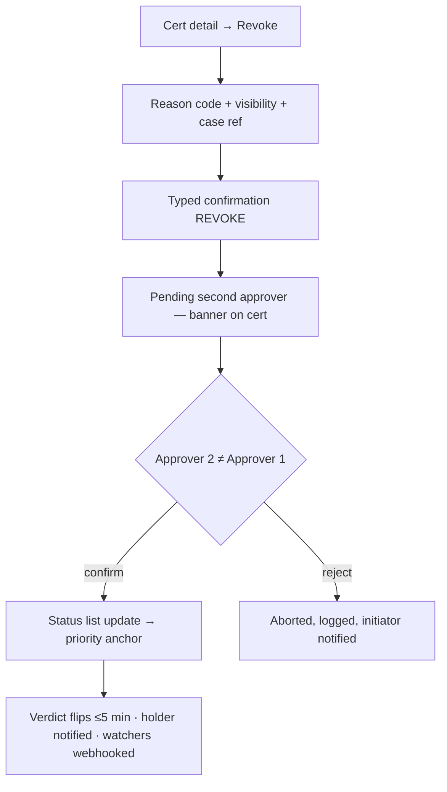
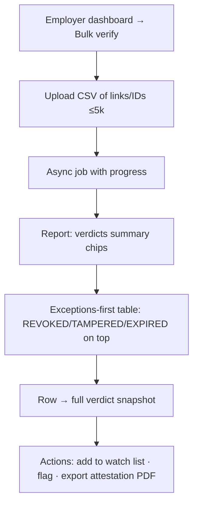
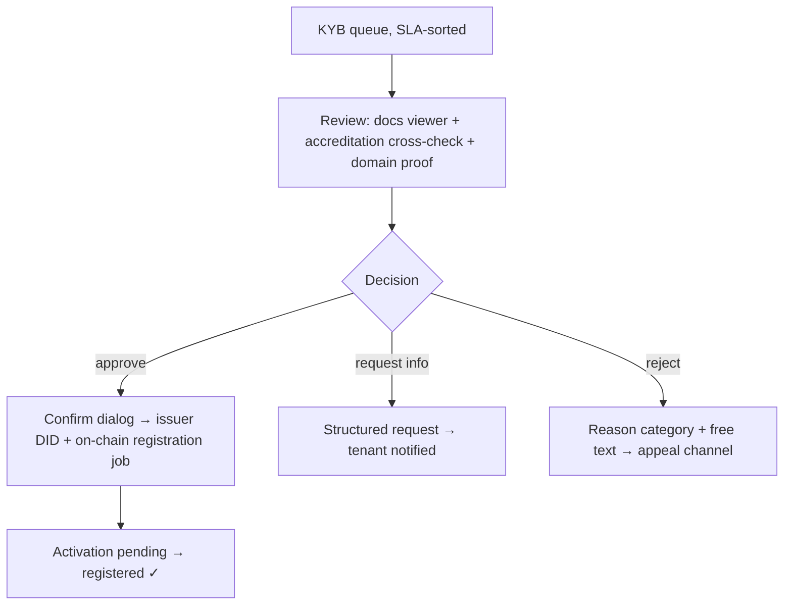
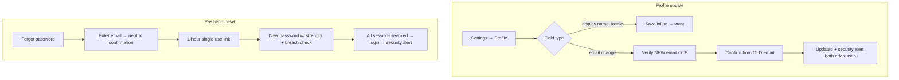

# TrustChain — UI/UX Design Specification

**Blockchain-Based Certificate Verification Platform**

| Field | Value |
|---|---|
| Document | UI/UX Design Specification v1.0 |
| Date | July 2026 |
| Status | Implementation-ready (frontend teams build from this + `packages/ui`) |
| Upstream sources of truth | [Planning](../planning/00-README.md) · [PRD/SRS](../specs/TRUSTCHAIN-PRD-SRS.md) · [TDD](../architecture/TRUSTCHAIN-TDD.md) (§11–12 are binding for this spec) |
| Apps covered | verify-web · wallet-web · issuer-web · admin-web (+ employer portal inside issuer-web shell) |

---

## Table of Contents

1. [Product Design Vision](#1-product-design-vision)
2. [Information Architecture](#2-information-architecture)
3. [User Flow Diagrams](#3-user-flow-diagrams)
4. [Wireframes (Low-Fidelity)](#4-wireframes-low-fidelity)
5. [High-Fidelity UI Design](#5-high-fidelity-ui-design)
6. [Design System](#6-design-system)
7. [Component Library](#7-component-library)
8. [Dashboard Design](#8-dashboard-design)
9. [Certificate Experience](#9-certificate-experience)
10. [Form Design](#10-form-design)
11. [Mobile Experience](#11-mobile-experience)
12. [Accessibility](#12-accessibility)
13. [Motion Design](#13-motion-design)
14. [UX Writing](#14-ux-writing)
15. [Design Tokens](#15-design-tokens)
16. [Frontend Development Guidelines](#16-frontend-development-guidelines)
17. [Figma Planning](#17-figma-planning)

---

# 1. Product Design Vision

## 1.1 Design Philosophy

1. **Trust is the product; the UI is its evidence.** Every screen must make cryptographic certainty *feel* certain: unambiguous verdicts, visible proofs, honest states ("cached as of 12:03 UTC"), zero dark patterns. If the interface ever feels vague, we have failed at the product level, not just the design level.
2. **Blockchain invisible, confidence visible.** No wallets, gas, hashes, or jargon in primary paths (constraint C-4). Chain evidence exists one tap *below* the surface for those who want it — progressive disclosure, never prerequisite knowledge.
3. **The registrar is the design ceiling, the scanning embassy officer is the design floor.** If Dr. Meena Rao (Persona 1) trusts a screen enough to approve 8,000 degrees on it, and a non-technical official understands a verdict in 5 seconds, everyone in between is served.
4. **Calm enterprise, not crypto-flash.** No gradients-on-black web3 aesthetics, no animation theater. This looks like the best of modern SaaS (Linear/Stripe-class restraint) with the gravitas of an institution.
5. **Errors are guidance.** Every failure state names the next action (NFR-USE-03). Dead ends are design bugs.

## 1.2 User Experience Goals (measurable)

| Goal | Metric | Source |
|---|---|---|
| Instant verifier comprehension | ≥95% correct verdict interpretation by non-technical users | NFR-USE-02 |
| Effortless claim | ≥90% unaided claim completion, ≤2 min | NFR-USE-01 |
| Fearless issuance | Operator completes 8k-row batch with dry-run fix cycle without support ticket | US-I-004/005 |
| Zero-training verification | No account, no app, no instructions on the QR path | BR-16 |
| Fast everywhere | Verdict <3 s p95 on 4G; verdict page <100 KB critical path | NFR-PERF-01, NFR-LOC-02 |
| Inclusive by default | WCAG 2.2 AA, EN+HI at GA | NFR-ACC/LOC |

## 1.3 Product Personality

**Assured · Precise · Plainspoken · Quietly modern.** Voice attributes: states facts without hedging ("This certificate is valid" — not "appears to be"); explains without condescending; celebrates sparingly (claiming your degree deserves one moment of delight; verifying 500 candidates does not). Anti-personality: hype, crypto-slang, exclamation-mark enthusiasm, fear-mongering about fraud.

## 1.4 Visual Identity

- **Mark:** shield-check + chain-link motif (monogram "T" negative space); works at 16 px favicon and 2 cm print.
- **Primary color:** Trust Blue `#1D4ED8` scale — chosen for institutional trust associations and AA-contrast headroom in both themes.
- **Typography:** Inter (UI) + Noto Sans Devanagari (Hindi pairing) + JetBrains Mono (hashes/IDs). Confident, neutral, ubiquitous rendering.
- **Imagery:** abstract geometric lattice patterns (Merkle-tree derived) at low opacity for public pages; no stock photos of graduates in caps; institutional logos are the heroes on certificates.
- **Verdict iconography (the brand's most important assets):** ✔ shield (valid), ⊘ (revoked), ↪ (superseded), ⏱ (expired), ⚠ broken-seal (tampered), ? (unknown issuer), ⏸ (suspended issuer) — each a distinct silhouette recognizable without color.

## 1.5 Trust & Security Principles (design-level)

1. Verdicts render on the canonical domain with consistent layout — teachable anti-phishing shape ("real TrustChain verdicts look exactly like this, at verify.trustchain.io").
2. Security-relevant actions look different: danger variants, typed confirmations for revocation, second-approver banners — irreversibility is visually loud (BR-11).
3. Never fake certainty: pending anchor = "anchoring…", stale cache = timestamped banner, AI opinions labeled "assisted opinion" (FR-VER-018).
4. Privacy visible: share builder previews exactly what the verifier will and won't see; disclosure notices on verdict pages ("holder shared 4 of 9 fields").
5. No engagement tricks: no streaks, no urgency banners, no pre-checked boxes.

## 1.6 Accessibility Goals

WCAG 2.2 AA across all surfaces (verify + wallet audited hardest); zero color-only meaning; full keyboard + screen-reader journeys for claim/share/verify; 44 px touch targets; reduced-motion parity; EN/HI with pseudo-locale CI. Full checklist in [Section 12](#12-accessibility).

## 1.7 Responsive Design Strategy

Mobile-first for verify-web and wallet-web (dominant contexts: phone camera scan; student's phone); desktop-first-but-responsive for issuer/admin consoles (data-dense registrar work). Breakpoints: `xs 320` · `sm 640` · `md 768` · `lg 1024` · `xl 1280` · `2xl 1536`. Strategy per surface in [Section 11](#11-mobile-experience).

---

# 2. Information Architecture

## 2.1 Sitemap

```mermaid
flowchart TB
    subgraph PUBLIC["verify.trustchain.io + www (public)"]
        HOME[Landing] --> HOW[How verification works]
        HOME --> INST[For institutions]
        HOME --> PRICE[Pricing]
        HOME --> VERIFY[Verify hub]
        VERIFY --> VQR["/v/[certUid] — verdict page"]
        VERIFY --> VSHARE["/share/[token] — shared verdict"]
        VERIFY --> VUP["/upload — file verification"]
        VERIFY --> VLOOK["/lookup — ID lookup"]
        HOME --> STATUS[Status page ↗]
        HOME --> DOCS[Developer docs ↗]
        HOME --> HELP[Help Center]
        HELP --> HC1[Guides: holders / issuers / verifiers]
        HELP --> HC2[FAQ] --> HC3[Contact support]
        HOME --> LEGAL[Privacy · Terms · Security.txt]
    end

    subgraph AUTH["Auth (shared)"]
        LOGIN[Login] --> MFA[MFA challenge]
        LOGIN --> SSO["SSO /sso/[tenant]"]
        REG[Register] --> VEMAIL[Verify email]
        LOGIN --> FORGOT[Forgot password] --> RESET[Reset]
        OTP[OTP login — holders]
    end

    subgraph WALLET["wallet.trustchain.io (Student portal)"]
        CLAIM["/claim/[token]"] --> W[Wallet home]
        W --> WD["Credential detail /wallet/[uid]"]
        WD --> WSHARE[Share builder]
        W --> WSH[My shares + activity]
        W --> WDIS[Disputes]
        W --> WSET[Settings: profile · notifications · privacy & data · sessions]
    end

    subgraph ISSUER["issuer.trustchain.io (Institution portal)"]
        IDASH[Dashboard] --> IBATCH[Batches] --> IBNEW[New batch wizard]
        IBATCH --> IBDET["Batch detail /batches/[id]"]
        IDASH --> ICERT[Certificates] --> ICDET[Certificate detail]
        IDASH --> IREV[Revocations queue]
        IDASH --> ITPL[Templates] & ISCH[Schemas]
        IDASH --> IDISP[Disputes]
        IDASH --> IANA[Analytics]
        IDASH --> ISET[Settings: profile · members · departments · keys · webhooks · API keys · billing · audit log]
        IDASH --> IONB[Onboarding checklist / KYB status]
    end

    subgraph EMP["Employer portal (issuer shell, org context)"]
        EDASH[Verify dashboard] --> EBULK[Bulk verify]
        EDASH --> EHIST[History] --> EWATCH[Watch lists]
        EDASH --> EUSAGE[Usage & API]
    end

    subgraph ADMIN["admin.trustchain.io (allowlisted)"]
        ADASH[Ops overview] --> AKYB[KYB queue]
        ADASH --> ATEN[Tenants]
        ADASH --> AANC[Anchoring ops]
        ADASH --> ACASE[Fraud cases]
        ADASH --> ADSR[DSR console]
        ADASH --> AFLAG[Flags & quotas]
        ADASH --> AREG[Regulator view]
    end

    ERR["Error pages: 404 · 403 · 500 · maintenance · link-expired (410)"]

    HOME -.-> LOGIN
    LOGIN -.-> W & IDASH & EDASH & ADASH
```



## 2.2 Navigation Model

| Surface | Primary nav | Secondary | Utility |
|---|---|---|---|
| Public | Top navbar: Verify · How it works · For institutions · Pricing · Help | Footer columns | Language switch, Login/Get started |
| Wallet (mobile-first) | Bottom tab bar: Wallet · Shares · Activity · Profile | In-page tabs on detail | Notification bell, help |
| Issuer console | Left sidebar (role-filtered): Dashboard · Batches · Certificates · Revocations · Templates · Schemas · Disputes · Analytics · Settings | Breadcrumbs + page tabs | Tenant switcher, sandbox toggle badge, bell, avatar |
| Employer | Same shell: Verify · History · Watch lists · Usage | — | Org switcher |
| Admin | Left sidebar: Overview · KYB · Tenants · Anchoring · Cases · DSR · Flags · Regulator | Command palette ⌘K | Environment badge, JIT-elevation timer |

Rules: current location always visible (sidebar active state + breadcrumbs); max nav depth 3; every deep page reachable by URL (shareable, guard-protected); sandbox mode shows a persistent amber "SANDBOX" environment ribbon on every page.

---

# 3. User Flow Diagrams

## 3.1 Institution Registration (KYB)



## 3.2 Institution Login & Student Login



## 3.3 Wallet Connection (scoped: claim binding + optional BYO-DID)



*(No crypto wallet is ever required — this flow is additive, per TDD §10.3.)*

## 3.4 Certificate Creation → Approval → Issuance



## 3.5 QR Generation & Verification



## 3.6 Certificate Revocation (two-person)



## 3.7 Employer Verification (bulk)



## 3.8 Admin Workflow (KYB decision)



## 3.9 Profile Update & Password Reset



---

# 4. Wireframes (Low-Fidelity)

Notation: `[...]` = component/region; indentation = hierarchy; ≡ list, ▤ table, ◻ card. All wireframes assume the 12-column grid (desktop) / 4-column (mobile).

### 4.1 Landing Page (public)
```
[Navbar: logo | Verify · How it works · For institutions · Pricing · Help | 🌐 EN | Login | Get started(btn-primary)]
[Hero 60vh: H1 + subhead + dual CTA (Verify a certificate / For institutions) + trust strip: "N certificates · M institutions · verified on Polygon"]
[3-up value cards ◻: Instant verdicts · Fraud-proof issuance · Student-owned records]
[How-it-works: 3-step horizontal diagram issue→anchor→verify]
[Verdict demo: interactive sample VerdictPanel (safe demo cert)]
[Institution logos strip] [Security & standards band: W3C VC · SOC 2 · DPDP]
[CTA band] [Footer: product / resources / legal / language / status]
```

### 4.2 Login
```
[Split layout: left 5-col brand panel (lattice pattern + one-line promise) | right 7-col form card]
  ◻ [Logo] H1 "Sign in"
    [Email] [Password + show toggle] [Forgot link]
    [Sign in (primary, full-width)] [—or—] [SSO: "Continue with your institution"]
    [Footer links: Create account · Student? Sign in with OTP]
[MFA variant: 6-slot OTPInput + "use recovery code"]
```

### 4.3 Register (user account)
```
◻ centered 480px: H1 "Create your account"
  [Email] [Password + strength meter + policy hint] [Locale select]
  [Create account (primary)] [Legal microcopy]
→ [Verify email screen: icon + "We sent a link to {email}" + resend (60s cooldown)]
```

### 4.4 Issuer Dashboard
```
[Sidebar 240px] [Topbar: breadcrumbs | sandbox badge? | bell | tenant switcher | avatar]
[Main: H1 "Dashboard" + date filter]
  [KPI row: 4× StatCard — Issued (30d) · Claim rate · Verifications (30d) · Batches pending]
  [2-col: TimeSeries verifications chart (8-col) | Quick actions ◻ (4-col): New batch · Invite member · View unclaimed]
  [Attention list ≡: pending approvals, failed rows, undeliverable holders, open disputes — each row → deep link]
  [Recent batches ▤: name · rows · status(FSM chip) · anchored tx · actions]
```

### 4.5 Certificate List (issuer)
```
[Header: H1 + count | SearchBar (uid/name/roll) | Filters: status, batch, schema, date | Export | Issue single (btn)]
[▤ DataTable virtualized: checkbox | UID(mono, copy) | holder name | type | issued | status chip | claim ✓ | actions ⋮]
[Bulk bar on selection: export · re-notify]  [Cursor pagination]
```

### 4.6 Issue Certificate (batch wizard)
```
[Stepper: 1 Setup → 2 Upload → 3 Validate → 4 Review → 5 Submit]
Step3: [Summary chips: 8,214 ok · 37 errors · 12 duplicates] [ErrorsTable: row# · field · message · inline-fix]
       [Re-upload] [Exclude failing rows toggle] [Continue disabled until 0 blocking]
Step4: [Sample cert preview (render) | duplicates review list | approval-chain notice]
Step5: [Summary card + "Submit for approval" | maker-checker explainer]
```

### 4.7 Certificate Details (issuer)
```
[Breadcrumbs] [H1: holder name + VerdictBadge + status chip]
[2-col: left 8-col — artifact preview ◻ + Timeline (issued→claimed→verified×N→…) ]
[right 4-col — facts ◻: UID copy · batch link · schema/template versions · ChainStatusChip + explorer link · claim status]
[Danger zone ◻: Revoke (danger) · Supersede & correct]
```

### 4.8 Verification Page (public — the flagship)
```
[Minimal header: TrustChain logo + canonical domain cue + language]
[VerdictPanel hero: giant icon + "VALID CERTIFICATE" + one-line meaning]
[IssuerIdentityCard: logo · name · accreditation · registry status ✓]
[Certificate summary ◻: disclosed fields only + DisclosureNotice if partial]
[CheckList: 7 checks, each ✓/✗/… with plain-language tooltip]
[Advanced (collapsed): AnchorProofViewer — tx hash·block·root·Merkle path·explorer link]
[Actions row: Download proof bundle · Report a problem]  [Tiny footer: how verification works]
```

### 4.9 Student Wallet
```
[Bottom tabs: Wallet · Shares · Activity · Profile]  [Top: greeting + bell]
[Wallet: ≡ CertificateCards — thumbnail · issuer chip · title · status badge · issued date]
[Empty state: illustration + "No credentials yet" + claim-help]
[Card tap → detail: artifact viewer (pinch-zoom) · status · [Share][Download][More⋮: VC JSON, OB3, proof bundle, dispute]]
```

### 4.10 Employer Dashboard
```
[Sidebar: Verify · History · Watch lists · Usage]
[Verify: big single input (URL/ID) + [Scan QR] + [Upload file] + [Bulk verify CSV]]
[History ▤: date · candidate ref/tag · verdict chip (snapshot) · channel · actions (view, watch, flag, attestation PDF)]
[Watch lists ▤: cert · added by · status · alerts on]
```

### 4.11 Admin Dashboard (ops overview)
```
[Env badge PROD | JIT elevation timer chip]
[SLO row: verify availability · p95 latency · anchor queue depth · wallet balances — green/amber/red tiles each linking a runbook]
[Queues: KYB (n, SLA breaches) · failed anchors (n, retry) · open cases (n)]
[Live anchor FSM board: queued→submitted→confirmed→finalized counts]
```

### 4.12 Analytics (issuer)
```
[Filter bar: range · department · schema] 
[KPI row] [TimeSeries: verifications] [BarBreakdown: verdicts · channels] [FunnelChart: issued→claimed→shared→verified]
[GeoList table] [Scheduled exports panel]
```

### 4.13 Settings (issuer, tabbed)
```
[Tabs: Profile · Members · Departments · Keys · Webhooks · API keys · Billing · Audit log]
Members: [Invite (email+role+dept)] [▤ members: name · role badge · MFA ✓ · last active · actions]
Keys: [Active key card: created · algorithm · rotate (step-up MFA)] [History ≡]
Webhooks: [Endpoint list + delivery log ▤ (status, attempts, replay btn)]
```

### 4.14 Notifications Center
```
[Bell → panel 400px: tabs All · Unread]
[≡ rows: icon (severity) · title · time · action link]  [Mark all read] [Preferences link]
[Security notices pinned with shield icon — cannot be dismissed unread]
```

### 4.15 Audit Logs (issuer/admin)
```
[Filter bar: actor · action type · resource · date] [Export (202 job)]
[▤: time(UTC+local) · actor · action · resource link · before/after diff (expand) · traceId copy]
[Integrity banner: "Log chain verified ✓ — anchored daily on-chain" + last anchor link]
```

### 4.16 Error Pages
```
404: [Verdict-style neutral icon] H1 "Page not found" + search + [Go home]
403: H1 "You don't have access" + "Signed in as {email} ({role})" + [Switch account] [Request access]
500: H1 "Something went wrong on our side" + traceId copy + [Try again] [Status page link]
410 (share expired): H1 "This share link has expired" + "Ask the credential holder for a fresh link"
Maintenance: banner-driven, verdict path exempt where cache allows
```

---

# 5. High-Fidelity UI Design

Shared page anatomy (referenced as "standard console chrome"): **Header** 64 px (breadcrumbs left, utility cluster right) · **Sidebar** 240 px collapsible→64 px icon rail · **Main** max-width 1280 px, 24 px gutters, cards on `--tc-bg-surface` · **Footer** (consoles: none; public: full). Every page below also inherits: skeleton loading, RFC-9457-mapped error banners with traceId, defined empty states, reduced-motion parity.

## 5.1 Public Verification Page `/v/[certUid]` — the flagship

| Aspect | Specification |
|---|---|
| Purpose / user | Deliver an unambiguous verdict in <5 s of comprehension; anonymous verifier, possibly non-technical, possibly on 3G |
| Layout | Single column, max 720 px, centered; minimal header (logo + domain cue + language); no sidebar/nav |
| Main content | 1) **VerdictPanel**: 96 px verdict icon, H1 verdict, one-sentence meaning, timestamp. 2) IssuerIdentityCard. 3) Certificate summary card (disclosed fields, grouped label/value pairs, `mono` for IDs). 4) CheckList (7 checks streaming). 5) `<details>` Advanced: AnchorProofViewer. 6) Action row |
| Buttons | Secondary: "Download proof bundle", ghost: "Report a problem"; no primary CTA (the verdict is the point) |
| Charts/tables | None — deliberately |
| Dialogs | Report-a-problem modal (category + optional contact) |
| Responsive | Identical single column at all sizes; check list rows wrap; artifact preview omitted <sm (fields only) |
| Accessibility | Verdict announced via `role=status` on resolution; icon has text alternative; checks are an ordered list; contrast ≥7:1 on verdict text |
| Animations | Checks tick in sequentially (120 ms stagger); VALID shield has a single 300 ms settle animation — plays once, skipped under reduced-motion |
| Loading | Shell paints <1 s (SSR); checks show `…` spinners individually; never a full-page spinner |
| Error/empty | Unknown UID → neutral "not found" (anti-enumeration); chain unavailable → amber UNAVAILABLE state with "cached as of {t}" if cache exists; 410 for dead shares |

## 5.2 Verdict states (visual spec — applies to 5.1 and all VerdictBadge uses)

| Verdict | Icon | Color pair (light/dark) | H1 copy | Explanation line |
|---|---|---|---|---|
| VALID | shield-check | success-700/success-400 | Valid certificate | Issued by {issuer} and cryptographically verified on the blockchain. |
| REVOKED | slash-circle | danger-700/danger-400 | Revoked certificate | {Issuer} revoked this certificate on {date}. {Reason if permitted.} |
| SUPERSEDED | arrow-right-circle | info-700/info-400 | Superseded certificate | A corrected version exists. → View the current certificate |
| EXPIRED | clock | warning-700/warning-400 | Expired certificate | This certificate was valid until {date}. |
| TAMPERED | shield-off | danger-800/danger-300 + emphatic border | Certificate doesn't match records | This file has been altered or is not the original. Do not rely on it. → Report |
| UNKNOWN ISSUER | help-circle | warning | Issuer not recognized | The issuer isn't in the TrustChain registry. Verify with the institution directly. |
| SUSPENDED ISSUER | pause-circle | warning | Issuer currently suspended | The certificate checks pass, but the issuing institution is suspended. |

## 5.3 Batch Wizard (issuer) `/batches/new`

| Aspect | Specification |
|---|---|
| Purpose / user | Zero-fear bulk issuance for Priya (operator persona); enforce data quality before anything is signed |
| Layout | Console chrome; Stepper pinned top; content card per step; sticky footer bar (Back · autosave indicator · Continue) |
| Forms | Step 1 selects (schema/template/name); Step 2 FileDrop (CSV/XLSX ≤50k rows, template download link) or single-cert schema-driven form; Step 3 ErrorsTable with inline cell fixes; Step 4 sample preview carousel + duplicates panel; Step 5 summary + Submit |
| Tables | ErrorsTable: virtualized, errors-first sort, columns row#/field/value/message/fix; sticky header; keyboard row navigation |
| Buttons | Continue (primary, disabled w/ reason tooltip until step valid); "Exclude failing rows" (secondary + confirm) |
| Dialogs | Duplicate-override confirm (requires approver later — notice); leave-page guard (draft autosaved) |
| Responsive | Desktop-optimized; ≥md required for step 3 table; mobile shows read-only progress |
| Accessibility | Stepper is a nav with aria-current; upload progress announced; every error row links field-level description |
| Loading | Validation runs async: progress bar + row counter + "you can leave, we'll notify you" |
| Error/empty | Parser failure → file-level error card with first 3 problems + docs link; >20% invalid → blocking banner (E1, SRS 3.3) |
| Animations | Step transitions 200 ms slide; checkmark on completed steps |

## 5.4 Approval Review (issuer, approver role)

| Aspect | Specification |
|---|---|
| Purpose / user | Dr. Rao approving with full confidence and minimal reading |
| Main content | Summary header (batch, rows, schema/template versions, operator); anomaly strip (duplicates overridden, out-of-range values, off-hours submission); 3 random sample previews; approvals sidebar showing chain (who approved when) |
| Buttons | Approve (primary, step-up MFA if stale) · Reject with comments (danger-secondary, requires comment) |
| Dialogs | Approve confirm restates counts + "this will anchor on Polygon"; reject dialog with structured reasons |
| Accessibility | Anomalies as a list with severity text; sample previews have text equivalents |
| Error states | Batch changed since load → stale banner + reload (optimistic locking) |

## 5.5 Wallet Home & Credential Detail (student)

| Aspect | Specification |
|---|---|
| Purpose / user | Arjun's lifelong record; mobile-first |
| Layout | Bottom tab bar; card list with pull-to-refresh; FAB-less (actions live on cards) |
| Cards | CertificateCard: 3:2 artifact thumb, issuer chip w/ logo, title, VerdictBadge (compact), issued date; long-press/⋮ menu |
| Detail | Artifact viewer (pinch-zoom, swipe pages); status strip; primary actions Share (primary) · Download (secondary); Timeline accordion; "Proof & blockchain details" accordion (explorer link, bundle) |
| Dialogs | Share builder bottom-sheet ([§9.8](#98-share-experience)); dispute form sheet |
| Responsive | ≥lg: two-column (list + persistent detail pane) |
| Accessibility | Cards are single links with composed accessible name ("B.Tech Degree, XYZ University, valid, issued June 2026"); artifact viewer has SR field-list alternative |
| Loading/empty | Card skeletons ×3; empty: "No credentials yet — when an institution issues you one, it appears here" + claim-link help |
| Animations | Card → detail shared-element transition (200 ms); claim success: one confetti-free shield pulse + toast |

## 5.6 Employer Verify & History

Purpose: Sofia's exception-driven screening. Layout: console chrome, Verify page centered mega-input (paste URL/ID) with three secondary entries (Scan QR — opens camera modal; Upload file; Bulk CSV). History table (verdict-snapshot chips, tag/notes inline edit, exceptions filter default ON for bulk reports). Buttons: row actions watch/flag/attestation. Dialogs: flag-a-certificate (category, notes, evidence). Charts: usage sparkline on Usage page + quota meter with plan CTA at 80%. Empty history: "Verify your first candidate — paste a link or scan their QR." Accessibility: verdict chips = icon+text; bulk report downloadable as accessible CSV.

## 5.7 Admin KYB Review

Purpose: careful, auditable approval decisions. Layout: master-detail (queue left 360 px, SLA-sorted with breach chips; detail right). Detail: applicant profile, document viewer (zoom/rotate), accreditation cross-check panel (registry lookup result), domain-proof status, prior attempts. Actions: Approve (primary, dual-confirm summarizing on-chain effect) · Request info (structured checklist) · Reject (reason taxonomy). Every action writes visible audit entry ("You approved — logged"). Error: registration tx failure → "approved, activation pending" state chip with auto-retry note (UC-01 E-3).

## 5.8 Anchoring Ops (admin/SRE)

Purpose: Vikram's queue health at a glance. Layout: SLO tiles row (each links runbook); FSM board (columns queued/submitted/confirmed/finalized with counts + age percentiles); failures table (error class, attempts, one-click retry — idempotent); wallet balance cards with threshold bars; gas trend chart. Danger zone: chain-write kill switch (dual-control dialog: second admin approval request flow, typed CONFIRM, reason required). All timestamps dual UTC/local. Real-time via SSE with connection-state indicator.

## 5.9 Analytics (issuer) & Settings pages

Analytics per wireframe 4.12 with: chart↔table toggle on every viz (a11y), export buttons spawn async jobs, date presets (7/30/90/custom), all metrics footnoted with definitions. Settings tabs per 4.13 with: role badges colored by scope; destructive actions (remove member, revoke key) in danger sections with typed confirms; API-key creation shows secret once with copy + "stored hashed" note; webhook delivery log expandable rows with request/response (redacted) + replay.

---

# 6. Design System

## 6.1 Color Palette

| Scale | 50 | 100 | 300 | 500 | 600 | 700 | 900 | Usage |
|---|---|---|---|---|---|---|---|---|
| **Primary (Trust Blue)** | #EFF4FF | #DBE6FE | #93B4FD | #3B6FF6 | **#1D4ED8** | #1E40AF | #1E2A78 | Actions, links, focus, brand |
| **Secondary (Slate-Indigo)** | #F5F6FA | #E9EBF4 | #B9BFD6 | #6B7394 | #555C7B | #434963 | #23263A | Secondary buttons, subdued UI |
| **Neutral (Slate)** | #F8FAFC | #F1F5F9 | #CBD5E1 | #64748B | #475569 | #334155 | #0F172A | Text, borders, surfaces |
| **Success** | #F0FDF4 | #DCFCE7 | #86EFAC | #22C55E | #16A34A | **#15803D** | #14532D | VALID, confirmations |
| **Warning** | #FFFBEB | #FEF3C7 | #FCD34D | #F59E0B | #D97706 | **#B45309** | #78350F | EXPIRED, cautions, sandbox |
| **Danger** | #FEF2F2 | #FEE2E2 | #FCA5A5 | #EF4444 | #DC2626 | **#B91C1C** | #7F1D1D | REVOKED/TAMPERED, destructive |
| **Info** | #F0F9FF | #E0F2FE | #7DD3FC | #0EA5E9 | #0284C7 | **#0369A1** | #0C4A6E | SUPERSEDED, informational |

## 6.2 Light & Dark Themes (semantic mapping)

| Semantic token | Light | Dark |
|---|---|---|
| bg-page | neutral-50 | #0B1220 (near-slate-950) |
| bg-surface (cards) | white | #111A2E |
| bg-raised (popovers) | white + shadow-md | #16213A + shadow reduced |
| text-primary | neutral-900 | #E6EAF2 |
| text-secondary | neutral-600 | #9AA6BF |
| border-default | neutral-200 | #253150 |
| primary-action | primary-600 | primary-500 (lifted for contrast) |
| verdict colors | 700-weight | 400-weight (on dark surfaces) |
| focus-ring | primary-500 @ 2 px offset 2 px | primary-300 |

Dark theme rules: shadows lower opacity + tighter; pure black avoided; artifact previews keep light "paper" background with dark surround (documents read as documents); charts remap via token palette; both themes ship every component — no light-only components.

## 6.3 Typography & Sizes

| Token | Size/line | Weight | Usage |
|---|---|---|---|
| display | 48/56 | 700 | Landing hero |
| h1 | 30/38 | 700 | Page titles, verdict headline |
| h2 | 24/32 | 600 | Section heads |
| h3 | 20/28 | 600 | Card titles |
| body-lg | 18/28 | 400 | Verdict explanation, marketing |
| body | 16/24 | 400 | Default UI |
| body-sm | 14/20 | 400 | Tables, secondary |
| caption | 12/16 | 500 | Labels, timestamps |
| mono | 14/20 | 450 | Hashes, UIDs, code (JetBrains Mono) |

Fonts: Inter (variable) + Noto Sans Devanagari fallback chain; min body size 14 px; user font scaling respected to 200% without loss (WCAG 1.4.4).

## 6.4 Spacing, Radius, Elevation, Icons

- **Spacing (4 px base):** `1=4 · 2=8 · 3=12 · 4=16 · 5=20 · 6=24 · 8=32 · 10=40 · 12=48 · 16=64 · 24=96`. Card padding 24; section gaps 32; form field gap 16; page gutter 24 (mobile 16).
- **Radius:** sm 4 (inputs, chips) · md 8 (buttons, cards) · lg 12 (modals, hero cards) · full (avatars, pills).
- **Elevation/shadows:** `sm` 0 1 2 rgba(15,23,42,.06) (cards) · `md` 0 4 12 .10 (popovers, sticky bars) · `lg` 0 12 32 .14 (modals). Dark theme: halve opacity, add 1 px border-raised instead.
- **Icons:** lucide-react, 16/20/24 px grid, 1.5 px stroke; every icon paired with text or aria-label; custom set: verdict icons (§1.4), chain-status glyphs, shield-brand mark.

---

# 7. Component Library

Extends TDD §12.2 with interaction + a11y specs. All components: keyboard-complete, both themes, RTL-safe, stories + axe tests.

| Component | Anatomy & variants | States | Interaction & a11y notes |
|---|---|---|---|
| **Button** | primary / secondary / outline / ghost / danger / danger-secondary × sm(32) md(40) lg(48); optional leading/trailing icon | default·hover·active·focus·disabled(+reason tooltip)·loading(spinner replaces label, width locked) | Enter/Space; loading sets aria-busy; destructive always paired with confirm pattern |
| **Input / TextField** | label(top) · required mark · input · help text · error text · char count; prefix/suffix slots | default·focus·error·disabled·readonly | Label always visible (no placeholder-as-label); error linked via aria-describedby; error icon + text |
| **Dropdown / Select / Combobox** | trigger(button) + Radix popover listbox; searchable variant with typeahead; multi w/ chips | open·filtered·empty("No matches — try …")·loading | Full APG listbox keys; selection announced; virtualized >100 options |
| **DataTable** | toolbar(search/filters/export) · virtualized rows · sticky header · selection column · bulk bar · cursor Pagination | loading skeleton rows·empty·error(retry)·partial(load-more) | th scope; row actions in ⋮ menu (keyboard reachable); sort state aria-sort; mobile → card list transform (§11.4) |
| **Card / StatCard** | header·body·footer; StatCard: label, value(tabular-nums), delta chip, sparkline | loading skeleton·error dash | Whole-card link only when single action; delta has text sign ("up 12%") |
| **Accordion** | Radix; single or multiple; chevron rotates | — | Button semantics; content region labeled |
| **Tabs** | underline (page-level) · pill (in-card) | active·hover·focus | Arrow-key roving; tabpanel labeled; deep-linkable via URL |
| **Sidebar** | logo · nav groups · item(icon+label+badge) · collapse toggle · footer(user) | expanded·rail(icon+tooltip)·mobile drawer | nav landmark; aria-current=page; ⌘\\ toggles |
| **Navbar** | breadcrumbs · env/sandbox badge · bell(badge count) · tenant/org switcher · avatar menu | — | Switcher is combobox; badge count announced |
| **Breadcrumbs** | chevron-separated, current = plain text | truncation w/ middle ellipsis menu | nav aria-label="Breadcrumb" |
| **Pagination** | prev/next + page-size select (cursor model — no page numbers) | disabled ends | Buttons labeled "Newer/Older results" |
| **SearchBar** | icon · input · shortcut hint(/) · clear ×; scoped variant with entity select | loading·results dropdown | Combobox pattern; results grouped with headers |
| **QRGenerator (QRDisplay)** | SVG QR + label + actions (download PNG, copy link, print) | — | Described as "QR code linking to verification page for {cert}"; print stylesheet ≥2×2 cm |
| **QRScanner** | camera viewport + guide frame + torch toggle + "upload image instead" fallback | requesting-permission·denied(guidance)·scanning·success | Permission denial gives path forward; success haptic+tone (optional); fully operable without camera via fallback |
| **CertificateCard** | thumb · issuer chip · title · VerdictBadge(compact) · date · ⋮ menu; wallet/issuer/verifier variants | loading·revoked(dimmed thumb + badge) | Single composed link; menu is separate button |
| **BlockchainStatusBadge (ChainStatusChip)** | dot + label: Queued·Submitted·Confirmed·Finalized(+block link) | pulsing dot ≤confirmed (static under reduced-motion) | Text always present; tooltip explains state in plain words |
| **WalletCard** (admin: relayer wallets) | address(mono, copy) · balance bar vs threshold · last activity | ok·low(amber)·critical(red) | Balance as text + meter role |
| **RoleBadge** | pill: Owner/Issuer Admin/Operator/Approver/Viewer/Holder/Platform Admin — color per scope tier | — | Never color-only: label text is the role |
| **Analytics cards / Charts** | Recharts wrapped: TimeSeries·BarBreakdown·Funnel·GeoList·GasCost; unified tooltip, legend toggles | loading shimmer·empty("No data for this range")·error | Chart↔table toggle mandatory; series distinguishable by shape/dash, not hue alone |
| **Alert** | inline banner: info/success/warning/danger; title+body+optional action; dismissible | — | role=status (info/success) or alert (warn/danger) |
| **Toast** | bottom-right (desktop)/top (mobile); icon·message·action·close; queue max 3 | auto-dismiss 5 s (pause on hover/focus) | aria-live=polite; danger toasts persist until dismissed |
| **NotificationItem** | severity icon · title · body · time · unread dot | read/unread | List semantics; security items pinned |
| **Skeleton** | text lines · card · table-row · chart block; shimmer 1.2 s | — | aria-hidden; container gets aria-busy |
| **Dialog / Modal** | Radix: title · body · footer(actions right); sizes sm 400/md 560/lg 720; ConfirmDialog danger variant w/ typed confirmation | — | Focus trap+restore; Esc cancels (never confirms); danger primary is right-most and not default-focused |
| **Tooltip** | 300 ms delay, max 240 px | — | Never sole carrier of required info; focus-triggered too |
| **Form primitives** | FieldGroup·Legend·InlineHint·FormErrorSummary(top, links to fields) | — | Summary receives focus on failed submit |
| **DatePicker** | input w/ mask + calendar popover; range variant; locale-aware (en-IN/hi-IN) | invalid·disabled dates w/ reason | Grid keyboard nav; manual typing always allowed |
| **FileUpload (FileDrop)** | dropzone(dashed) · browse link · file row(name·size·progress·remove) · constraints line | idle·drag-over·uploading(%)·success·error(per-file reason) | Button+input fallback; progress announced at 25% steps |

---

# 8. Dashboard Design

Shared dashboard grammar: KPI StatCards top (4-up desktop, 2-up tablet, 1-up mobile) → one hero chart → attention/queue list → recent-activity table → quick actions. All widgets: skeleton, empty, error states; range filter affects everything; every number links to its filtered detail view.

## 8.1 Institution Dashboard

| Zone | Content |
|---|---|
| KPIs | Certificates issued (30d, +delta) · Claim rate % (with cohort tooltip) · Verifications (30d) · Pending approvals (amber if >0) |
| Charts | TimeSeries verifications (stacked by channel: QR/link/API); mini FunnelChart issued→claimed→shared |
| Attention list | Pending approvals (deep-link to review) · failed/undeliverable notifications · open disputes w/ SLA chips · unclaimed >30 d |
| Recent activity | Last 10 batches table: name·rows·FSM chip·anchor link·report |
| Quick actions | New batch · Issue single · Invite member · View analytics |
| Widgets | Onboarding checklist card (until complete) · sandbox-mode notice · anchoring-status strip (live) |
| Notifications | Bell + inline attention list; digest opt-in promo once |

## 8.2 Student Dashboard (Wallet home)

KPIs deliberately minimal (not a metrics product for holders): credential count · active shares · recent views. Primary surface = CertificateCards. Widgets: "Recent share activity" (who viewed, when — FR-STU-007), pending disputes chip, profile-completeness nudge (email migration prompt pre-graduation, US-S-016). Quick actions: Claim a certificate (token entry) · Share · Download. Statistics live under Activity tab, not the home.

## 8.3 Employer Dashboard

KPIs: Verifications this month vs quota (meter) · exceptions count (REVOKED/TAMPERED, red if >0) · watch-list alerts · avg verification age. Chart: verifications by verdict (BarBreakdown, 30 d). Tables: recent verifications (snapshot chips) · watch-list changes. Quick actions: Verify (mega-input) · Bulk CSV · Scan QR. Widgets: API usage sparkline + key health (last used, scope), plan/quota card at 80% threshold.

## 8.4 Administrator Dashboard

KPIs (SLO tiles, red/amber/green, runbook-linked): verify availability · verify p95 · anchor queue depth+age · relayer balances · webhook DLQ size · open KYB w/ SLA breaches. Charts: anchor FSM board (live) · gas spend trend · tenant growth. Tables: failed anchors (retry) · newest tenants · open fraud cases by severity. Quick actions: KYB queue · retry failures · create announcement · JIT-elevate. Widgets: incident banner editor · environment/chain info card (chainId, contract versions) · audit "last day-root anchored ✓".

---

# 9. Certificate Experience

## 9.1 Certificate Viewer

Artifact rendered as "paper on desk": light document surface on neutral surround (both themes), max-width 840 px, zoom 50–300% (pinch + buttons + keyboard ±), multi-page thumbnails rail, rotate for scanned legacy docs. Below viewer: field list (the data of record) — viewer is presentation, fields are truth; a divergence note is impossible by construction (fields render from VC).

## 9.2 Certificate Details (holder/issuer variants)

Header: title + holder + VerdictBadge + status chip. Facts panel: UID (mono+copy) · issuer + accreditation · issued/expiry dates · schema/template versions · claim status. Issuer variant adds: batch link, operator/approver identities, danger zone. Holder variant adds: Share/Download primaries, dispute entry.

## 9.3 Blockchain Transaction Details (AnchorProofViewer)

Collapsed by default under "Proof & blockchain details". Expanded: network name+chainId · contract (linked, verified badge) · tx hash (mono, copy, explorer link) · block number+time · finality state chip · Merkle root (copy) · leaf index · proof-path visual (compact tree diagram highlighting the path — decorative, aria-hidden, with text alternative "proof depth 14, validates against root 0x8a…"). Plain-words footer: "What does this prove?" popover.

## 9.4 Verification Screen

Fully specified in [§5.1–5.2](#51-public-verification-page-vcertuid--the-flagship).

## 9.5 Certificate History (Timeline)

Vertical timeline, newest first: issued(+anchor link) → claimed → share created → verified (aggregated: "Verified 12 times in March") → revocation/supersede events (emphasized, with actor roles for issuer view, reasons per visibility policy). Each entry: icon, title, timestamp (dual TZ on hover), expandable detail. Exportable in issuer view (audit use).

## 9.6 Download & Print

Download menu: PDF (artifact) · VC JSON · Open Badges 3.0 · Proof bundle (.zip) — each with one-line explainer ("Proof bundle: verify this certificate independently, even offline"). Print: dedicated stylesheet — artifact full-bleed A4, QR ≥2×2 cm at 300 dpi, verification URL printed as text under QR, no UI chrome; verdict pages print with verdict + checks + timestamp ("snapshot printed {t}" disclaimer).

## 9.7 QR Experience

Generation: every artifact QR = `https://verify.trustchain.io/v/{certUid}` (short, error-correction M); wallet share QRs encode share-token URLs. Display: QRDisplay component with brand-safe quiet zone (no logo overlay — reliability over vanity). Scan: in-app QRScanner for employer portal; public path assumes native camera. Scan-success micro-moment: frame snaps to corners, 150 ms, then navigates.

## 9.8 Share Experience

Share builder (bottom-sheet mobile / modal desktop), 3 steps in one surface: 1) **What**: field checklist grouped (always-shared core, optional fields) with live "Verifier will see" preview panel; 2) **Guards**: expiry presets (7/30/90 d/custom) · max views · PIN toggle; 3) **How**: copy link · QR · email · LinkedIn button. Post-create: share appears in My Shares with activity counter and instant Revoke (confirm; "viewers lose access within a minute").

## 9.9 Blockchain Explorer Link

Always secondary/ghost, opens new tab with external-link icon + "Polygonscan ↗"; tooltip: "View the anchoring transaction on the public blockchain." Never required for any user task (progressive disclosure).

---

# 10. Form Design

## 10.1 Global Form Rules

Labels above fields, always visible; one column (max 480 px) except data-dense admin filters; required marked with * + legend; inline validation on blur, revalidate on change after first error; on submit failure — FormErrorSummary at top (focused, links to fields) + field-level messages; autosave for wizards (indicator: "Saved · just now"); destructive/irreversible submissions restate consequences in the confirm dialog; success = toast + navigation (never silent).

## 10.2 Form Inventories & Validation

| Form | Fields (type) | Validation rules | Error message examples | Success |
|---|---|---|---|---|
| **Institution registration** | Legal name(text) · type(select) · accreditation body(select+other) · accreditation ref(text) · proofs(file ≤10 MB ×5, pdf/jpg) · domain(text) | Name 3–200; ref format per body; ≥1 proof; domain RFC hostname | "Enter the accreditation reference exactly as issued by UGC — e.g., UGC/2019/1234." | "Application submitted — most reviews finish within 2 business days." |
| **Student registration / OTP** | Email or phone(text) · OTP(6-digit) | RFC-5322 / E.164; OTP 10-min TTL, 5 attempts | "That code didn't match. 3 attempts left." / "Code expired — we've sent a new one." | Enters wallet |
| **Certificate creation (single)** | Schema-driven: names, IDs, dates, enums, GPA | Types from schema; date sanity (issue ≤ today); GPA range; duplicate check on submit | "CGPA must be between 0 and 10 for this schema." / "Possible duplicate: same holder + program issued 2024 → review" | Draft added to batch |
| **Batch upload** | File(csv/xlsx ≤50k rows) | Header mapping check; per-row schema validation; >20% invalid blocks | "Column 'dob' not found. Expected headers: … Download template." | Dry-run report ready |
| **Certificate search** | Query(text) · status(multi) · date range · schema(select) | Debounced 300 ms; empty query allowed with filters | — | Results count announced |
| **Verification (lookup/upload)** | cert UID(text) or file(pdf/json ≤10 MB) | UID checksum format precheck; file type sniffing | "That doesn't look like a certificate ID — IDs look like TC-xxxx…" / neutral "No certificate found for this ID." | Verdict page |
| **Settings/profile** | Display name · locale(select) · notification matrix(toggles) | Name ≤80 chars; security events non-optoutable (locked toggles + why) | "Security alerts can't be turned off — they protect your account." | Inline toast "Saved" |
| **Email change** | New email → OTP → old-email confirm | Dual confirmation; 24 h revert link in alert to old address | "Confirm from your old address to finish — this protects you if someone else tries this." | Both addresses alerted |
| **Password reset** | Email → token → new password ×2 | ≥12 chars + breach check + match | "This password appeared in a known breach — choose a different one." | "Password updated. You've been signed out everywhere." |
| **Wallet connection (P3, optional)** | Wallet select · signed challenge | Nonce 5-min TTL; signature recovers linked address; origin-bound message | "Signature didn't match. Make sure you're signing with the wallet you want to link." | "DID linked — you can now claim to your own wallet." |
| **Revocation** | Reason code(select) · visibility(radio) · case ref(text, optional) · typed REVOKE | Reason required; typed confirmation exact | Confirm dialog: "This cannot be undone. The certificate will show as revoked within 5 minutes." | "Revocation recorded — awaiting second approver." |

---

# 11. Mobile Experience

## 11.1 Layout Strategy per Breakpoint

| Surface | xs–sm (≤640) | md (768) tablet | lg+ desktop |
|---|---|---|---|
| verify-web | Single column (native design center) | Same, wider gutters | Same, max 720 px |
| wallet-web | Bottom tab bar; sheets over modals; card list | 2-col grid of cards; sheets persist | List + detail split panes; top nav replaces tabs |
| issuer-web | Read/monitor mode: dashboard, batch status, approvals(!), notifications. Creation flows gated: "Batch creation works best on a computer" + email-me-link | Sidebar → icon rail; tables scroll or card-transform; wizard usable | Full experience |
| admin-web | Critical ops only: SLO tiles, retry, kill-switch approvals | Rail + dense | Full |

**Approvals are first-class on mobile** — Dr. Rao approves from her phone: summary → anomalies → approve with biometric-backed step-up.

## 11.2 Navigation & Touch

Bottom tabs (wallet) 56 px, labeled icons; drawer nav (consoles <lg) with scrim; back behavior = browser-consistent (sheets close first). Touch: 44×44 min targets, 8 px spacing between destructive/regular actions; swipe: card lists support pull-to-refresh; no swipe-to-delete anywhere near credentials (irreversibility discipline); long-press = ⋮ menu equivalent.

## 11.3 Responsive Tables, Charts, Forms

- **Tables <md:** transform to stacked cards (each row = card with label:value pairs, primary action visible, rest in ⋮); bulk selection via edit mode; the ErrorsTable keeps table form with horizontal scroll + frozen first column (row #) because comparison matters.
- **Charts <md:** height 200 px, legend → horizontal scroll chips, tooltips → tap-to-pin, GeoList always table.
- **Forms mobile:** full-width fields, sticky submit above keyboard, numeric keypads via inputmode, date pickers native-feel sheet, file upload triggers camera option for document capture.

---

# 12. Accessibility

## 12.1 WCAG 2.2 AA Commitments (binding checklist)

| Area | Requirement | How verified |
|---|---|---|
| Contrast | Text ≥4.5:1 (large ≥3:1); UI components/graphics ≥3:1; verdict text ≥7:1 target | Token pairs pre-validated; axe CI; manual spot checks |
| Keyboard | Every action keyboard-reachable; no traps; visible focus everywhere; skip-to-content; roving tabindex in composite widgets | Keyboard-only test scripts per app per release |
| Focus states | 2 px ring, 2 px offset, primary-500/300; never removed, only restyled; focus restored on dialog close; 2.4.11 focus-not-obscured honored (sticky bars pad scroll) | Storybook a11y states |
| Screen readers | Landmarks (banner/nav/main/contentinfo); one h1/page; live regions: verdict (status), toasts (polite), errors (alert); composed accessible names on cards | NVDA + VoiceOver scripted passes on claim/share/verify |
| ARIA | Radix-supplied patterns; aria-current for nav; aria-sort on tables; aria-busy on loading regions; described-by for errors/help | axe + manual |
| Color-blind support | Verdicts = icon + label + color (7 distinct silhouettes); chart series differ by shape/dash; status dots always adjacent to text | Sim-tested (deutan/protan/tritan) |
| Reduced motion | prefers-reduced-motion: transitions → opacity-only ≤120 ms; pulsing/shimmer → static; scan/success animations skipped | Media-query token switch, CI check |
| Forms | Visible labels; error summary focus; instructions before fields; no timeout without warning (OTP shows countdown + resend) | Pattern library enforced |
| Tables | Caption or labeled heading; th scope; row headers where meaningful; card-transform preserves label:value pairing | Component tests |
| Dialogs | Focus trap + initial focus on title/first field (never destructive button); Esc = cancel; labelled-by title | Radix + tests |
| Targets & gestures | ≥24×24 CSS px (2.5.8), we standardize 44 px touch; no drag-only interactions (2.5.7) — all have button equivalents | Design review gate |
| Language | lang attributes per locale switch; Hindi copy reviewed by native speaker; numerals locale-aware | i18n pipeline |

## 12.2 Assistive-Technology Acceptance Scenarios

1. NVDA user completes claim (OTP announced, identity fields labeled, success announced) without sighted help.
2. VoiceOver iOS user shares a credential with selective disclosure and later revokes the share.
3. Keyboard-only registrar reviews and approves a batch, including anomaly review.
4. Screen-reader verifier reads a TAMPERED verdict and finds the report action.

---

# 13. Motion Design

## 13.1 Principles & Tokens

Motion explains, never decorates: max one meaningful animation per view-change; durations `fast 120 ms · standard 200 ms · overlay 300 ms`; easing `ease-out` (enter), `ease-in` (exit), `ease-in-out` (move); reduced-motion swaps all to ≤120 ms opacity fades.

## 13.2 Catalog

| Moment | Spec |
|---|---|
| Page transitions | Console route change: content fade+4 px rise, 200 ms; no full-page slides |
| Loading | Skeleton shimmer 1.2 s linear loop; progress bars eased; anchor "in progress" = soft dot pulse on ChainStatusChip |
| Hover | Buttons: bg shift 120 ms; cards: shadow sm→md + 1 px lift; table rows: bg tint |
| Verdict reveal | Checks tick sequentially (staggered 120 ms); final verdict icon settles with 300 ms scale 0.9→1 + fade — once, never loops |
| Blockchain confirmation | ChainStatusChip transitions queued→submitted→confirmed→finalized: dot color morph + one 200 ms ring ripple on "finalized"; ANCHORED batch banner slides in |
| QR scan | Guide-frame corners breathe (2 s cycle); on detect: frame snaps to code 150 ms + success tick |
| Success moments | Claim complete: shield icon pulse (400 ms, single) + toast — the one celebratory beat in the product |
| Modal/sheet | Modal: fade + scale 0.96→1, 200/150 ms out; sheets: slide-up 300 ms with scrim fade |
| Toast/notification | Slide+fade in 200 ms, exit 150 ms; bell badge: single 300 ms scale pop on increment |
| Micro-interactions | Copy button → checkmark morph 150 ms + "Copied"; toggle thumb 120 ms; stepper check draw 200 ms; input error: 1× 4 px horizontal shake (skipped reduced-motion) |

Forbidden: parallax, auto-playing loops near content, animated numbers on trust surfaces (verdicts/counts render final values instantly).

---

# 14. UX Writing

## 14.1 Voice Rules

Plain words over jargon ("recorded on the blockchain" not "anchored via Merkle root" — except in Advanced panels); verbs first on buttons; sentence case everywhere; no exclamation marks except the single claim-success moment; numbers and dates localized; never blame the user ("That code didn't match" not "Invalid input"); irreversible actions say so plainly.

## 14.2 Landing Page Copy

- **H1:** *Certificates that prove themselves.*
- **Subhead:** TrustChain lets institutions issue tamper-proof digital certificates that anyone can verify in seconds — no phone calls, no waiting, no doubt.
- **CTA pair:** `Verify a certificate` · `For institutions →`
- **Value trio:** *Instant verdicts* — Scan a QR and know in seconds, not weeks. / *Fraud-proof by design* — Every certificate is cryptographically sealed on a public blockchain. / *Yours for life* — Students keep their credentials forever, wherever they go.
- **How it works:** 1. *Issue* — The institution issues certificates in bulk, with approval controls. 2. *Seal* — Each certificate is sealed on the Polygon blockchain. 3. *Verify* — Anyone can check authenticity instantly — free, forever.
- **Trust band:** Built on open standards (W3C Verifiable Credentials) · Zero personal data on the blockchain · Works even if we're gone — verification is independent.

## 14.3 Headings & Empty States

| Context | Heading / empty-state copy |
|---|---|
| Wallet empty | **No credentials yet** — When an institution issues you a certificate, it will appear here. Got a claim link? `Claim a certificate` |
| Batches empty | **Issue your first batch** — Upload a spreadsheet of recipients and we'll handle validation, approval, and sealing. `New batch` |
| History empty (employer) | **Verify your first candidate** — Paste a certificate link or scan the QR on a resume. |
| Search no results | **Nothing matched "{query}"** — Check the spelling, or clear filters. |
| Notifications empty | **You're all caught up.** |
| Analytics no data | **No data for this range** — Try widening the date range. |

## 14.4 Buttons (canonical labels)

`Sign in` · `Create account` · `Send code` · `Verify code` · `New batch` · `Run validation` · `Submit for approval` · `Approve batch` · `Reject with comments` · `Issue certificate` · `Revoke certificate…` (ellipsis = dialog) · `Confirm revocation` · `Correct & reissue` · `Claim certificate` · `Share` · `Create share link` · `Revoke link` · `Download` · `Download proof bundle` · `Verify` · `Scan QR` · `Upload file` · `Add to watch list` · `Report a problem` · `Retry` · `Save changes` · `Cancel` (never "Close" for cancel semantics).

## 14.5 Errors, Validation, Confirmation Dialogs

| Situation | Copy |
|---|---|
| Login failure | Email or password didn't match. Try again, or reset your password. |
| Lockout | Too many attempts. Try again in {n} minutes, or unlock via the email we just sent. |
| OTP wrong / expired | That code didn't match. {n} attempts left. / That code expired — we've sent a new one. |
| CSV header mismatch | We couldn't find the column **dob**. Expected headers: name, roll_no, dob, program… `Download the template` |
| Row error | Row 214 — **date_of_birth**: "31-02-2003" isn't a valid date. Use DD-MM-YYYY. |
| Duplicate warning | Possible duplicate: {name}, same program and year, issued in batch {x}. An approver must confirm to issue anyway. |
| Verify not found | We couldn't find a certificate with this ID. Check for typos — IDs look like TC-XXXX-XXXX. |
| Tampered upload | **This file doesn't match the sealed record.** It may have been altered. Do not rely on it. `Report this certificate` |
| Share expired | This share link has expired. Ask the certificate holder for a fresh link. |
| Chain degraded | Showing results from our last confirmed blockchain snapshot ({time}). Live checks will resume automatically. |
| 500 | Something went wrong on our side. Your work is saved. Try again, or contact support with code **{traceId}**. |
| Revocation confirm (dialog) | **Revoke this certificate?** This cannot be undone. Within 5 minutes, anyone verifying it will see it as revoked. A second approver must confirm. Type **REVOKE** to continue. |
| Share revoke confirm | **Revoke this link?** People with this link will lose access within a minute. |
| Erasure confirm | **Delete your personal data?** Your certificates will stop being linked to you and this can't be reversed. Institutions keep non-identifying records as required by law. |
| Key rotation confirm | **Rotate signing key?** New certificates will use the new key. Existing certificates remain valid. |

## 14.6 Success, Toasts, Tooltips, System Alerts

- Claim: **Certificate claimed!** It's now in your wallet. *(the one "!")*
- Batch: Batch approved — sealing on the blockchain now. → Batch anchored ✓ 8,214 certificates are live; recipients are being notified.
- Share: Link created and copied. Expires {date}. / Link revoked.
- Revocation: Revocation recorded — waiting for a second approver. → Certificate revoked. The holder has been notified.
- Tooltips: ChainStatusChip-Finalized: "Permanently recorded on the Polygon blockchain." · Claim rate: "Share of issued certificates that recipients have added to their wallet." · Disclosure notice: "The holder chose which fields to share. Hidden fields stay verified but unseen."
- System alerts (banner): Scheduled maintenance {window}: issuing pauses; verification stays available. · Sandbox mode — certificates here are test-only and carry a watermark.

## 14.7 Email Templates (subjects + key lines)

| Email | Subject | Body core |
|---|---|---|
| Claim invitation | Your {Institution} certificate is ready | {Name}, {Institution} has issued you: **{Title}**. Claim it in about a minute. `Claim my certificate` — link personal to {maskedContact}. |
| Claim reminder | Reminder: your certificate is waiting | Still unclaimed. It remains verifiable either way, but claiming lets you share and track it. |
| Revocation notice | Important: your certificate was revoked | {Institution} revoked **{Title}** on {date}. Reason: {reason/level}. If you believe this is a mistake: `Start an appeal`. |
| Security alert | New sign-in to your TrustChain account | New sign-in from {device}, {place}, {time}. Wasn't you? `Secure my account` |
| Batch report (issuer) | Batch "{name}" anchored — {n} certificates live | Summary counts + `Download report` + anchor reference. |
| Watch-list alert (employer) | A credential you verified was revoked | **{ref}** verified on {date} is now revoked. `View details` |
| KYB outcome | Your institution is approved 🎉 / needs more information | Next steps checklist / itemized requests. |

---

# 15. Design Tokens

Single source: `packages/ui/tokens` → CSS variables + Tailwind config + Figma variables (synced). Naming: `--tc-{category}-{concept}-{variant}`.

```text
── Color (primitives → semantic) ──────────────────────────────
--tc-color-{primary|secondary|neutral|success|warning|danger|info}-{50…950}
--tc-bg-{page|surface|raised|inverse}        --tc-text-{primary|secondary|muted|inverse|link}
--tc-border-{default|strong|focus}           --tc-verdict-{valid|revoked|superseded|expired|tampered|unknown|suspended}-{fg|bg|border}
--tc-chain-{queued|submitted|confirmed|finalized}
── Typography ─────────────────────────────────────────────────
--tc-font-{sans|devanagari|mono}
--tc-text-{display|h1|h2|h3|body-lg|body|body-sm|caption}-{size|line|weight|tracking}
── Spacing & layout ───────────────────────────────────────────
--tc-space-{1,2,3,4,5,6,8,10,12,16,24}   --tc-container-{sm|md|lg|xl}   --tc-grid-gutter{-mobile}
── Border & radius ────────────────────────────────────────────
--tc-radius-{sm|md|lg|full}   --tc-border-width-{1|2}
── Elevation ──────────────────────────────────────────────────
--tc-shadow-{sm|md|lg}   (dark-theme overrides half opacity + border-raised)
── Motion ─────────────────────────────────────────────────────
--tc-duration-{fast|standard|overlay}=120|200|300ms
--tc-ease-{enter|exit|move}   --tc-motion-reduced (query-driven switch)
── Component tokens (bind to semantics, never primitives) ─────
--tc-button-{height-sm|md|lg}=32|40|48  --tc-button-{radius|font|px}
--tc-input-{height=40|radius|border|focus-ring}
--tc-card-{padding=24|radius=md|shadow=sm}
--tc-table-{row-height=44|header-bg|stripe}
--tc-dialog-{width-sm|md|lg}=400|560|720
--tc-toast-{width=360|duration=5000}
--tc-sidebar-{width=240|rail=64}  --tc-navbar-height=64
--tc-badge-{height=20|radius=full|font=caption}
--tc-focus-{ring-width=2|offset=2|color}
--tc-touch-target-min=44
```

Governance: primitives may only be referenced by semantic tokens; components may only reference semantic/component tokens (lint-enforced); token changes = PR + visual-regression run + Figma sync.

---

# 16. Frontend Development Guidelines

| Area | Rules |
|---|---|
| **Component naming** | PascalCase components (`CertificateCard`), `use*` hooks, `*.stories.tsx`/`*.test.tsx` colocated; props interfaces `{Component}Props`; variants via `cva` unions, no boolean explosions (`variant="danger"` not `isDanger`) |
| **Folder structure** | Per TDD §4: `apps/*/src/{app,features/<domain>,components,lib}`; features own their routes' logic; `packages/ui` is the only source of primitives (lint rule bans local buttons); barrel exports at feature roots only |
| **Coding standards** | TypeScript strict; no `any` on exported surfaces; ESLint (boundaries, a11y, tailwind plugins) + Prettier; no inline hex/spacing (tokens only); server components by default in Next, client only where interaction demands |
| **State management** | Server state = TanStack Query (keys `[app, tenant, resource, params]`, invalidate on mutation); client state = Zustand slices (session/ui/wizard); forms = RHF+Zod from `core-types`; URL owns filters/pagination; no global stores for server data — ever |
| **Reusable components** | Rule of 2: second usage → promote to `packages/ui` with stories + axe test + both themes; composition over configuration (slots/children before prop flags) |
| **Performance** | Budgets: verify-web ≤100 KB critical path, consoles ≤250 KB initial; dynamic-import below-fold widgets; virtualize lists >50; images via next/image; memo only with measured cause; Lighthouse CI budgets enforced |
| **Accessibility checklist (per PR)** | ☐ keyboard path ☐ visible focus ☐ labels/names ☐ axe zero violations ☐ contrast via tokens ☐ reduced-motion behavior ☐ loading/error announced ☐ works at 200% zoom |
| **Testing** | Component: Vitest+Testing Library (behavior not snapshots) + axe; visual: Chromatic on `packages/ui`; E2E: Playwright golden paths (TDD §19); i18n pseudo-locale render test; MSW for API mocks — no live calls in tests |

---

# 17. Figma Planning

## 17.1 File & Page Structure

```
TrustChain Design (org library)
├─ 📄 00 Cover & Changelog          — status, owners, version log
├─ 📄 01 Foundations                — color styles/variables (light+dark modes), type styles,
│                                     spacing/radius/elevation specs, grid styles, icon set
├─ 📄 02 Components                 — every §7 component: base + variants + states
├─ 📄 03 Patterns                   — form layouts, tables, wizards, dialogs, empty/error/loading
├─ 📄 04 verify-web                 — verdict page ×7 states × mobile/desktop × light/dark
├─ 📄 05 wallet-web                 — claim flow, wallet, detail, share builder, settings (mobile-first frames)
├─ 📄 06 issuer-web                 — dashboard, batch wizard (5 steps), certificates, detail,
│                                     revocation flow, templates/schemas, analytics, settings tabs
├─ 📄 07 employer                   — verify, bulk report, history, watch lists, usage
├─ 📄 08 admin-web                  — ops overview, KYB master-detail, anchoring, cases, DSR
├─ 📄 09 Emails & Print             — email templates, artifact/print layouts, QR specs
├─ 📄 10 Prototypes                 — wired flows (below)
└─ 📄 99 Archive
```

## 17.2 Components, Variants, Auto Layout

- Every library component mirrors code props: e.g. `Button` variants = `variant(6) × size(3) × state(5) × icon(3)` via component properties, not separate components.
- **Variables:** color/spacing/radius as Figma variables with **Light/Dark modes** — frames switch themes by mode, no duplicate styles.
- Auto layout everywhere (hug/fill rules documented per component); min-width constraints match code tokens; responsive frames at 375 / 768 / 1280 / 1536.
- `VerdictBadge` and `VerdictPanel` = single component with 7-value verdict property (the most-reused asset).
- Icons: lucide library + custom `tc/verdict-*`, `tc/chain-*` published as components.

## 17.3 Prototype Connections

Wired click-through flows (matching §3 diagrams): ① QR scan → verdict (all 7 states via variant swap) ② claim (link → OTP → success) ③ batch wizard happy path + error-fix loop ④ approval → anchoring status ⑤ revocation two-person ⑥ share builder → verifier view ⑦ employer bulk → exceptions ⑧ KYB approve. Smart-animate limited to spec'd motion (§13); prototypes device-framed for stakeholder review.

## 17.4 Developer Handoff Notes

- Dev Mode enabled; every frame annotated with: token references (never raw values), component/prop mapping to `packages/ui`, spacing redlines via auto-layout inspection, interaction notes linking §5/§13 specs, a11y annotations (focus order arrows, aria notes, live-region markers) using an annotation component set.
- Naming contract: Figma component name === code component name; variant property names === prop names.
- Status labels on frames: 🟢 ready-for-dev / 🟡 in-review / 🔴 exploration — only 🟢 is buildable truth.
- Handoff ritual: design review → a11y annotation pass → eng walkthrough → frame locked 🟢 → linked in the ticket; divergences during build come back as PR-to-design (changelog entry), keeping Figma and `packages/ui` in sync.

---

*End of UI/UX Design Specification v1.0. Binding companions: TDD §11–12 (frontend architecture & component contracts), SRS NFR-ACC/USE/LOC (measurable experience requirements), and `packages/ui` (the coded source of truth once built). Any conflict resolves in the order: SRS → TDD → this spec → Figma.*


