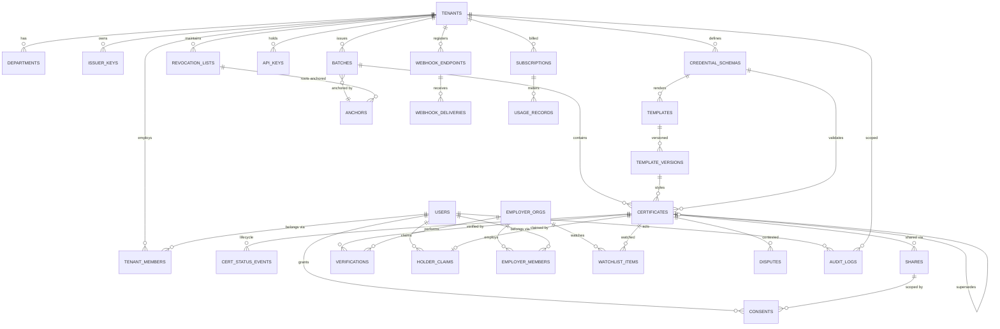

# 14. Database Planning

PostgreSQL 16. Multi-tenancy via `tenant_id` column + **row-level security** on every tenant-scoped table. All PKs are UUIDv7 (time-ordered). All timestamps `timestamptz` UTC. PII columns (marked ※) use field-level encryption (pgcrypto/app-layer AES-GCM with KMS data keys).

## 14.1 ER Diagram

## 14.2 Tables

### Identity & Tenancy

| Table | Key columns | Notes |
|---|---|---|
| `users` | id, email※ (uniq, citext), phone※, password_hash (nullable for OTP-only), mfa_secret※, status, locale, holder_did, created_at | Both staff and holders; role comes from membership tables |
| `tenants` | id, legal_name, slug (uniq), type (university/college/certifier/enterprise), status (pending_kyb/active/suspended/offboarded), accreditation_body, accreditation_ref, domain, domain_verified_at, issuer_did (uniq), region, settings jsonb | Institution = tenant |
| `departments` | id, tenant_id FK, name, parent_id FK nullable | Sub-org tree |
| `tenant_members` | id, tenant_id FK, user_id FK, department_id FK nullable, role (owner/issuer_admin/operator/approver/viewer), invited_by, status | UNIQUE(tenant_id, user_id) |
| `issuer_keys` | id, tenant_id FK, kms_key_ref, public_key_jwk jsonb, algorithm, status (active/rotating/revoked), valid_from, valid_until, chain_tx_hash | Key history mirrors on-chain registry |
| `employer_orgs` / `employer_members` | analogous to tenants/members with roles (admin/verifier) | Verifier side |
| `api_keys` | id, owner_type (tenant/employer), owner_id, name, key_hash (uniq), scopes text[], environment (sandbox/prod), rate_limit_override jsonb, last_used_at, revoked_at | Plaintext never stored |

### Credential Definition

| Table | Key columns | Notes |
|---|---|---|
| `credential_schemas` | id, tenant_id FK, name, version int, json_schema jsonb, vc_context jsonb, disclosure_flags jsonb, status (draft/published/retired) | UNIQUE(tenant_id, name, version) |
| `templates` | id, tenant_id FK, department_id FK, schema_id FK, name, status | Design container |
| `template_versions` | id, template_id FK, version int, layout jsonb, assets jsonb, published_at, published_by FK | Immutable once published; certs pin this |

### Issuance & Certificates

| Table | Key columns | Notes |
|---|---|---|
| `batches` | id, tenant_id FK, template_version_id FK, schema_id FK, name, status (draft/validating/validated/pending_approval/approved/signing/anchoring/anchored/failed/partially_failed), row_count, error_report jsonb, source (ui/api/sftp), scheduled_at, anchor_id FK nullable, created_by, approved_by[] | State machine enforced in app + CHECK |
| `certificates` | id, tenant_id FK, batch_id FK, schema_id FK, template_version_id FK, holder_claim_id FK nullable, **cert_uid** (public non-guessable ID, uniq), subject_data_enc※ (jsonb encrypted), subject_index (blind-indexed columns for search: name_bi, roll_bi, dob_bi), content_hash bytea, salt_enc※, merkle_leaf_index int, merkle_proof jsonb, vc_document jsonb (signed VC, PII-minimized), artifact_s3_key, artifact_ipfs_cid nullable, status (issued/claimed/revoked/superseded/suspended/expired), status_list_index bigint, supersedes_id FK nullable, superseded_by_id FK nullable, expires_at nullable, legacy_attested bool, issued_at | **Partitioned by (tenant_id hash, issued_at range)** |
| `cert_status_events` | id, certificate_id FK, event (issued/claimed/revoked/…), reason_code, reason_visibility, actor_user_id, actor2_user_id (two-person ops), evidence_ref, chain_tx_hash nullable, created_at | Append-only lifecycle timeline |
| `holder_claims` | id, certificate_id FK (uniq), user_id FK, method (otp_email/otp_sms), identity_fields_matched jsonb, claimed_at | One claim per cert |
| `disputes` | id, certificate_id FK, opened_by FK, category, description, evidence_s3_keys, status (open/issuer_review/resolved_upheld/resolved_rejected/escalated), resolution_event_id FK, sla_due_at | UC-09 |

### Blockchain

| Table | Key columns | Notes |
|---|---|---|
| `anchors` | id, chain_id int, contract_addr, merkle_root bytea (uniq per chain), anchor_type (issuance/status_list/audit_log), tx_hash, block_number, block_time, status (queued/submitted/confirmed/finalized/reorged), gas_used, gas_cost_wei, submitted_at, finalized_at | FSM per FR-BC-006 |
| `revocation_lists` | id, tenant_id FK, list_uri, bitstring_s3_key, current_root bytea, size, anchor_id FK, updated_at | W3C Bitstring Status List |
| `chain_wallets` | id, purpose (relayer), kms_key_ref, address, min_balance_wei, last_balance_wei, last_checked_at | Ops monitoring |

### Sharing, Verification, Consent

| Table | Key columns | Notes |
|---|---|---|
| `shares` | id, certificate_id FK, created_by FK, token_hash (uniq), disclosed_fields text[], expires_at, max_views int, view_count int, pin_hash nullable, revoked_at | Token itself never stored |
| `verifications` | id, certificate_id FK, share_id FK nullable, employer_org_id FK nullable, channel (qr/url/file/api/bulk), verdict, checks jsonb, verifier_meta jsonb (volunteered only), geo_coarse, created_at | **Partitioned by created_at (monthly)**; feeds analytics |
| `consents` | id, user_id FK, subject_type (share/credential_request/digilocker_push), subject_id, scope jsonb, purpose, granted_at, expires_at, revoked_at | AUD-004 evidence |
| `credential_requests` | id, employer_org_id FK, holder_user_id FK, requested_type, requested_fields text[], purpose, retention_days, status (pending/approved/declined/expired/revoked), consent_id FK | UC-08 |
| `watchlist_items` | id, employer_org_id FK, certificate_id FK, created_at, UNIQUE(org, cert) | Revocation alerts |

### Platform

| Table | Key columns | Notes |
|---|---|---|
| `webhook_endpoints` | id, owner_type/owner_id, url, secret_enc※, events text[], status | Egress-proxied delivery |
| `webhook_deliveries` | id, endpoint_id FK, event_id, event_type, payload jsonb, attempt int, status (pending/delivered/failed/dlq), response_code, next_retry_at | Replayable |
| `notifications` | id, user_id FK, channel, template, payload jsonb, status (queued/sent/delivered/bounced), provider_ref | Bounce handling |
| `audit_logs` | id, tenant_id FK nullable, actor_type (user/api_key/system), actor_id, action, resource_type, resource_id, before jsonb, after jsonb, ip, user_agent, trace_id, day_hash_chain bytea, created_at | **Append-only** (no UPDATE/DELETE grants; trigger-blocked); daily hash anchored |
| `kyb_reviews` | id, tenant_id FK, documents jsonb, status, reviewer_id, decision_reason, sla_due_at | ADM-002 |
| `fraud_cases` | id, source (flag/ai/admin), certificate_id FK nullable, tenant_id FK nullable, risk_score, status, assignee_id, outcome, notes jsonb | UC-11 |
| `feature_flags` | key, description, default_value, overrides jsonb (per tenant/plan) | ADM-006 |
| `subscriptions` | id, owner_type/owner_id, plan, status, provider (stripe/razorpay), provider_ref, period_start/end | Billing |
| `usage_records` | id, owner_id, metric (certs_issued/verifications/api_calls/storage), quantity, period, source_ref | Metered, reconciled |
| `dsr_requests` | id, user_id FK, type (erasure/access/correction), status, due_at, evidence jsonb | ADM-014 |

## 14.3 Relationships (cardinality summary)

- `tenants 1—N batches 1—N certificates`; `certificates N—1 template_versions`, `N—1 credential_schemas`.
- `batches N—1 anchors` (many batches may share one anchor tx via multi-root anchoring); `revocation_lists N—1 anchors` over time.
- `certificates 1—0..1 holder_claims 1—N users` (a user holds many certs; a cert has at most one claimant).
- `certificates` self-reference: `supersedes_id` / `superseded_by_id` (correction chain, UC-06).
- `verifications N—1 certificates`, optional N—1 `shares` and `employer_orgs`.
- `consents` referenced by `shares`, `credential_requests`, DigiLocker pushes — every disclosure has a consent row.

## 14.4 Indexes

| Table | Index | Purpose |
|---|---|---|
| certificates | UNIQUE (cert_uid) | Public verification lookup (hot path) |
| certificates | (tenant_id, batch_id) · (tenant_id, status) · (holder_claim_id) | Console lists, wallet |
| certificates | (content_hash) | File-upload verification |
| certificates | blind-index columns (name_bi, roll_bi) partial per tenant | Encrypted-PII search without plaintext |
| certificates | (expires_at) WHERE expires_at IS NOT NULL | Expiry sweeps |
| anchors | UNIQUE (chain_id, merkle_root) · (status, submitted_at) | Idempotent anchoring, queue monitoring |
| verifications | (certificate_id, created_at DESC) · BRIN (created_at) | Per-cert analytics; partition-friendly scans |
| shares | UNIQUE (token_hash) · (certificate_id) WHERE revoked_at IS NULL | Share resolution |
| audit_logs | (tenant_id, created_at DESC) · (actor_id, created_at DESC) · (resource_type, resource_id) | Audit queries |
| webhook_deliveries | (status, next_retry_at) | Retry scheduler |
| users | UNIQUE (lower(email)) | Login |
| api_keys | UNIQUE (key_hash) | Auth hot path |
| usage_records | (owner_id, metric, period) | Billing rollups |

## 14.5 Constraints & Integrity Rules

- **RLS on every tenant-scoped table**: `USING (tenant_id = current_setting('app.tenant_id')::uuid)`; platform-admin role bypass is explicit and audited.
- **CHECK constraints:** batch/certificate/anchor status values; `view_count <= max_views`; `expires_at > issued_at`; `supersedes_id <> id`.
- **FK policies:** `ON DELETE RESTRICT` everywhere except user-owned convenience rows (shares → cascade on cert redaction path); certificates are never hard-deleted — erasure = PII column shredding (subject_data_enc, salt_enc nulled + key destroyed) leaving non-identifying skeleton + hash.
- **Append-only enforcement:** `audit_logs`, `cert_status_events`, `verifications`, `consents` — REVOKE UPDATE/DELETE + BEFORE trigger raising exception; nightly export to S3 Object Lock (WORM).
- **Two-person rule:** revocation event rows require distinct `actor_user_id ≠ actor2_user_id` (CHECK + app enforcement).
- **Partitioning:** `certificates` (hash by tenant_id, range by issued_at year), `verifications` (monthly range) — supports NFR-SCA-01/05 and cheap retention drops.
- **Migrations:** additive-first, backward compatible across one deploy generation (NFR-AVL-06).
