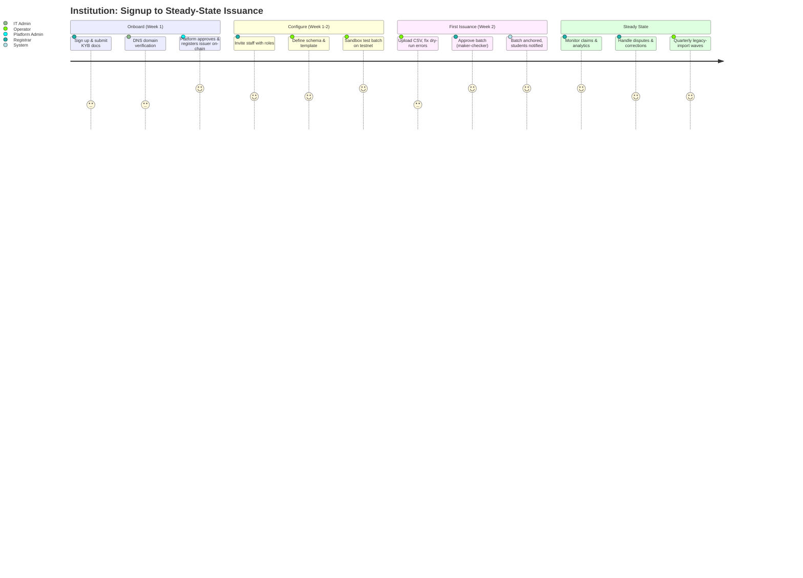
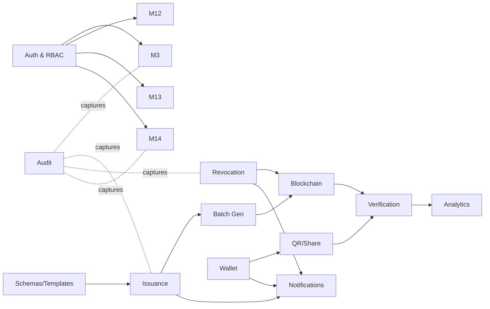
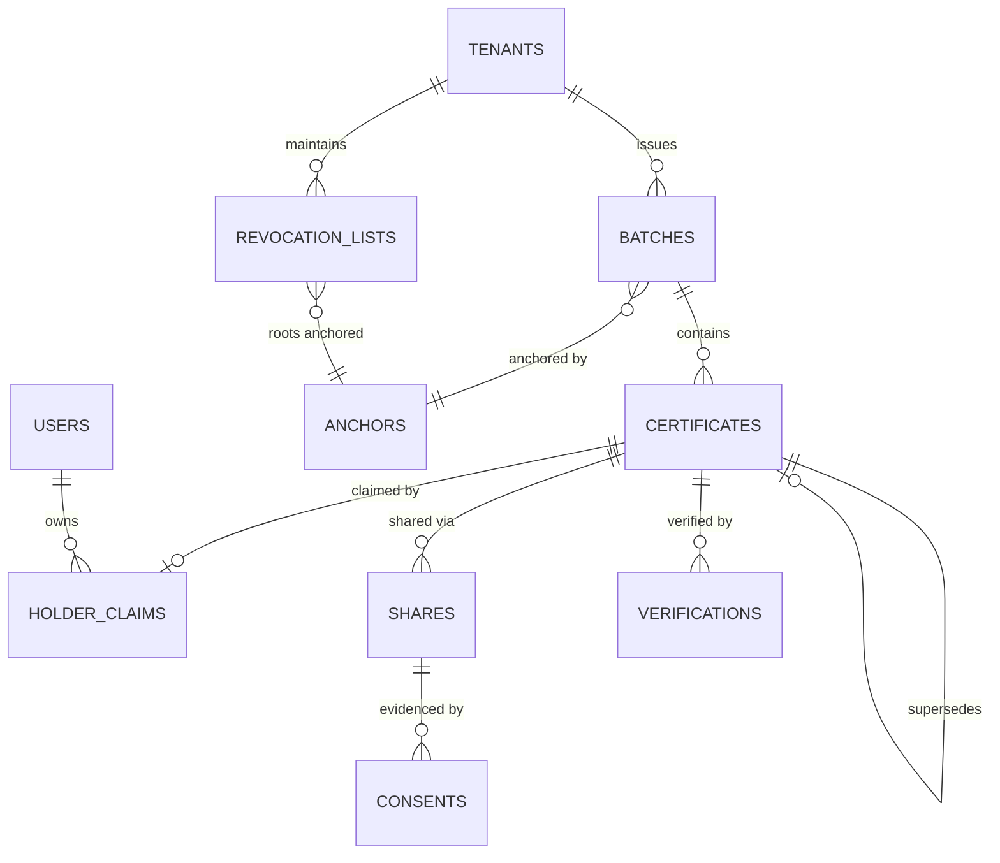

# TrustChain — Product Requirements Document & Software Requirements Specification

**Blockchain-Based Certificate Verification Platform**

| Field | Value |
|---|---|
| Document | Combined PRD + IEEE 830 SRS |
| Version | 1.0 |
| Date | July 2026 |
| Status | Baseline for development (Gate 0 approved) |
| Source of truth | [Research & Planning set](../planning/00-README.md) — this document refines, never contradicts |
| Audience | Engineering, product, QA, security, leadership, external reviewers |

---

## Table of Contents

**Document 1 — Product Requirements Document (PRD)**
1. [Executive Summary](#p1-executive-summary)
2. [Problem Statement](#p2-problem-statement)
3. [Proposed Solution](#p3-proposed-solution)
4. [Stakeholders](#p4-stakeholders)
5. [User Personas](#p5-user-personas)
6. [User Journeys](#p6-user-journeys)
7. [Functional Modules](#p7-functional-modules)
8. [Feature Prioritization (MoSCoW)](#p8-feature-prioritization-moscow)
9. [Product Roadmap](#p9-product-roadmap)
10. [Risks](#p10-risks)
11. [Assumptions, Dependencies, Constraints, Success Factors](#p11-assumptions-dependencies-constraints-success-factors)

**Document 2 — IEEE 830 Software Requirements Specification (SRS)**
1. [Introduction](#s1-introduction)
2. [Overall Description](#s2-overall-description)
3. [System Features](#s3-system-features)
4. [External Interface Requirements](#s4-external-interface-requirements)
5. [Functional Requirements](#s5-functional-requirements)
6. [Non-Functional Requirements](#s6-non-functional-requirements)
7. [Security Requirements](#s7-security-requirements)
8. [Business Rules](#s8-business-rules)
9. [Data Requirements](#s9-data-requirements)
10. [Error Handling](#s10-error-handling)
11. [Reporting Requirements](#s11-reporting-requirements)
12. [Compliance Requirements](#s12-compliance-requirements)
13. [Quality Attributes](#s13-quality-attributes)
14. [Future Enhancements](#s14-future-enhancements)
15. [Appendices](#s15-appendices)

---

---

# DOCUMENT 1 — PRODUCT REQUIREMENTS DOCUMENT

---

## P1. Executive Summary

### 1.1 Vision

A world where any credential — degree, diploma, marksheet, professional certification — can be trusted instantly by anyone, anywhere, forever, without depending on the goodwill, uptime, or continued existence of any single organization.

### 1.2 Mission

Give institutions a certificate-lifecycle platform that makes forgery cryptographically impossible to hide, gives holders lifelong ownership of their achievements, and reduces verification from days of manual effort to seconds of automatic proof — while keeping blockchain complexity completely invisible to every user.

### 1.3 Product Overview

TrustChain is a **multi-tenant SaaS platform** with four user-facing surfaces and a blockchain trust layer:

| Surface | Users | Purpose |
|---|---|---|
| Issuer Console | Institutions (registrars, operators, approvers) | Design templates, issue single/bulk certificates, revoke, correct, analyze |
| Holder Wallet (PWA) | Students, alumni, professionals | Claim, hold, share, and control credentials for life |
| Public Verification Page | Anyone (no account) | Scan QR / open URL / upload file → cryptographic verdict in < 3 s |
| Employer Portal + API | Employers, background-check firms, admissions | Bulk and automated verification, watch lists, ATS integration |
| Platform Admin Console | TrustChain operations | Tenant KYB, anchoring ops, fraud cases, compliance tooling |

Under the hood, every certificate is a **W3C Verifiable Credential 2.0**, hashed (salted SHA-256), batched into a **Merkle tree**, and anchored to **Polygon PoS** via three minimal smart contracts (IssuerRegistry, CertificateAnchor, RevocationRegistry). Personal data never touches the chain. Verification works even if TrustChain itself disappears, via an open-source verifier and public on-chain data.

### 1.4 Background

Planning research ([02-market-research.md](../planning/02-market-research.md)) established that:

- Certificate fraud is an industrial-scale problem; manual verification costs $10–$100+ and takes days.
- India's DigiLocker/NAD/ABC ecosystem (110+ crore records) is trusted but centralized, jurisdiction-locked, and offers no issuer-independent cryptographic proof — TrustChain integrates with it rather than competing.
- First-generation blockchain systems (Blockcerts, MIT pilot, OpenCerts) proved the concept but failed on revocation, issuer identity, enterprise UX, and vendor survivability (the Learning Machine → Hyland shutdown stranded customers).
- The winning design is a hybrid: open standards (W3C VC) + public-chain anchors + enterprise SaaS product quality.

### 1.5 Business Objectives

| # | Objective | Measure | Horizon |
|---|---|---|---|
| BO-1 | Launch GA on Polygon mainnet | M6 milestone shipped | Month 3 |
| BO-2 | Establish issuer base | 10 active institutions, 100k certificates | Month 12 |
| BO-3 | Establish verification demand | 250k verifications, ≥40% via API | Month 12 |
| BO-4 | Achieve enterprise readiness | SSO, API, webhooks, 99.9% SLA, SOC 2 Type I | Month 9 |
| BO-5 | Secure ecosystem legitimacy | DigiLocker bridge or regulator pilot accepted | Month 9–12 |
| BO-6 | Prove unit economics | < $0.005 chain cost/cert; path to 80% gross margin | Month 12 |

### 1.6 Success Metrics

Inherited from planning KPIs ([01-executive-summary.md §1.7](../planning/01-executive-summary.md)) — the operational dashboard tracks:

- **Adoption:** active issuing institutions; time-to-first-issuance < 5 business days; holder claim rate ≥ 60%.
- **Trust:** zero platform-attributable forgery incidents; credentials verify in ≥ 2 third-party W3C VC verifiers.
- **Performance:** verification p95 < 3 s; anchoring p95 < 15 min; revocation propagation ≤ 5 min.
- **Reliability:** verification-path uptime 99.9%; batch anchor success ≥ 99.5%.
- **Security:** zero unresolved critical/high vulnerabilities; two clean contract audits.
- **Experience:** issuer-admin NPS ≥ 45; claim-flow completion without support ≥ 90%.

### 1.7 Product Scope

#### In Scope (Phases 1–3)

1. Multi-tenant institution onboarding with KYB/accreditation review and on-chain issuer registry.
2. Credential schema & template management mapped to W3C VC 2.0 (+ Open Badges 3.0 export).
3. Single and bulk (≥ 50,000 rows) issuance with dry-run validation, duplicate detection, maker-checker approval.
4. Merkle-batch anchoring on Polygon PoS with relayer-managed gas (users never touch crypto).
5. Public verification (QR, URL, ID lookup, file upload) with seven distinct verdict states.
6. On-chain revocation (Bitstring Status List), suspension, expiry, supersede-and-reissue correction.
7. Holder wallet: OTP claim, multi-institution wallet, share links (expiry/views/PIN/field selection), disputes, data portability.
8. Employer portal: org accounts, bulk verify, watch lists, verification history, fraud flagging.
9. Public REST API v1 (OpenAPI 3.1), GraphQL for dashboards, signed webhooks, sandbox environment.
10. Platform administration: KYB queue, tenant lifecycle, anchoring ops, fraud cases, DSR console, feature flags.
11. Notifications (email/SMS/in-app), analytics dashboards, audit logging with on-chain tamper evidence.
12. Billing (tiers, metering, Stripe + Razorpay, GST invoices); free-forever holder wallet and public verification.
13. Compliance: DPDP (India), GDPR, WCAG 2.2 AA, data residency (ap-south-1), SOC 2 program.
14. Open-source standalone verifier (CLI/library) + public subgraph — vendor-independence guarantee.

#### Out of Scope (explicit non-goals)

1. Cryptocurrency/token features, user-facing gas payments, or NFT (transferable) certificates — credentials are non-transferable attestations.
2. Learning delivery, assessment, or proctoring.
3. General-purpose national identity; TrustChain consumes DIDs/SSO, it does not mint citizen identity.
4. Background-check investigation services (employment history, references).
5. On-chain storage of documents or PII of any kind.
6. Operating a permissioned consortium chain (a private-deployment SKU is future vision, not scope).
7. Native mobile apps at GA (PWA covers mobile; native apps are Phase-3+ candidates).

---

## P2. Problem Statement

### 2.1 Existing Verification Problems

The credential-trust chain today has a single weak link everywhere: **the verifier must contact or trust the issuer (or a central intermediary) for every check.** This makes verification slow, expensive, unscalable, and fragile — and it collapses entirely when the issuer is unresponsive, defunct, or complicit.

### 2.2 Certificate Forgery

- Paper certificates are reproduced with commodity printing; PDF scans are altered in minutes with free tools.
- Forgery detection relies on human inspection of logos, seals, and fonts — precisely the things forgers copy best.
- Diploma mills operate as businesses, selling complete fake credential packages including "verification" phone lines.
- Even genuine-looking verification is spoofable: a forged certificate can carry a QR pointing to a fake "verification" site the forger controls.

### 2.3 Manual Verification

- Employers email or call registrar offices; typical turnaround is 3–15 business days per credential.
- Background-check vendors charge ₹1,000–₹8,000 (~$12–$100) per verification and still depend on the same manual channels.
- Universities process thousands of inbound verification requests per year with zero attached revenue — pure cost.
- Peak seasons (campus hiring, admissions) create months-long backlogs.

### 2.4 Centralized Systems

- Central repositories (including DigiLocker/NAD) concentrate trust in one operator: their uptime, their database integrity, their jurisdiction.
- A verifier abroad has no way to independently confirm the repository itself hasn't been tampered with or misconfigured.
- Access is gated by national identity systems, excluding cross-border verifiers and private certifiers.
- Vendor-hosted blockchain products (Hyland Credentials) proved that when the vendor exits, verification infrastructure rots.

### 2.5 Delayed Validation

- Offer letters, visa applications, admissions, and professional licensing all stall on credential checks.
- Candidates lose offers to verification delays; institutions lose applicants; employers lose hiring velocity.
- Delay creates pressure to skip verification entirely — studies consistently find a double-digit percentage of resumes contain credential misrepresentation that is never checked.

### 2.6 Fake Universities

- Verifying a certificate is only half the problem; verifying that the *issuer* is a real, accredited institution is the other half.
- Fake universities issue internally "consistent" certificates that pass any check that doesn't consult an accreditation registry.
- No mainstream verification flow surfaces accreditation status at the moment of verification.

### 2.7 Employer Pain Points

| Pain | Consequence |
|---|---|
| Days-to-weeks turnaround per credential | Slow hiring, lost candidates |
| High per-check cost | Verification skipped for "low-risk" roles → fraud slips through |
| No integration with ATS/HRMS | Manual copy-paste workflows, no audit trail |
| No post-hire monitoring | Revoked/withdrawn credentials go unnoticed after hiring |
| No reliable issuer-legitimacy signal | Diploma-mill degrees pass superficial checks |

### 2.8 Student Pain Points

| Pain | Consequence |
|---|---|
| Credentials live in institutional silos | Repeated transcript requests, fees, courier delays |
| Loss/damage of paper originals | Costly, slow reissuance; sometimes impossible for closed institutions |
| All-or-nothing sharing | Sharing a marksheet exposes every grade to see one qualification |
| No visibility | No idea who has viewed or re-shared their documents |
| Cross-border friction | Foreign verifiers can't or won't navigate home-country processes |
| College email expiry | Loss of access to digital records after graduation |

### 2.9 Institution Pain Points

| Pain | Consequence |
|---|---|
| Perpetual unfunded verification workload | Registrar staff consumed by inbound checks |
| Brand damage from forgeries in circulation | Reputation risk they cannot see or control |
| Error correction is ad hoc | Reissued certificates create two "originals" with no authoritative chain |
| Compliance pressure (NEP 2020, NAD) | Mandates arriving faster than internal IT capacity |
| Legacy records on paper | Decades of alumni records unverifiable at scale |
| No control evidence | Malpractice investigations lack tamper-proof issuance logs |

---

## P3. Proposed Solution

TrustChain answers each problem class with a specific, testable mechanism. The design maxim from planning holds throughout: **the chain stores trust, not data.**

### 3.1 Blockchain (Polygon PoS anchor layer)

- Every issuance batch commits a single 32-byte Merkle root to a public chain that no institution, vendor, or government controls.
- Verifiers get proof that is **issuer-independent and vendor-independent**: even if TrustChain and the institution both vanish, the anchor persists and the open-source verifier can validate a credential against it (planning UC-14).
- Solves: centralized-system fragility, vendor-death risk, cross-border trust.

### 3.2 Smart Contracts (three minimal contracts)

| Contract | Trust question it answers |
|---|---|
| **IssuerRegistry** | "Is this issuer real, accredited, and was this signing key valid at issuance time?" — kills fake universities at verification time; supports key rotation and regulator suspension |
| **CertificateAnchor** | "Did this exact content exist, issued by this issuer, at this time?" — Merkle roots, append-only, duplicate-rejecting |
| **RevocationRegistry** | "Is it *still* valid?" — on-chain commitments to W3C Bitstring Status Lists; revocation checking that survives issuer death (the flaw that broke Blockcerts) |

Governance: UUPS proxies behind a 3-of-5 multisig + 48 h timelock; pausable writes; two independent audits before mainnet ([15-blockchain-planning.md](../planning/15-blockchain-planning.md)).

### 3.3 Cryptographic Hashes

- Certificate content is canonicalized (JCS) and hashed with **salted SHA-256**; the salt prevents dictionary attacks linking public hashes to guessable PII (roll numbers, names).
- Domain-separated Merkle hashing (`leaf = H(0x00‖salt‖certHash)`, `node = H(0x01‖L‖R)`) prevents second-preimage and proof-ambiguity attacks.
- Any single-character alteration of a certificate changes its hash → **TAMPERED** verdict. Forgery is not "hard to detect"; it is mathematically self-announcing.
- Erasure compatibility: destroying the off-chain salt renders the on-chain hash permanently unlinkable to a person — resolving the GDPR/DPDP right-to-erasure vs. immutability conflict.

### 3.4 QR Verification

- Every rendered certificate embeds a QR encoding its verification URL + certificate UID.
- Scan → verdict in < 3 s, no account, no app install, no crypto knowledge. Seven explicit verdict states (VALID / REVOKED / SUPERSEDED / EXPIRED / TAMPERED / UNKNOWN ISSUER / SUSPENDED ISSUER) with plain-language explanations.
- Anti-spoofing: verdicts are meaningful only on the canonical domain; the verdict page shows issuer registry status and anchor transaction links; verifiers can download a machine-readable proof bundle and re-verify independently — a fake site cannot fake the chain.

### 3.5 Wallet Authentication

Two deliberate layers, per the planning decision that end users never handle crypto wallets:

1. **Platform wallet (default):** holders authenticate with email/OTP + optional TOTP MFA; each holder gets a platform-managed DID (did:key). Zero seed phrases, zero gas — the relayer service signs and pays for all chain transactions from KMS-held keys.
2. **BYO wallet (future/optional):** holders may link a self-managed DID or an external wallet (e.g., MetaMask signature challenge) to bind credentials self-sovereignly, and standards wallets will interoperate via OIDC4VCI/VP. This is additive; it is never required.

Issuer signing keys are HSM-backed (AWS KMS), non-exportable, rotated on-chain — institutional "wallet security" is a managed service, not a registrar's browser extension.

### 3.6 Immutable Records

- Anchors and status roots are append-only facts; the contracts reject mutation, and invariant tests + audits enforce that upgrades can never rewrite history.
- Corrections never delete: the **supersede-and-reissue chain** links old → new certificates, so every version of the truth remains inspectable (fixing the "two originals" problem).
- Platform audit logs are append-only with daily hash roots anchored on-chain — even TrustChain's own operational history is tamper-evident.

### 3.7 Instant Verification

| Old world | TrustChain |
|---|---|
| 3–15 business days | < 3 seconds (p95) |
| ₹1,000–₹8,000 per check | Free (public) / fractions of a rupee (API at volume) |
| Email threads, phone calls | QR scan, URL, file upload, or one REST call |
| No issuer-legitimacy signal | Accreditation + registry status in every verdict |
| Point-in-time only | Watch lists push revocation alerts after hiring |
| Trust the process | Verify the math — independently, forever |

### 3.8 Problem → Solution Traceability

| Problem (P2) | Solving mechanism (P3) |
|---|---|
| Forgery | Salted hashes + Merkle anchors (3.3, 3.1) → TAMPERED verdict |
| Manual verification | QR/URL/API instant verification (3.4, 3.7) |
| Centralized systems | Public-chain anchors + open verifier (3.1, 3.2) |
| Delayed validation | < 3 s verdicts; bulk + ATS APIs (3.7) |
| Fake universities | On-chain IssuerRegistry + KYB + regulator attestation (3.2) |
| Employer pain | Employer portal, watch lists, attestation PDFs, API (3.7) |
| Student pain | Lifelong wallet, selective disclosure, share controls (3.5) |
| Institution pain | Bulk issuance, maker-checker, supersede chain, analytics, legacy import (3.6) |

---

## P4. Stakeholders

### 4.1 Student / Holder

| Aspect | Detail |
|---|---|
| Responsibilities | Claim issued credentials; keep contact identity current; manage shares and consents responsibly; raise disputes honestly |
| Goals | Lifelong portable proof of achievements; instant sharing; privacy control; zero cost |
| Pain points | Siloed records, lost originals, all-or-nothing sharing, college-email expiry, cross-border friction |
| Permissions | Own wallet only: view/download own credentials, create/revoke shares, select disclosed fields, open disputes, export/erase own data. Cannot alter credential content or status |

### 4.2 Institution (College / Certification Body)

| Aspect | Detail |
|---|---|
| Responsibilities | Truthful issuance; data quality; maker-checker discipline; timely dispute adjudication; key custody decisions; DPDP-compliant handling of holder data |
| Goals | Eliminate forgery of their brand; cut verification workload ~90%; comply with NEP-2020/NAD; modernize alumni services |
| Pain points | Unfunded verification burden, forgery brand damage, legacy paper archives, audit exposure |
| Permissions | Tenant-scoped: manage own templates/schemas, issue/revoke/supersede own certificates (role-gated), manage own members and settings, view own analytics and audit logs. Cannot see other tenants; cannot un-revoke; cannot bypass approval policy |

### 4.3 University (as both issuer and verifier)

Universities inherit all Institution attributes and additionally act as **verifiers** (admissions, credit transfer). Extra goals: validate incoming transcripts instantly, map credits (ABC alignment). Extra permissions: employer-style verification features under the same tenant. Pain point: transfer-student transcript fraud and slow inter-university confirmation.

### 4.4 Employer

| Aspect | Detail |
|---|---|
| Responsibilities | Verify with candidate consent where non-public data is involved; honor consent scope and retention; report suspected fraud responsibly |
| Goals | Seconds-fast, cheap, legally defensible verification inside existing hiring tools; post-hire revocation monitoring |
| Pain points | Cost/turnaround of background checks, no ATS integration, diploma mills, no post-hire signal |
| Permissions | Verify public/shared credentials; bulk verify; maintain org verification history; watch lists; request credentials (consent-gated); flag suspicious certificates. Cannot access undisclosed fields or issuer internals |

### 4.5 Verifier (ad-hoc third party)

Embassies, licensing boards, landlords, scholarship committees. Responsibilities: none beyond honest use. Goals: unambiguous verdict with zero onboarding. Pain points: no expertise, no accounts, sometimes low bandwidth. Permissions: anonymous access to public verification surfaces only; rate-limited; may self-identify for holder visibility.

### 4.6 Government / Accreditation Agencies (UGC, AICTE, boards, ministries)

| Aspect | Detail |
|---|---|
| Responsibilities | Accreditation truth (optionally attested on-chain); policy setting; oversight without operating burden |
| Goals | Fraud reduction at national scale; DigiLocker/NAD complementarity; data sovereignty; visibility into issuance/fraud patterns |
| Pain points | Fake universities operating openly; no real-time oversight instrument; cross-jurisdiction fraud |
| Permissions | Read-only regulator portal (aggregates, never raw PII); REGULATOR_ROLE on-chain: attest issuers, trigger accreditation-status changes via governed process. Cannot view or alter individual holder data |

### 4.7 System Administrator (TrustChain platform operations)

| Aspect | Detail |
|---|---|
| Responsibilities | KYB review integrity; anchoring/relayer operations; incident response; fraud-case handling; DSR execution; SLA delivery |
| Goals | Healthy tenants, green SLOs, zero security incidents, low support burden |
| Pain points | Abuse attempts, alert noise, surge events (convocation days), chain/RPC instability |
| Permissions | Highest platform privileges, but engineered least-privilege: MFA + IP allowlist console, JIT elevation, watermarked read-only impersonation, dual-control for destructive ops, every action audit-logged and tamper-evidenced. Cannot silently modify certificates or logs (append-only + on-chain log anchoring make it detectable) |

---

## P5. User Personas

### Persona 1 — Dr. Meena Rao, Controller of Examinations (Issuer Approver)

| Attribute | Detail |
|---|---|
| Background | 52, PhD, 24 years in university administration; runs exams and records for a 20,000-student engineering university; issues ~6,000 degrees + 40,000 marksheets/year |
| Goals | Zero forged certificates bearing her university's name; cut the 30+ weekly verification emails to zero; a defensible audit trail for every issuance decision |
| Motivations | Institutional reputation; NEP-2020/NAD compliance recognition; leaving a modernization legacy |
| Challenges | Distrustful of "crypto"; needs board approval for spending; fears technology that could mis-issue at scale |
| Technology familiarity | Moderate: ERP screens, Excel, email. Will not use anything resembling a crypto wallet |
| Typical workflow | Reviews batch summaries prepared by staff → checks anomalies → approves with her credentials → files the issuance report. Expects maker-checker, expects paper-trail equivalence |

### Persona 2 — Arjun Sharma, Final-Year B.Tech Student (Holder)

| Attribute | Detail |
|---|---|
| Background | 21, CSE student at a Tier-2 college in Telangana; applying simultaneously to Indian IT employers and US grad schools |
| Goals | Degree + marksheets in one place; a link on his resume that recruiters can trust instantly; get his credentials into DigiLocker |
| Motivations | Standing out in a crowded job market; avoiding transcript-courier fees for each US application |
| Challenges | College email expires 6 months after graduation; worried about oversharing grades; unfamiliar with credential standards (and shouldn't need to be) |
| Technology familiarity | High (mobile-first); zero blockchain knowledge; expects OTP-style logins |
| Typical workflow | Gets claim SMS → OTP → wallet on phone → shares link on LinkedIn/resume → checks who viewed it before interviews |

### Persona 3 — Sofia D'Souza, HR Operations Lead (Employer)

| Attribute | Detail |
|---|---|
| Background | 34, leads hiring ops at a 500-hire/year IT services firm in Hyderabad; currently pays ₹2,000/candidate to a background-check vendor with 7-day turnaround |
| Goals | Verification inside her ATS in seconds; bulk-verify campus-hire cohorts; audit evidence for client compliance requirements |
| Motivations | Cost reduction (₹10L+/year), hiring velocity, protecting the firm from a publicized fake-degree incident |
| Challenges | Procurement scrutiny of new vendors; integration bandwidth from IT is scarce; needs legally defensible records |
| Technology familiarity | High as a power user (ATS, Excel, dashboards); not a developer — needs CSV and clean UI paths in addition to API |
| Typical workflow | Offer stage triggers verification → reviews exceptions only → exports attestation PDFs to the client audit file |

### Persona 4 — Vikram Patel, Platform SRE (System Administrator)

| Attribute | Detail |
|---|---|
| Background | 29, SRE with fintech background; owns anchoring pipeline, relayer wallets, and on-call |
| Goals | Green SLOs; anchor queue never > 1 h; every alert actionable with a runbook |
| Motivations | Operational craftsmanship; hates 3 a.m. pages caused by preventable design |
| Challenges | RPC provider flakiness, gas spikes, convocation-day surges, distinguishing attack traffic from viral legitimate traffic |
| Technology familiarity | Expert: Kubernetes, Terraform, Grafana, EVM mechanics |
| Typical workflow | Morning SLO review → queue/wallet-balance dashboard → drill failures via traces → game-day drills monthly |

### Persona 5 — Joint Secretary Iyer, Higher Education Department (Government)

| Attribute | Detail |
|---|---|
| Background | 48, IAS officer overseeing higher-education digitization in a large state; accountable for NEP-2020 rollout |
| Goals | Fewer fake-degree scandals; complementarity with DigiLocker/APAAR (not competition); data kept in-country |
| Motivations | Measurable governance wins; safe innovation (no crypto headlines) |
| Challenges | Procurement rules; political sensitivity to "blockchain" framing; needs aggregate visibility without touching student PII |
| Technology familiarity | Low-moderate; consumes dashboards and briefs |
| Typical workflow | Quarterly review of issuance/fraud aggregates → policy directives → sponsors regulator attestation of accredited issuers |

### Persona 6 — Priya Nair, Registrar Office Data-Entry Operator (Issuer Operator)

| Attribute | Detail |
|---|---|
| Background | 26, contract staff handling exam-records data; the person who actually uploads the CSVs |
| Goals | Get 8,000-row batches through validation without rework; clear error messages; never be blamed for a bad issuance |
| Motivations | Job performance; fear of irreversible mistakes (relieved by maker-checker — she can't finalize anything alone) |
| Challenges | Messy source data (name spellings, transliteration); deadline pressure before convocation |
| Technology familiarity | Moderate: Excel expert, ERP data entry |
| Typical workflow | Export from ERP → clean in Excel → upload → fix rows flagged by dry-run → submit for approval → track batch status notifications |

---

## P6. User Journeys

### 6.1 Institution Journey — from signup to steady state



**Key moments:** approval unlock (KYB pass → on-chain registration), first anchored batch (< 5 business days from signup per KPI), first "we didn't get any verification emails this month" realization — the retention moment.

### 6.2 Student Journey — from claim to career

1. **Notification:** SMS/email at issuance → claim link.
2. **Claim (2 min):** OTP + identity-field match → certificate lands in wallet. Failure path: mismatch → guided dispute to issuer.
3. **First share:** creates link for a recruiter, sets 30-day expiry; adds badge to LinkedIn.
4. **Privacy moment:** shares degree *without* marksheet grades to one employer (selective disclosure), full transcript to grad school.
5. **Lifecycle events:** email migration after college address expires; sees view-events before interviews; years later, downloads VC JSON to use in a national wallet; requests DigiLocker push.
6. **Edge journeys:** dispute over name spelling → supersede-reissue → old links show SUPERSEDED pointing forward; account erasure on request with anchors rendered unlinkable.

### 6.3 Employer Journey — from ad-hoc to integrated

1. **Ad-hoc (day 1):** recruiter scans a candidate's QR → VALID verdict with issuer accreditation → done, zero onboarding.
2. **Team (week 1):** creates employer org; verification history shared across recruiters; flags one suspicious PDF (TAMPERED) — case filed.
3. **Bulk (season):** uploads 500-candidate CSV before campus offers; reviews the 3% exceptions only.
4. **Integrated (quarter 1):** API keys scoped `verify:read`; ATS triggers verification at offer stage; watch lists arm post-hire revocation alerts; attestation PDFs auto-filed.
5. **Trust ceiling:** compliance team re-verifies a sample via the open-source CLI against public chain data — accepts TrustChain evidence as issuer-independent.

### 6.4 Administrator Journey — a platform admin's day

1. Morning: SLO dashboard green; anchor queue depth normal; one relayer wallet below threshold → funds via runbook.
2. KYB queue: approves two colleges (accreditation verified), requests documents from one ambiguous applicant.
3. Incident: verification-burst alert — traces show a viral job-portal integration, not attack; raises tenant quota instead of blocking.
4. Fraud case: employer flag on a certificate; risk score elevated (prior flags on same issuer operator); opens investigation with the institution; outcome: institution revokes (two-person rule), case closed with evidence chain.
5. Compliance: executes one DSR erasure — PII shredded, salts destroyed, evidence recorded; audit log day-root anchors on schedule.

### 6.5 Verifier Journey — the 30-second embassy check

1. Visa officer receives a printed degree with QR → scans with phone camera (no app).
2. Verdict page: VALID, issuer "XYZ University — accredited (UGC), active", issued 2024-06-30, anchor tx link, disclosed fields only.
3. Officer taps "explain this verdict" → plain-language checklist of what was cryptographically proven.
4. Optionally downloads the proof bundle and attaches it to the case file; the bundle can be re-verified years later, offline from TrustChain.
5. Alternate ending: verdict REVOKED (reason: "superseded — corrected certificate exists") → officer requests the successor certificate; fraud path: TAMPERED → officer files with the fraud-report button.

---

## P7. Functional Modules

Module inventory with responsibilities, key capabilities, and FR-category traceability to [planning doc 04](../planning/04-functional-requirements.md).

| # | Module | Responsibilities & key capabilities | FR trace |
|---|---|---|---|
| M1 | **Authentication & Identity** | Registration, email/OTP/password login, TOTP MFA (mandatory for privileged roles), sessions (15-min JWT + rotating refresh), SSO brokering (OIDC/SAML), API keys with scopes, holder DIDs, device management | AUTH-* |
| M2 | **Role Management (RBAC)** | Predefined roles (Owner, Issuer Admin, Operator, Approver, Viewer, Holder, Verifier, Platform Admin), permission matrix enforcement on every route, custom tenant roles (P2), segregation-of-duties reporting | AUTH-007/008 |
| M3 | **Institution Dashboard** | Tenant home: issuance funnel, claim rates, verification traffic, unclaimed queue, dispute queue, batch statuses, onboarding checklist | INST-*, ANA-001 |
| M4 | **Certificate Issuance** | Single form + bulk CSV/XLSX (50k rows), dry-run row-level validation, duplicate detection, maker-checker (multi-step P2), scheduling, drafts, issuance API, per-batch reports | ISS-* |
| M5 | **Batch Certificate Generation** | Merkle tree construction, VC signing via KMS, PDF/PNG render farm with QR embedding, artifact storage (S3 + optional IPFS), batch state machine (draft→anchored) | ISS-009..012 |
| M6 | **Blockchain Integration** | Relayer (KMS-signed, gasless for users), anchor queue & batching windows, EIP-1559 fee strategy, confirmation/finality FSM, reorg detection & re-anchor, idempotency, gas accounting, chain-adapter abstraction, kill switch | BC-* |
| M7 | **Wallet Management (Holder)** | Claim via OTP + identity match, multi-institution wallet, downloads (PDF/VC/OB3), timeline, profile & DID linkage, account email migration, PWA offline cache | STU-* |
| M8 | **QR & Share Verification** | QR generation at render; share links with expiry/max-views/PIN/field-selection; share revocation; share-activity visibility | TPL-009, STU-005..008 |
| M9 | **Certificate Verification** | Public page + file upload + ID lookup + bulk + API; 7-verdict engine (integrity, Merkle proof, anchor, issuer status, revocation, expiry, binding); proof bundles; open-source verifier; anti-enumeration | VER-* |
| M10 | **Certificate Revocation** | Reason-coded revocation with two-person rule, bulk recall, suspension (reversible), Bitstring Status List publication + on-chain roots, holder notification & appeal, verifier watch-list webhooks | REV-* |
| M11 | **Certificate Renewal & Expiry** | Fixed/period expiry, auto-EXPIRED verdicts, renewal re-attestation linking prior period, expiry reminder campaigns (90/30/7) | REV-007/008, NOT-008 |
| M12 | **Student Dashboard** | Wallet home: credentials, shares, view events, disputes, consents, notification prefs, data export/erasure | STU-*, AUD-004 |
| M13 | **Employer Dashboard** | Org & team management, verification history with verdict snapshots, bulk verify, watch lists, credential requests (consent-gated), usage & billing views | EMP-* |
| M14 | **Admin Dashboard** | KYB queue, tenant lifecycle, anchoring ops, wallet balances, fraud cases, feature flags, rate limits, DSR console, regulator portal (read-only) | ADM-* |
| M15 | **Audit Logs** | Append-only capture of every privileged action (fail-closed), tenant-scoped viewer, daily hash chain anchored on-chain, WORM archival, chain-of-custody exports | AUD-001..003, 012 |
| M16 | **Analytics** | Issuer/platform/fraud/cost dashboards, per-certificate view analytics, funnels, scheduled exports, warehouse export (P3) | ANA-* |
| M17 | **Notifications** | Email/SMS (DLT-compliant)/in-app; lifecycle + security (non-optoutable) events; preferences & digests; bounce handling with issuer-facing undeliverable queue | NOT-* |
| M18 | **Profile Management** | User profile, contact changes with re-verification, institution profile & branding, domain verification | AUTH, INST-003/004 |
| M19 | **Settings** | Tenant defaults (expiry, approval policy), disclosure flags, webhook endpoints, API keys, feature-flag surface, locale | INST-008, API-006 |
| M20 | **Search** | Tenant-scoped certificate/holder search over blind-indexed encrypted fields; global privacy-scoped admin search | ADM-004, NFR-PERF-09 |
| M21 | **Reporting** | Issuance reports, verification reports, audit reports, compliance/GST billing reports, regulator aggregates (see [S11](#s11-reporting-requirements)) | ANA-*, BIL-010 |
| M22 | **Templates & Schemas** | Typed schema editor → VC 2.0 mapping, template designer with versioning, publish workflow, prebuilt library, grading metadata | TPL-* |
| M23 | **Billing & Subscription** | Tiers, metering, Stripe/Razorpay, GST invoices, PO flow, overage grace (verification never blocked) | BIL-* |
| M24 | **AI Services** (Phase 3) | OCR legacy digitization, forgery screening, issuance/verification anomaly detection, risk scoring — always human-in-the-loop | AI-* |

Module dependency sketch:



---

## P8. Feature Prioritization (MoSCoW)

### Must Have (MVP — cannot launch without)

- Tenant onboarding + KYB + on-chain issuer registry
- Schemas/templates (prebuilt), versioning
- Single + bulk issuance (50k), dry-run validation, duplicate detection, maker-checker
- Salted hashing, Merkle batching, Polygon anchoring, relayer, finality FSM, idempotency
- Public verification (QR/URL/file), 7 verdicts, anti-enumeration, < 3 s
- Revocation (two-person, on-chain status list), supersede-and-reissue, expiry
- Holder wallet: claim, share links (expiry/revoke/PIN), PDF + VC JSON download
- Notifications: issuance/claim/revocation/security; batch progress
- REST /v1 core (issuance, verification, proof bundles), sandbox, idempotency keys, scoped API keys
- Append-only audit logging (fail-closed), RLS tenant isolation, PII field encryption
- Platform admin: KYB queue, anchoring ops dashboard, tenant suspend, chain kill switch
- Free holder wallet + free public verification (policy)

### Should Have (GA / fast-follow)

- SSO (OIDC) for tenants; SAML fast-follow
- Selective disclosure (SD-JWT), disclosure flags
- Open-source verifier CLI + public subgraph; Open Badges 3.0 export
- Webhooks platform + management UI; employer org portal + bulk verify; fraud flagging
- Issuer analytics v1; audit log on-chain anchoring; legacy import (CSV-attested)
- Billing tiers + metering + GST invoices; template designer; scheduled issuance
- Dispute/correction case management; unclaimed/bounce management; key rotation UX
- Localization EN+HI; WCAG 2.2 AA audits

### Could Have (post-GA, capacity-permitting)

- Multi-step approval chains; BYO-HSM issuer keys; custom roles
- ATS connectors (Greenhouse/Lever), SIS/ERP import, watch-list webhooks, attestation PDFs
- DigiLocker push bridge; consent-gated credential requests; AI OCR + forgery screening + anomaly detection
- Regulator read-only portal; SOC 2 evidence automation; embeddable verify widget; digests; benchmark analytics

### Won't Have (this product cycle — explicit)

- Tokens, NFTs, transferable certificates, user gas payments
- Native mobile apps (PWA instead); permissioned consortium chain operation
- Autonomous AI revocation/rejection decisions (policy: human-in-the-loop always)
- General identity provision, proctoring/assessment, background-investigation services
- On-chain PII or on-chain document storage (permanent architectural prohibition)

---

## P9. Product Roadmap

### Phase 1 — MVP (Sprints 1–4, weeks 1–9)

Everything in *Must Have*: foundations & identity → issuance pipeline & testnet anchoring → verification & revocation trust loop → holder wallet & claim. Exit: **M4 private beta** — two design-partner institutions issuing on testnet, students claiming and sharing. (Sprint detail: [16-roadmap.md](../planning/16-roadmap.md).)

### Phase 2 — Advanced Features (Sprints 5–6, weeks 10–13 → GA)

Programmability and launch-grade hardening: public API GA + webhooks + sandbox, employer portal, OSS verifier + subgraph, analytics v1, billing, SSO, pentest + second contract audit + key ceremony, compliance pack (DPIA, DSR, residency), localization & accessibility, mainnet cutover. Exit: **M6 GA** — production certificates on Polygon mainnet, 3+ institutions live.

### Phase 3 — Enterprise Features (months 4–12)

- **Privacy pack:** SD-JWT selective disclosure GA, consented credential requests.
- **India ecosystem:** DigiLocker/NAD bridge certification, APAAR mapping.
- **Enterprise pack:** SAML breadth, multi-step approvals, BYO-HSM, SIS/ATS connectors, SLA tiers, SOC 2 Type I→II.
- **AI pack:** OCR digitization, forgery screening, anomaly detection, risk scoring with model governance.
- **Interop pack:** Open Badges 3.0 GA, OIDC4VCI/VP, third-party verifier conformance evidence.

### Future Vision (year 2+)

ZK predicate proofs ("CGPA ≥ 8" without revealing the value, BBS+), EBSI/EU-wallet bridge for cross-border recognition, skill passports & micro-credential stacking aligned to ABC credits, offline verification mode, multi-region active-active, permissioned sovereign-deployment SKU, talent-pool opt-in marketplace, NL verification assistant and issuer copilot.

---

## P10. Risks

Condensed from the full register ([10-risk-analysis.md](../planning/10-risk-analysis.md)); scores = Likelihood × Impact (1–5 each).

| Class | Top risks (score) | Mitigation strategy |
|---|---|---|
| **Technical** | RPC provider outage (12); contract bug (10); issuer-key compromise (10); reorg on anchors (9); bulk pipeline at scale (9) | Dual RPC + cached-state degradation; 2 audits + fuzz/invariants + minimal contract surface + pause; HSM keys + on-chain rotation with compromise fencing; finality FSM + auto re-anchor; queue-based idempotent pipeline + load-test gates |
| **Business** | Adoption chicken-and-egg (16); "DigiLocker is enough" perception (12); funding gap (12); crypto stigma (9) | Free zero-friction verifier side + anchor-institution pilots; complement-not-compete positioning with DigiLocker bridge; milestone-based burn + early pilot revenue; zero-crypto UX and outcome-led messaging |
| **Legal** | Erasure vs immutability (8); DPDP enforcement (8); legal standing of verdicts (9); NAD-only policy shift (8) | Zero PII on-chain + salt-destruction unlinkability + DPIA; DPO + consent records + breach drills; s.65B-ready evidence bundles + counsel review; NAD-feeding integration posture |
| **Security** | Phishing clones of verify pages (16); fake-issuer onboarding (15); insider issuance fraud (12); PII breach (10); platform-insider abuse (10) | Canonical-domain trust signals + proof bundles + takedown process; KYB rigor + accreditation cross-check + registry transparency; maker-checker + anomaly detection + immutable audit; field-level encryption + least privilege + SIEM; JIT elevation + dual control + tamper-evident logs |
| **Operational** | Convocation-day surge (12); failed DB migration (10); legacy-import dispute wave (9); support surge on claims (8) | Burst load tests + CDN + static verdict fallback; backward-compatible migrations + PITR + rehearsals; OCR human-review queue + "legacy-attested" labeling; self-serve claim troubleshooting + issuer contact-correction tools |

Governance: register reviewed monthly; any score ≥ 12 owned at leadership level with named owner and dated mitigation checkpoints.

---

## P11. Assumptions, Dependencies, Constraints, Success Factors

### Assumptions

1. Polygon PoS remains operational, low-cost, and EVM-compatible through the product horizon (hedged by chain-adapter design).
2. Institutions can legally issue digital-first certificates in target jurisdictions (validated per jurisdiction during onboarding).
3. Pilot institutions can produce issuance data as CSV/Excel from existing ERPs.
4. Holders have access to a smartphone or browser and an email address or Indian mobile number.
5. W3C VC 2.0 and Bitstring Status List remain the interop baseline; Open Badges 3.0 continues converging on VC.
6. DigiLocker issuer onboarding remains available to accredited private-sector partners (timeline risk accepted for Phase 3).

### Dependencies

| Dependency | Type | Fallback |
|---|---|---|
| Polygon PoS + Amoy testnet | Critical infra | Chain-adapter migration playbook |
| RPC providers (Alchemy, QuickNode) | Critical infra | Dual-provider failover; self-hosted node Phase 2 |
| AWS ap-south-1 (KMS, RDS, EKS, S3) | Critical infra | IaC portability; DR region plan |
| Email/SMS providers (SES + DLT-registered SMS) | Important | Provider abstraction with failover |
| Stripe + Razorpay | Important | PO/offline invoicing path |
| Accreditation registries (UGC/AICTE lists) | Important | Manual KYB review absorbs gaps |
| External audit firms (2× contract audit, pentest) | Schedule | Booked at Sprint 3 start; launch gate |
| DigiLocker partner APIs | Phase 3 | Feature ships when access granted; not on GA critical path |

### Constraints

1. **Architectural (non-negotiable):** zero PII on-chain; verification path must survive platform outage (cached state) and platform death (OSS verifier); revocation irreversible (supersede for corrections); no tokens.
2. **Regulatory:** Indian tenant PII resides in ap-south-1; DPDP consent and breach rules; DLT sender registration for SMS.
3. **Budget/schedule:** 6–8 engineers, 13 weeks to GA; audits are fixed calendar items; contract scope frozen at Sprint 3 for audit #1.
4. **Compatibility:** evergreen browsers + Android WebView; verification page must function < 100 KB critical path on 3G.

### Success Factors

1. **Time-to-first-issuance < 5 business days** — onboarding friction is the adoption killer; measured per tenant from day one.
2. **Verifier-side zero friction** — no account, no app, no jargon; the verdict page is the product's reputation.
3. **Registrar-grade trust features** — maker-checker, audit trails, and correction chains matter more to buyers than blockchain.
4. **Vendor-independence proof** — the OSS verifier demo converts skeptics (institutions and regulators alike).
5. **Security gates honored** — no launch with unresolved criticals; a single forgery-by-platform-flaw incident would be existential.
6. **Ecosystem posture** — complement DigiLocker/NAD, adopt W3C standards, publish open data; being infrastructure, not a silo, is the moat.

---

---

# DOCUMENT 2 — IEEE 830 SOFTWARE REQUIREMENTS SPECIFICATION

---

## S1. Introduction

### 1.1 Purpose

This SRS specifies the complete software requirements for **TrustChain v1.0**, a blockchain-based certificate verification platform. It is the binding agreement between product and engineering for what will be built, the basis for the QA test plan, and the traceability root for design and implementation artifacts. Intended readers: developers, QA, security, DevOps, product, auditors, and academic/industrial reviewers.

### 1.2 Scope

TrustChain issues, anchors, holds, verifies, revokes, and analyzes digital certificates as W3C Verifiable Credentials whose integrity is anchored to the Polygon PoS public blockchain. The system comprises four web applications (issuer console, holder wallet, public verification, platform admin), a modular backend, asynchronous workers (anchoring, notification, rendering), three smart contracts, an open-source verifier, and public APIs. The system delivers the in-scope capabilities enumerated in [PRD §1.7](#p1-executive-summary); the out-of-scope list there applies normatively to this SRS.

### 1.3 Definitions

| Term | Definition |
|---|---|
| Certificate / Credential | A digitally signed attestation (degree, diploma, marksheet, course completion) expressed as a W3C Verifiable Credential |
| Anchor | An on-chain record of a Merkle root committing to a batch of certificate hashes |
| Merkle proof | The hash path proving a certificate's membership in an anchored root |
| Issuer | An approved institution tenant with an on-chain registry entry |
| Holder | The person a credential is about (student/alumnus/professional) |
| Verifier | Any party checking a credential's validity |
| Claim | The act of binding an issued certificate to a holder account/DID |
| Supersede | Correction mechanism: new certificate replaces old; old remains visible as SUPERSEDED |
| Status List | W3C Bitstring Status List used for revocation/suspension state |
| Relayer | Platform service that signs and pays for blockchain transactions on behalf of all tenants |
| Verdict | The result of verification: one of VALID, REVOKED, SUPERSEDED, EXPIRED, TAMPERED, UNKNOWN ISSUER, SUSPENDED ISSUER |
| Tenant | An isolated institution workspace within the multi-tenant platform |
| Proof bundle | Portable evidence package (VC + Merkle proof + anchor references) enabling independent verification |

### 1.4 Abbreviations

ABC (Academic Bank of Credits) · AC (Acceptance Criteria) · ATS (Applicant Tracking System) · DID (Decentralized Identifier) · DLT (Distributed Ledger Technology; also India's telecom Distributed Ledger for SMS registration) · DPDP (Digital Personal Data Protection Act 2023, India) · DSR (Data Subject Request) · EVM (Ethereum Virtual Machine) · FR (Functional Requirement) · GDPR (General Data Protection Regulation) · HSM (Hardware Security Module) · JCS (JSON Canonicalization Scheme) · JWT (JSON Web Token) · KMS (Key Management Service) · KYB (Know Your Business) · MFA (Multi-Factor Authentication) · NAD (National Academic Depository) · NFR (Non-Functional Requirement) · OB3 (Open Badges 3.0) · OIDC (OpenID Connect) · OTP (One-Time Password) · PII (Personally Identifiable Information) · PWA (Progressive Web App) · RBAC (Role-Based Access Control) · RLS (Row-Level Security) · SIS (Student Information System) · SLA/SLO (Service Level Agreement/Objective) · SSO (Single Sign-On) · TOTP (Time-based OTP) · UUPS (Universal Upgradeable Proxy Standard) · VC (Verifiable Credential) · WCAG (Web Content Accessibility Guidelines)

### 1.5 References

1. TrustChain Research & Planning set, v1.0 ([docs/planning/](../planning/00-README.md)) — normative upstream source.
2. W3C Verifiable Credentials Data Model 2.0; W3C DID Core; W3C Bitstring Status List v1.0.
3. 1EdTech Open Badges 3.0 specification.
4. IEEE Std 830-1998, Recommended Practice for Software Requirements Specifications.
5. OWASP ASVS 4.x; OWASP Top 10 (2021).
6. Digital Personal Data Protection Act 2023 (India); GDPR (EU) 2016/679; FERPA (US, 20 U.S.C. § 1232g).
7. Indian IT Act 2000 (electronic records & evidence, incl. s.65B Evidence Act interplay).
8. WCAG 2.2; RFC 9457 (Problem Details); RFC 8785 (JCS); OpenAPI 3.1.

### 1.6 Overview

Section 2 describes the product context; Section 3 specifies major system features in full detail; Sections 4–7 give interface, functional, non-functional, and security requirements; Sections 8–13 cover business rules, data, error handling, reporting, compliance, and quality attributes; Sections 14–15 record future enhancements and appendices. Requirement IDs are stable and traceable to the planning catalog.

---

## S2. Overall Description

### 2.1 Product Perspective

TrustChain is a new, self-contained multi-tenant SaaS system that interoperates with, but does not depend on, external ecosystems (DigiLocker/NAD, W3C VC wallets, ATS/SIS systems). It replaces manual verification processes; it does not replace institutions' systems of record (ERP/SIS remain upstream data sources).

```mermaid
flowchart TB
    subgraph External Actors
        ST[Students/Holders]
        IN[Institutions]
        EM[Employers/Verifiers]
        GV[Regulators]
    end
    subgraph TrustChain Platform
        FE[4 Web Apps<br/>verify · wallet · issuer · admin]
        API[REST v1 / GraphQL / Webhooks]
        CORE[Core Services<br/>identity · issuance · verification<br/>revocation · notifications · billing]
        WRK[Workers<br/>anchoring · rendering · notify]
        DB[(PostgreSQL RLS<br/>+ Redis + S3/IPFS)]
    end
    subgraph Public Chain — Polygon PoS
        SC[IssuerRegistry<br/>CertificateAnchor<br/>RevocationRegistry]
    end
    subgraph External Systems
        DL[DigiLocker/NAD]
        SIS[SIS/ERP]
        ATS[ATS/HRMS]
        WAL[W3C VC Wallets]
    end
    ST & IN & EM & GV --> FE
    FE --> API --> CORE --> DB
    CORE --> WRK --> SC
    SC -. public reads .-> EM
    API <--> SIS & ATS
    CORE <--> DL
    ST -. VC export .-> WAL
    OSS[Open-source Verifier CLI] --> SC
```

### 2.2 Product Functions (summary)

Issue (single/bulk with approval) → Anchor (Merkle → Polygon) → Notify & Claim → Hold & Share (wallet, selective disclosure) → Verify (QR/URL/file/API, 7 verdicts) → Maintain (revoke/suspend/supersede/expire/renew) → Observe (analytics, audit, reporting) → Administer (tenants, fraud, compliance, billing) → Integrate (API, webhooks, DigiLocker, standards export).

### 2.3 User Characteristics

| Class | Technical level | Design consequence |
|---|---|---|
| Issuer operators/approvers | Excel/ERP proficiency; no crypto knowledge | CSV-first flows, plain-language errors, maker-checker safety nets |
| Holders | Mobile-first consumers; no crypto knowledge | OTP auth, PWA, zero jargon, guided claim |
| Verifiers (anonymous) | Any — including non-technical officials | No-login verdict page, icons + text, < 100 KB, localized |
| Employer teams | Business power users; some have dev teams | Both UI (CSV) and API paths for every verification capability |
| Platform admins/SREs | Expert | Dense consoles, runbook links, keyboard-efficient |
| Integrators | Professional developers | OpenAPI, sandbox, idempotency, SDK quickstarts < 15 min |

### 2.4 Operating Environment

- **Client:** evergreen Chrome/Edge/Firefox/Safari (last 2 major), Android WebView ≥ 10, iOS Safari ≥ 15; verification page functional on 3G (< 100 KB critical path); PWA offline for wallet.
- **Server:** AWS ap-south-1 (Mumbai); Kubernetes (EKS); PostgreSQL 16, Redis; Node.js 22 services; Python AI services.
- **Blockchain:** Polygon PoS mainnet (production), Amoy testnet (sandbox/staging); dual RPC providers.
- **Environments:** dev → staging (testnet) → production (mainnet), plus per-tenant sandbox mode inside production.

### 2.5 Design and Implementation Constraints

C-1 Zero PII on-chain (permanent). C-2 Verification survives platform outage (cached finalized state) and vendor death (OSS verifier + public data). C-3 Revocations irreversible; corrections only via supersede chain. C-4 No end-user crypto: relayer pays gas; keys in KMS/HSM. C-5 W3C VC 2.0 conformance for every credential. C-6 India data residency (ap-south-1) for Indian tenants. C-7 Fail-closed audit logging on privileged actions. C-8 All mutating APIs idempotent. C-9 Contracts upgrade only via multisig + 48 h timelock; anchors append-only. C-10 Free-forever holder wallet and public verification.

### 2.6 Assumptions and Dependencies

As stated in [PRD §P11](#p11-assumptions-dependencies-constraints-success-factors); normative for this SRS. Any assumption failure triggers change control against the affected requirements.

---

## S3. System Features

Each feature is specified with the full IEEE-style template. Priorities: P0 (MVP) / P1 (GA) / P2 (post-GA).

### 3.1 Feature: Institution Onboarding & KYB Approval

| Field | Specification |
|---|---|
| **Description** | Self-serve tenant creation with accreditation (KYB) review gating issuance rights; approval registers the issuer DID and key hash on-chain |
| **Priority** | P0 |
| **Inputs** | Legal name, institution type, accreditation body + reference, proof documents (PDF ≤ 10 MB each), domain, admin contact; DNS TXT token; admin decision |
| **Outputs** | Tenant record (states: pending_kyb → active/suspended); issuer DID + KMS keypair; on-chain `IssuerRegistered` event; notification emails; audit entries |
| **Business rules** | BR-I1 no issuance before approval; BR-I2 one active tenant per legal institution; BR-I3 domain proof required for did:web; BR-I4 approval requires human platform-admin decision (never automated) |
| **Preconditions** | Applicant holds a verified user account with MFA |
| **Postconditions** | Approved: tenant active, issuer resolvable on-chain, onboarding checklist issued. Rejected: reason recorded, appeal channel open |
| **Main flow** | Register → submit KYB → verify domain (TXT) → admin reviews against accreditation registry → approve → system generates DID/keys → on-chain registration → unlock + notify |
| **Alternative flows** | A1 info-requested loop; A2 no-domain fallback (official-email challenge + enhanced review); A3 regulator-allowlisted fast track |
| **Error conditions** | E1 accreditation unverifiable → reject; E2 duplicate tenant → merge workflow; E3 chain registration tx failure → "approved, activation pending" + idempotent retry + ops alert |
| **Acceptance criteria** | Unapproved tenant blocked from anchoring (API + UI); approval produces resolvable on-chain issuer entry; median KYB decision ≤ 2 business days with SLA timer visible; every state transition audit-logged |

### 3.2 Feature: Credential Schema & Template Management

| Field | Specification |
|---|---|
| **Description** | Typed credential schemas mapped to W3C VC 2.0 contexts, and versioned visual templates rendering PDF/PNG artifacts with embedded QR |
| **Priority** | P0 (schemas, prebuilt templates); P1 (designer) |
| **Inputs** | Field definitions (name, type: string/number/date/enum/GPA-scale, required flag, disclosure flag), template layout + brand assets, publish action |
| **Outputs** | Published schema version; published template version (immutable); JSON-LD context; render previews |
| **Business rules** | BR-T1 published versions immutable — edits create new versions; BR-T2 issued certificates pin schema + template versions forever; BR-T3 unpublished templates unusable for issuance; BR-T4 every template embeds QR + verification URL |
| **Preconditions** | Active tenant; user holds Operator+ role (publish requires Issuer Admin) |
| **Postconditions** | Schema/template available for issuance; version history preserved |
| **Main flow** | Define fields → map disclosure flags → design/pick layout → preview with sample data → publish (review step) |
| **Alternative flows** | A1 clone prebuilt template; A2 multi-language variant; A3 department-scoped template |
| **Error conditions** | E1 invalid type constraints rejected inline; E2 publish blocked if VC-context mapping fails validation |
| **Acceptance criteria** | Issued VC passes external W3C VC validator; editing a template never changes previously rendered artifacts; type-violating issuance data is rejected with field-level errors |

### 3.3 Feature: Certificate Issuance (Single & Batch)

| Field | Specification |
|---|---|
| **Description** | End-to-end issuance pipeline: intake (form/CSV/API) → validation → approval → signing → Merkle batching → anchoring → notification |
| **Priority** | P0 |
| **Inputs** | Schema-conformant certificate data (single form or CSV/XLSX ≤ 50,000 rows or API payload); approver decision; optional schedule time |
| **Outputs** | Certificates (UUIDv7 UID + checksum), signed VCs, salted SHA-256 hashes, Merkle proofs, rendered artifacts (S3/IPFS), anchored root (tx hash), batch report, holder claim notifications |
| **Business rules** | BR-C1 no self-approval (maker ≠ checker); BR-C2 duplicates (holder + type + period) require approver override; BR-C3 hash computed over JCS-canonicalized content with per-cert salt; BR-C4 batch is atomic at anchor level — a root is anchored exactly once; BR-C5 API issuance obeys identical approval policy as UI |
| **Preconditions** | Active tenant; published schema + template; roles present |
| **Postconditions** | Every issued certificate independently verifiable via Merkle proof against on-chain root; audit + report complete |
| **Main flow** | Upload → dry-run row validation report → fix/exclude → submit → approve → sign (KMS) → Merkle build → queue → anchor (≤ 10-min window) → confirm/finalize → notify holders |
| **Alternative flows** | A1 single-certificate form (same pipeline, batch of 1); A2 scheduled anchoring; A3 multi-step approval chain (P2); A4 legacy import marked `legacyAttested` |
| **Error conditions** | E1 >20% invalid rows blocks batch pending confirmation; E2 anchor tx failure → idempotent retry + alternate RPC + ops alert at 3 failures, batch stays "anchoring", never partial; E3 signing service down → fail-closed pause; E4 reorg → auto re-anchor |
| **Acceptance criteria** | 50k-row file: validate < 5 min, anchor p95 < 15 min post-approval; zero certificates exist without valid Merkle proof to a finalized root; duplicate detection catches same-holder-same-type-same-period at 100% in test corpus; batch report tx hash matches chain |

### 3.4 Feature: Public Certificate Verification

| Field | Specification |
|---|---|
| **Description** | Anonymous verification via QR/URL/ID/file-upload producing a seven-state verdict with a full check breakdown and downloadable proof bundle |
| **Priority** | P0 |
| **Inputs** | Certificate UID (from QR/URL), share token, or uploaded PDF/VC JSON; optional PIN for protected shares |
| **Outputs** | Verdict ∈ {VALID, REVOKED, SUPERSEDED, EXPIRED, TAMPERED, UNKNOWN ISSUER, SUSPENDED ISSUER}; per-check breakdown (integrity, Merkle proof, anchor, issuer status, revocation, expiry, holder binding); issuer identity + accreditation; anchor tx link; proof bundle; logged verification event (no verifier PII unless volunteered) |
| **Business rules** | BR-V1 verdict never relies on color alone; BR-V2 all checks must pass for VALID — first failing check determines verdict per precedence (TAMPERED > UNKNOWN/SUSPENDED ISSUER > REVOKED > SUPERSEDED > EXPIRED); BR-V3 share-link constraints (expiry/views/PIN/fields) enforced before any data rendered; BR-V4 verification free and login-free forever |
| **Preconditions** | Certificate anchored (pre-claim certificates verify normally) |
| **Postconditions** | Event logged for analytics; holder can see share-view events |
| **Main flow** | Scan/open → resolve cert → recompute hash → validate Merkle proof vs cached finalized anchor → check registry/status list/expiry → render verdict < 3 s |
| **Alternative flows** | A1 file upload (recompute from file); A2 bulk CSV (async report); A3 API verification (identical verdict object); A4 stale cache → direct RPC fallback; A5 offline re-verification via OSS CLI with proof bundle |
| **Error conditions** | E1 unknown UID → neutral "not found" (anti-enumeration: identical latency/shape for guesses); E2 chain + cache unavailable → explicit UNAVAILABLE state, never a guessed verdict; E3 rate limit exceeded → 429 with Retry-After |
| **Acceptance criteria** | p95 < 3 s on 4G; each verdict state renders distinct icon + text + explanation; verdict identical across web/API/CLI for same cert; enumeration scan of 10k random IDs yields zero information differential; tampered file (1 byte) yields TAMPERED |

### 3.5 Feature: Revocation, Suspension & Supersession

| Field | Specification |
|---|---|
| **Description** | Certificate lifecycle state management: irreversible reason-coded revocation with two-person control, reversible suspension, expiry, and supersede-and-reissue correction, published via on-chain Bitstring Status Lists |
| **Priority** | P0 (revoke/supersede); P1 (status list publication, expiry); P2 (suspension, bulk recall) |
| **Inputs** | Certificate reference(s), reason code (fraud/error/misconduct/superseded/holder-request), reason-visibility policy, second-approver confirmation, corrected data (for supersede) |
| **Outputs** | Updated status list + anchored root; `StatusRootUpdated` event; REVOKED/SUSPENDED/SUPERSEDED verdicts; holder notification with appeal channel; watch-list webhooks; audit entries with both actors |
| **Business rules** | BR-R1 two distinct approvers required (enforced at DB + app layer); BR-R2 revocation permanent — "un-revoke" does not exist; BR-R3 corrections must use supersede (new UID, linked chain); BR-R4 identity-critical "corrections" (different person) are prohibited — revoke + fresh issuance; BR-R5 reason visibility configurable (public/verifier-only/private) |
| **Preconditions** | Certificate anchored; two users with approver role exist |
| **Postconditions** | Verification reflects new state ≤ 5 min; timeline updated; on-chain root committed |
| **Main flow** | Initiate with reason → second approver confirms → status list updated → root anchored → verdict flips → notifications fire |
| **Alternative flows** | A1 bulk recall with impact preview; A2 suspension (reversible, distinct verdict); A3 supersede: diff display → approval → new cert anchored with `supersedes` link, old auto-marked |
| **Error conditions** | E1 second approver rejects → aborted, logged; E2 status-anchor tx failure → "revocation pending" surfaced in verdicts immediately (off-chain flag), retry until anchored — fail-safe, never fail-open; E3 wrong-cert revocation → irreversible; recovery only via supersede + public note + incident record |
| **Acceptance criteria** | Same-person double-approval impossible (negative test); propagation ≤ 5 min measured; third-party VC verifier resolves status list correctly; superseded cert's old links show forward pointer |

### 3.6 Feature: Holder Wallet & Claim

| Field | Specification |
|---|---|
| **Description** | Lifelong holder account aggregating credentials across institutions: OTP-based claim with identity matching, artifact/VC downloads, timeline, disputes, and data-subject rights |
| **Priority** | P0 |
| **Inputs** | Claim link/OTP, identity fields (e.g., DOB + roll number), profile updates, dispute submissions, export/erasure requests |
| **Outputs** | Bound credential in wallet; downloads (PDF, VC JSON; OB3 P1); lifecycle timeline; dispute cases; DSR exports |
| **Business rules** | BR-W1 claim requires OTP to registered contact AND identity-field match; BR-W2 one claimant per certificate; BR-W3 unclaimed certs remain verifiable; BR-W4 email migration preserves access with verified continuity; BR-W5 erasure shreds PII + salt, leaving anchors unlinkable |
| **Preconditions** | Certificate issued with holder contact on record |
| **Postconditions** | Wallet reflects credential; issuer sees claim status |
| **Main flow** | Notification → claim link → OTP → identity match → credential in wallet |
| **Alternative flows** | A1 existing account with different email → verify issued-to contact then claim; A2 never claimed → issuer re-notify/correct-contact tools |
| **Error conditions** | E1 identity mismatch → claim denied + dispute path; E2 OTP brute force → rate limit + lockout + security alert; E3 forwarded link → interceptor cannot claim (OTP goes to registered contact) |
| **Acceptance criteria** | Claim completes ≤ 2 min for a first-time user in usability tests (≥ 90% unaided success); cross-tenant wallet shows credentials from ≥ 2 issuers; erased account leaves no recoverable PII (verified by data audit) |

### 3.7 Feature: Sharing & Selective Disclosure

| Field | Specification |
|---|---|
| **Description** | Holder-controlled share links with expiry, view limits, PIN, and per-share field selection; SD-JWT selective disclosure keeps signatures valid over disclosed subsets |
| **Priority** | P0 (share controls); P1 (selective disclosure) |
| **Inputs** | Certificate selection, disclosed-field set, expiry, max views, optional PIN, revoke action |
| **Outputs** | Share URL + QR (token stored hashed); share-activity events; verifier view limited to disclosed fields with intact cryptographic proof |
| **Business rules** | BR-S1 field visibility = template disclosure flags ∩ holder selection; BR-S2 revoked share dead ≤ 60 s globally; BR-S3 exhausted/expired links render zero certificate data; BR-S4 every share creates a consent record (scope + timestamp) |
| **Preconditions** | Claimed credential in wallet |
| **Postconditions** | Share active with enforced constraints; consent evidence stored |
| **Main flow** | Select cert → choose fields → set constraints → generate link/QR → monitor views → revoke anytime |
| **Alternative flows** | A1 full-disclosure quick share; A2 employer credential-request flow (consent-gated, P2) |
| **Error conditions** | E1 wrong PIN ×N → temporary block; E2 view-limit hit mid-session → graceful "link exhausted" |
| **Acceptance criteria** | Hidden fields absent from DOM/API/pdf of verifier view yet signature verifies (SD-JWT); revocation propagation ≤ 60 s verified; consent record retrievable per DSR |

### 3.8 Feature: Blockchain Anchoring Service

| Field | Specification |
|---|---|
| **Description** | The relayer/anchoring subsystem: batches Merkle roots and status roots into Polygon transactions with fee strategy, confirmation tracking, reorg handling, idempotency, and cost accounting |
| **Priority** | P0 |
| **Inputs** | Queued roots (issuance/status/audit types), gas oracle data, chain events |
| **Outputs** | On-chain anchors (`RootAnchored`, `StatusRootUpdated` events); anchor records (tx hash, block, gas cost) through FSM queued→submitted→confirmed→finalized; ops metrics; per-tenant gas accounting |
| **Business rules** | BR-B1 a root anchors exactly once (contract rejects duplicates — idempotency backstop); BR-B2 anchoring window ≤ 10 min default; BR-B3 EIP-1559 fee cap with alert-on-cap; BR-B4 kill switch pauses writes, never reads; BR-B5 relayer keys KMS-held, non-exportable, low-balance alerts |
| **Preconditions** | Approved batch or status update queued; relayer funded |
| **Postconditions** | Verifiable on-chain record; internal indexer + public subgraph updated |
| **Main flow** | Collect roots in window → build multi-root tx → sign via KMS → submit → track confirmations → mark finalized on checkpoint → emit internal events |
| **Alternative flows** | A1 stuck tx → fee-bump replacement; A2 RPC failover; A3 priority lane for revocation roots |
| **Error conditions** | E1 tx revert → classify (duplicate = success-idempotent; else retry with backoff); E2 reorg detected (stored block-hash mismatch) → re-anchor + alert; E3 wallet below threshold → alert + top-up runbook; E4 both RPC providers down → queue durably, verification serves cached finalized state |
| **Acceptance criteria** | Simulated RPC failure yields exactly one on-chain root (idempotency test); injected reorg triggers automatic re-anchor; anchor p95 < 15 min; per-batch gas cost visible and reconciles with explorer |

### 3.9 Feature: Employer Portal & Bulk Verification

| Field | Specification |
|---|---|
| **Description** | Organization accounts for verifiers: shared history with verdict snapshots, CSV bulk verification, watch lists for post-verification revocation alerts, fraud flagging, usage dashboards |
| **Priority** | P1 (portal, bulk, flags); P2 (watch lists, credential requests, ATS connectors) |
| **Inputs** | Org registration, member invites, CSV of credential URLs/IDs, watch-list subscriptions, flag submissions |
| **Outputs** | Verification history records (immutable verdict snapshots), bulk reports, webhook alerts, fraud cases, usage metrics |
| **Business rules** | BR-E1 verdict snapshots record what was seen at verification time (never retro-edited); BR-E2 watch-list alerts fire ≤ 10 min after revocation; BR-E3 flags create cases but never auto-revoke; BR-E4 employer sees only disclosed/public fields |
| **Preconditions** | Employer org with appropriate plan/API scope |
| **Postconditions** | Auditable verification trail for the org |
| **Main flow** | Upload CSV → async job → report with per-row verdicts → exceptions reviewed → optional watch-list arm |
| **Alternative flows** | A1 API-driven (ATS) equivalent; A2 attestation PDF export per verification |
| **Error conditions** | E1 quota exceeded → 429, no silent drops; E2 malformed rows → per-item errors, valid rows processed |
| **Acceptance criteria** | 1,000-row bulk < 60 s; watch-list webhook ≤ 10 min; snapshot immutability verified by attempted-edit test |

### 3.10 Feature: Platform Administration & Compliance Operations

| Field | Specification |
|---|---|
| **Description** | Admin console for KYB, tenant lifecycle, anchoring ops, fraud cases, feature flags, quotas, DSR execution, and regulator reporting — all least-privilege and fully audited |
| **Priority** | P0 (KYB, ops dashboard, suspend, kill switch); P1 (cases, flags, DSR, quotas) |
| **Inputs** | Admin decisions, flag configurations, DSR requests, case updates |
| **Outputs** | Tenant state changes, replayed jobs, case outcomes, DSR evidence records, regulator aggregates |
| **Business rules** | BR-A1 console gated by MFA + IP allowlist; BR-A2 destructive ops require dual control; BR-A3 impersonation is read-only + watermarked + logged; BR-A4 tenant suspension halts issuance but never verification; BR-A5 every admin action audit-logged fail-closed |
| **Preconditions** | Platform-admin role with JIT elevation |
| **Postconditions** | Action effective ≤ 60 s; evidence trail complete |
| **Main flow** | (per sub-function; see UC-01, UC-11 and journey P6.4) |
| **Alternative flows** | Regulator read-only portal (aggregates, no PII) |
| **Error conditions** | E1 audit-log write failure blocks the action (fail-closed by design) |
| **Acceptance criteria** | Suspended tenant blocked from anchoring ≤ 60 s while its certs still verify; DSR erasure inside statutory window with certificate of destruction; kill-switch drill halts writes with zero verification impact |

### 3.11 Feature: Notifications

| Field | Specification |
|---|---|
| **Description** | Multi-channel (email/SMS/in-app) lifecycle and security notifications with preferences, digests, localization, and bounce management |
| **Priority** | P0 (lifecycle + security); P1 (preferences, bounce queue); P2 (digests) |
| **Inputs** | Domain events (issued/claimed/revoked/anchored/security), user preferences, provider delivery callbacks |
| **Outputs** | Delivered messages (localized), in-app notification center entries, bounce flags, issuer undeliverable queue |
| **Business rules** | BR-N1 security notices are non-optoutable; BR-N2 SMS via DLT-registered templates (India); BR-N3 hard bounce marks contact invalid and surfaces to issuer |
| **Error conditions** | Provider outage → failover provider → durable retry queue |
| **Acceptance criteria** | Issuance notification ≤ 5 min post-anchor; bounce visible in issuer queue; preference opt-outs honored except security class |

### 3.12 Feature: Analytics & Audit

| Field | Specification |
|---|---|
| **Description** | Issuer/platform/fraud analytics dashboards fed by immutable events, and the append-only audit subsystem with daily on-chain hash anchoring |
| **Priority** | P1 |
| **Inputs** | Verification events, issuance events, flags, admin actions |
| **Outputs** | Dashboards (≤ 15 min lag), scheduled exports, tamper-evident audit trail, chain-of-custody bundles |
| **Business rules** | BR-AN1 metrics must reconcile exactly with raw events; BR-AN2 analytics stores no verifier PII unless volunteered; BR-AN3 audit rows never updated/deleted (DB-enforced) |
| **Acceptance criteria** | Metric-vs-event reconciliation exact in test; modified historical log detected via hash chain; regulator export passes PII scan |

---

## S4. External Interface Requirements

### 4.1 User Interfaces

| App | Key screens | UI requirements |
|---|---|---|
| Public verification | Verdict page, file-upload verify, ID lookup, proof-bundle download | WCAG 2.2 AA; verdict = icon + color + text (never color alone); < 100 KB critical path; localized (EN/HI at GA); no login; mobile-first |
| Holder wallet (PWA) | Wallet home, credential detail (artifact + status + timeline), claim flow, share builder, share activity, disputes, profile/consents | OTP-first auth; installable PWA with offline cached artifacts (marked); screen-reader complete for claim/share/verify |
| Issuer console | Dashboard, batch wizard (upload → dry-run → fix → submit), approval queue, template/schema editors, certificates list + search, revocation flow, disputes, analytics, settings/members/webhooks | Dense-data tables with keyboard navigation; destructive actions double-confirmed with typed confirmation; every async job has visible status |
| Employer portal | Verify (single/bulk), history, watch lists, flags, usage | CSV-first ergonomics; exception-focused review views |
| Platform admin | KYB queue, tenant registry, anchoring ops, wallet balances, cases, flags/quotas, DSR console | Separate subdomain; MFA + IP allowlist; runbook deep links on every alert widget |

General: consistent design system (shared component library); all timestamps shown in viewer's locale with UTC on hover; empty/loading/error states specified for every screen; no dead-end error messages (every error names the next action).

### 4.2 Hardware Interfaces

No custom hardware. Interactions with commodity hardware: smartphone cameras (QR scan via standard camera apps — no proprietary scanner app required); printers (rendered PDFs are print-faithful at A4 with scannable QR ≥ 2×2 cm at 300 dpi); HSMs (AWS CloudHSM/KMS for key custody — accessed via service APIs, not direct hardware integration by users); optional institution HSMs for the BYO-key tier via PKCS#11-compatible signing services (P2).

### 4.3 Software Interfaces

| System | Direction | Protocol/format | Purpose |
|---|---|---|---|
| PostgreSQL 16 | Internal | SQL (Prisma + SQL migrations) | Primary datastore, RLS multi-tenancy |
| Redis | Internal | RESP | Cache, sessions, rate limits, BullMQ queues |
| S3 / IPFS (Pinata) | Internal/public | HTTPS / IPFS gateway | Artifacts, exports, WORM audit archive; optional public pinning |
| AWS KMS / CloudHSM | Internal | AWS API | Issuer + relayer signing, envelope encryption |
| Keycloak | Internal | OIDC/SAML | AuthN, tenant SSO brokering |
| Email (SES primary) / SMS (DLT-registered gateway) | Outbound | SMTP-API / vendor API | Notifications; failover providers |
| Stripe / Razorpay | Bidirectional | REST + webhooks | Billing; GST invoicing |
| DigiLocker Issuer API | Outbound (P2) | Gov REST spec | Push issued documents (consented) |
| SIS/ERP | Inbound (P2) | REST pull / SFTP CSV | Issuance data import with saved mappings |
| ATS (Greenhouse/Lever) | Bidirectional (P2) | Partner APIs + webhooks | Verification in hiring flow |
| The Graph | Public | GraphQL | Open indexed chain data |

### 4.4 Communication Interfaces

TLS 1.2+ (1.3 preferred) on all external endpoints, HSTS, certificate transparency monitoring; HTTPS-only webhooks with HMAC-SHA256 signatures (timestamp + body) delivered through an egress proxy (SSRF containment); WebSocket/SSE optional for dashboard live updates (fallback polling); SMTP with DKIM/SPF/DMARC enforced; SMS via DLT-registered sender IDs (India TRAI compliance); NTP-disciplined clocks, all wire timestamps UTC ISO-8601.

### 4.5 API Interfaces

Per [13-api-planning.md](../planning/13-api-planning.md), normative summary: versioned REST `/v1` (OpenAPI 3.1 published, CI-validated), cursor pagination, RFC 9457 errors with stable error-code catalog, mandatory `Idempotency-Key` on state-creating POSTs, async job pattern (202 + polling + completion webhook) for > 30 s work, `RateLimit-*`/`Retry-After` headers, `Sunset` headers with ≥ 6-month deprecation, scoped API keys (`issue:write`, `certs:read`, `revoke:write`, `verify:read`, `webhooks:manage`, `admin:*`) plus OAuth2 client-credentials; GraphQL for first-party dashboards (persisted queries only in production); webhook event catalog of 12 events with ≤ 24 h retry then DLQ + replay.

### 4.6 Wallet Interfaces

1. **Platform holder wallet (default):** no external wallet software; DID (did:key) managed server-side; authentication via OTP/JWT — this is the GA path for 100% of holders.
2. **Credential export:** W3C VC 2.0 JSON (Data Integrity proof) and SD-JWT VC formats downloadable for import into any conformant third-party wallet; Open Badges 3.0 export (P1).
3. **BYO-DID linking (P3):** external wallet (e.g., MetaMask or DID wallet) proves control via challenge-response signature; linked DID recorded as additional credential subject binding. MetaMask is never required for any core flow.
4. **OIDC4VCI / OIDC4VP endpoints (P3):** standards-based wallet-initiated issuance and presentation for interop with the emerging EUDI/national wallet ecosystem.

### 4.7 Blockchain Interfaces

| Interface | Detail |
|---|---|
| Chain | Polygon PoS mainnet (chainId 137); Amoy testnet (80002) for sandbox/staging |
| Contracts | IssuerRegistry, CertificateAnchor, RevocationRegistry — UUPS proxies; addresses + verified source published; ABIs documented |
| Access pattern | Writes only via platform relayer (KMS-signed, EIP-1559); reads via dual RPC providers with failover + internal indexer cache; public reads open to anyone |
| Events consumed | `IssuerRegistered`, `KeyRotated`, `KeyRevoked`, `IssuerStatusChanged`, `IssuerAttested`, `RootAnchored`, `StatusRootUpdated`, `Paused/Unpaused` |
| Public data | The Graph subgraph over all contract events; open-source verifier CLI consumes only public RPC + published ABIs |
| Finality contract | Verification treats anchors as `confirmed` (N blocks) → note in verdict; `finalized` (checkpoint) → full assurance |

---

## S5. Functional Requirements

**156 requirements** committed for Phases 1–3, organized by module, with stable IDs traceable to the master catalog of 221 in [planning doc 04](../planning/04-functional-requirements.md) (the remaining P3/future items are catalogued there and in [S14](#s14-future-enhancements)). Priority: P0 = MVP, P1 = GA, P2 = Phase 3.

### 5.1 Authentication & Identity (14)

| ID | Description | Priority | Acceptance criteria | Depends on |
|---|---|---|---|---|
| FR-AUTH-001 | Email+password registration with mandatory email verification | P0 | Unverified login blocked; link expires 24 h | — |
| FR-AUTH-002 | Password policy: ≥12 chars + breach-list check | P0 | Breached password rejected with guidance | AUTH-001 |
| FR-AUTH-003 | TOTP MFA enrollment with recovery codes | P0 | MFA login enforced; recovery codes single-use | AUTH-001 |
| FR-AUTH-004 | MFA mandatory for issuer-admin & platform-admin roles | P0 | Privileged actions blocked until MFA enrolled | AUTH-003 |
| FR-AUTH-005 | Tenant SSO via OIDC/SAML with JIT role mapping | P1 | IdP login lands with mapped role | INST-001 |
| FR-AUTH-006 | JWT access ≤15 min + rotating refresh with reuse detection | P0 | Reused refresh token invalidates session family | AUTH-001 |
| FR-AUTH-007 | RBAC with 8 predefined roles enforced on every route | P0 | Role-matrix tests: unauthorized = 403 | — |
| FR-AUTH-009 | Lockout after 5 failed attempts, exponential backoff | P0 | 6th attempt blocked; unlock via email/timeout | AUTH-001 |
| FR-AUTH-010 | Single-use 1-hour password-reset links; sessions revoked on reset | P0 | Expired/used link rejected | AUTH-001 |
| FR-AUTH-011 | Passwordless OTP login for holders | P1 | OTP 10-min, single-use, rate-limited | AUTH-001 |
| FR-AUTH-012 | Platform-managed DID per holder | P1 | Credential subject binds to holder DID | STU-001 |
| FR-AUTH-014 | Scoped API keys per tenant/environment | P0 | verify-scope key cannot issue | INST-001 |
| FR-AUTH-015 | API key rotation + revocation ≤60 s | P0 | Revoked key rejected platform-wide ≤60 s | AUTH-014 |
| FR-AUTH-018 | Session list + remote logout | P1 | Revoked session's next request fails | AUTH-006 |

### 5.2 Institution / Tenant Management (12)

| ID | Description | Priority | Acceptance criteria | Depends on |
|---|---|---|---|---|
| FR-INST-001 | Self-serve tenant creation with row-level isolation | P0 | Cross-tenant access test suite passes | AUTH-001 |
| FR-INST-002 | KYB workflow gating issuance rights | P0 | Unapproved tenant cannot anchor | INST-001 |
| FR-INST-003 | Institution profile + public-page branding | P0 | Profile renders on verdict page | INST-001 |
| FR-INST-004 | DNS TXT domain-ownership proof | P1 | did:web resolves on verified domain | INST-002 |
| FR-INST-005 | On-approval on-chain issuer registration (DID + key hash) | P0 | `IssuerRegistered` event; verdict shows accredited issuer | INST-002, BC-003 |
| FR-INST-006 | Departments (sub-orgs) with scoped operators/templates | P1 | Cross-department draft access denied | INST-001 |
| FR-INST-007 | Role-based member invites (7-day expiry) | P0 | Invitee lands with assigned role only | AUTH-007 |
| FR-INST-008 | Tenant settings: default expiry, approval policy, notifications | P1 | Settings apply to subsequent issuance | INST-001 |
| FR-INST-009 | Platform-custodied issuer keys in KMS/HSM, non-exportable | P0 | Export attempt impossible; signing audited | BC-002 |
| FR-INST-011 | Key rotation with on-chain update + overlap window | P1 | Pre-rotation certificates still verify | INST-005 |
| FR-INST-012 | Tenant suspension: issuance halted, verification live | P1 | Verdicts add "issuer suspended" notice | ADM-003 |
| FR-INST-015 | Sandbox mode per tenant (testnet, watermarked) | P1 | Sandbox certs excluded from analytics/production | BC-001 |

### 5.3 Schemas & Templates (10)

| ID | Description | Priority | Acceptance criteria | Depends on |
|---|---|---|---|---|
| FR-TPL-002 | Prebuilt template library (degree, diploma, marksheet, course, participation, training) | P0 | Each issues valid credential E2E | — |
| FR-TPL-003 | Typed schema editor (string/number/date/enum/GPA) | P0 | Out-of-type data rejected at issuance | — |
| FR-TPL-004 | Schema → W3C VC 2.0 credentialSubject + JSON-LD context | P0 | VC passes external validator | TPL-003 |
| FR-TPL-005 | Open Badges 3.0 export mapping | P1 | Passes 1EdTech conformance | TPL-004 |
| FR-TPL-006 | Template versioning; certificates pin versions | P0 | Edits never alter issued certs | — |
| FR-TPL-007 | Field-level disclosure flags (public/holder-controlled/never-in-QR) | P1 | Public page hides flagged fields absent consent | TPL-003 |
| FR-TPL-001 | Drag-drop branded template designer | P1 | Rendered PDF matches design | INST-003 |
| FR-TPL-009 | QR + verification URL auto-embedded in artifacts | P0 | Printed QR scan resolves correctly | VER-001 |
| FR-TPL-010 | Template approval workflow (draft→review→publish) | P1 | Unpublished template unusable | INST-006 |
| FR-TPL-011 | Grading-system metadata with conversion context | P2 | Verdict page shows grading context | TPL-003 |

### 5.4 Issuance (18)

| ID | Description | Priority | Acceptance criteria | Depends on |
|---|---|---|---|---|
| FR-ISS-001 | Single-certificate form with schema validation | P0 | Invalid field blocks with inline error | TPL-003 |
| FR-ISS-002 | Bulk CSV/XLSX issuance ≥50k rows | P0 | 50k file validates + issues without timeout | ISS-001 |
| FR-ISS-003 | Dry-run row-level validation report | P0 | Every failing row listed; zero certs issued | ISS-002 |
| FR-ISS-004 | Duplicate detection (batch + history) with approver override | P0 | Duplicates flagged; override role-gated | ISS-002 |
| FR-ISS-006 | Maker-checker: operator drafts, approver releases | P0 | Unapproved batch cannot reach anchor queue | AUTH-007 |
| FR-ISS-007 | Configurable multi-step approval chains | P2 | Sequential approvals enforced in order | ISS-006 |
| FR-ISS-008 | Globally unique non-guessable certificate UID (UUIDv7+checksum) | P0 | Enumeration infeasible; collision tests pass | — |
| FR-ISS-009 | JCS canonicalization + salted SHA-256 per certificate | P0 | Deterministic hash; salt blocks rainbow linkage | ISS-008 |
| FR-ISS-010 | VC signing with issuer KMS key (Data Integrity/SD-JWT) | P0 | Signature verifies against issuer DID | INST-009 |
| FR-ISS-011 | Merkle tree per batch; per-cert proofs stored | P0 | Every proof validates against anchored root | ISS-009 |
| FR-ISS-012 | Artifact rendering (PDF/PNG) to S3 + optional IPFS | P0 | Artifact downloadable; CID recorded | TPL-001/002 |
| FR-ISS-013 | Holder claim notification (email/SMS) | P0 | Link received ≤5 min post-anchor | NOT-001 |
| FR-ISS-014 | Pre-claim certificates fully verifiable; claim binds wallet | P0 | Verification works unclaimed | ISS-013 |
| FR-ISS-015 | Scheduled issuance (anchor at set time) | P2 | Anchors at schedule ±5 min | ISS-006 |
| FR-ISS-016 | Draft persistence for in-progress batches | P1 | Crash loses no validated state | ISS-002 |
| FR-ISS-017 | Supersede-and-reissue correction chain | P0 | Old cert SUPERSEDED with forward link | REV-001 |
| FR-ISS-018 | Legacy import marked retroactively-attested | P1 | Verdict shows attestation date honestly | ISS-002 |
| FR-ISS-019 | Programmatic issuance API under same approval policy | P1 | API batch requires configured approvals | API-001, ISS-006 |

### 5.5 Blockchain & Anchoring (14)

| ID | Description | Priority | Acceptance criteria | Depends on |
|---|---|---|---|---|
| FR-BC-001 | Anchor Merkle roots to Polygon PoS (Amoy for sandbox) | P0 | Root readable via contract call | — |
| FR-BC-002 | Relayer manages all gas; zero user crypto exposure | P0 | Issuance completes with no wallet interaction | — |
| FR-BC-003 | IssuerRegistry contract (register/rotate/suspend/attest) | P0 | Events consumed by indexer | — |
| FR-BC-004 | Anchoring queue with ≤10-min batching window | P0 | p95 anchor within window | BC-002 |
| FR-BC-005 | Idempotent anchoring (retry-safe, duplicate-root rejection) | P0 | Fault injection yields exactly one root | BC-004 |
| FR-BC-006 | Confirmation FSM: queued→submitted→confirmed→finalized | P0 | UI/API reflect accurate states | BC-004 |
| FR-BC-007 | Reorg detection + automatic re-anchor | P1 | Injected reorg re-anchors + alerts | BC-006 |
| FR-BC-008 | EIP-1559 fee strategy with caps + alerts | P0 | Spike survives without silent cap breach | BC-002 |
| FR-BC-009 | RevocationRegistry with on-chain status roots | P0 | Revocation in verdicts ≤5 min | BC-003 |
| FR-BC-010 | Chain-adapter abstraction for future chains | P2 | Second adapter passes same contract tests | BC-001 |
| FR-BC-011 | Public subgraph of registry/anchor/status events | P1 | Third party reconstructs verification independently | BC-003 |
| FR-BC-012 | Per-tenant/batch gas accounting | P1 | Cost reconciles with explorer | BC-004 |
| FR-BC-013 | Relayer key custody in KMS; balance alerts; top-up runbook | P0 | No plaintext keys; low-balance alert fires | BC-002 |
| FR-BC-014 | UUPS upgradeability behind multisig + 48 h timelock | P0 | Upgrade impossible without timelock elapse | BC-003 |

### 5.6 Verification (16)

| ID | Description | Priority | Acceptance criteria | Depends on |
|---|---|---|---|---|
| FR-VER-001 | Public per-certificate verification page, no login | P0 | Verdict <3 s p95 | ISS-008 |
| FR-VER-002 | QR scan resolves to verification page | P0 | Phone-camera scan works | TPL-009 |
| FR-VER-003 | Seven-check verdict engine (integrity, proof, anchor, issuer, revocation, expiry, binding) | P0 | Each check surfaced individually | BC-* |
| FR-VER-004 | Seven distinct verdict states with plain-language explanations | P0 | Distinct icon+text per state | VER-003 |
| FR-VER-005 | File-upload verification (hash recompute) | P0 | 1-byte tamper yields TAMPERED | VER-003 |
| FR-VER-006 | Certificate-ID lookup, anti-enumeration | P1 | Guessing yields no information differential | VER-001 |
| FR-VER-007 | Bulk verification (CSV → async report) | P1 | 1k rows <60 s | VER-003 |
| FR-VER-008 | Verification REST API with per-key quotas | P0 | API verdict ≡ web verdict | API-001 |
| FR-VER-009 | Machine-readable proof bundle export | P1 | Bundle re-verifies offline via CLI | VER-008 |
| FR-VER-010 | Open-source standalone verifier (CLI/lib) | P1 | Verifies with only public RPC | BC-011 |
| FR-VER-011 | SD-JWT selective-disclosure presentations | P1 | Hidden fields absent, signature valid | TPL-007 |
| FR-VER-012 | Share-link constraints: expiry, max views, PIN | P1 | Expired link renders no data | STU-005 |
| FR-VER-014 | Rate limiting + bot protection on all public surfaces | P0 | Scan blocked; legit burst passes | VER-006 |
| FR-VER-015 | Verification event logging (no verifier PII by default) | P1 | Events power analytics; PII scan clean | ANA-001 |
| FR-VER-017 | Embeddable verification widget/badge | P2 | Iframe/JS badge shows live verdict | VER-001 |
| FR-VER-018 | Legacy (non-TrustChain) document screening workflow | P2 | Labeled "assisted opinion", never chain verdict | AI-001 |

### 5.7 Revocation & Lifecycle (11)

| ID | Description | Priority | Acceptance criteria | Depends on |
|---|---|---|---|---|
| FR-REV-001 | Reason-coded revocation | P0 | Live ≤5 min; reason per policy | BC-009 |
| FR-REV-002 | Two-person revocation control | P0 | Single actor cannot complete | ISS-006 |
| FR-REV-003 | Bulk revocation with impact preview | P1 | Preview lists affected holders | REV-001 |
| FR-REV-004 | Revocation irreversibility (supersede for corrections) | P0 | Un-revoke rejected; supersede offered | ISS-017 |
| FR-REV-005 | Holder revocation notice + appeal channel | P0 | Notification + case creation | NOT-001 |
| FR-REV-006 | Watch-list revocation webhooks for verifiers | P2 | Alert ≤10 min post-revocation | API-005 |
| FR-REV-007 | Expiry support with auto-EXPIRED verdict | P1 | Expired ≠ VALID | TPL-003 |
| FR-REV-008 | Renewal re-attestation linked to prior period | P2 | Renewed cert links predecessor | REV-007 |
| FR-REV-009 | Reversible suspension state distinct from revocation | P2 | SUSPENDED reversible + audited | REV-001 |
| FR-REV-010 | W3C Bitstring Status List publication + on-chain root | P1 | Third-party verifier resolves status | BC-009 |
| FR-REV-012 | Full per-certificate lifecycle timeline | P1 | Ordered events with actors + tx refs | AUD-001 |

### 5.8 Holder Wallet (13)

| ID | Description | Priority | Acceptance criteria | Depends on |
|---|---|---|---|---|
| FR-STU-001 | Cross-institution holder wallet | P0 | ≥2 tenants' certs in one account | ISS-014 |
| FR-STU-002 | Credential detail: artifact, status, proof, history | P0 | Matches public verdict | STU-001 |
| FR-STU-003 | Downloads: PDF + VC JSON (P0); OB3 (P1) | P0/P1 | Each format validates | TPL-004/005 |
| FR-STU-004 | OTP + identity-match claim flow | P0 | Mismatch cannot claim; dispute offered | ISS-014 |
| FR-STU-005 | Share links with per-share controls | P0 | Constraints enforced | VER-012 |
| FR-STU-006 | Selective-disclosure share builder | P1 | Only selected fields visible | VER-011 |
| FR-STU-007 | Share-activity log for holder | P1 | View events listed | VER-015 |
| FR-STU-008 | Instant share revocation | P0 | Dead ≤60 s | STU-005 |
| FR-STU-009 | Profile + contact changes with re-verification | P1 | Email change requires OTP both ways | AUTH-012 |
| FR-STU-010 | Data-portability export (DSR) | P1 | Delivered ≤72 h | — |
| FR-STU-011 | Structured dispute/correction requests | P1 | Case tracked to resolution | ISS-017 |
| FR-STU-014 | PWA offline access to owned artifacts | P2 | Cached certs marked as cached | STU-001 |
| FR-STU-015 | Account email migration with continuity | P1 | Access preserved; audit logged | AUTH-001 |

### 5.9 Employer / Verifier Portal (9)

| ID | Description | Priority | Acceptance criteria | Depends on |
|---|---|---|---|---|
| FR-EMP-001 | Employer org accounts with teams | P1 | Shared org history | AUTH-007 |
| FR-EMP-002 | Verification history with verdict snapshots | P1 | Snapshot immutable | EMP-001 |
| FR-EMP-003 | Bulk candidate verification (CSV) | P1 | Emailed + downloadable report | VER-007 |
| FR-EMP-004 | Consent-gated credential requests | P2 | Data visible only post-consent | STU-006 |
| FR-EMP-005 | ATS integrations (Greenhouse/Lever/webhook) | P2 | Stage-change triggers verification | API-005 |
| FR-EMP-006 | Watch lists for post-verification monitoring | P2 | Revocation alert to watchers | REV-006 |
| FR-EMP-007 | Signed verification-attestation PDFs | P2 | Attestation hash-verifiable | VER-009 |
| FR-EMP-008 | Employer API tiers + usage dashboard | P1 | Quotas + usage accurate | API-001 |
| FR-EMP-010 | Fraud-report flag creating cases | P1 | Flag → case; repeat flags raise risk score | ADM-008 |

### 5.10 Platform Administration (12)

| ID | Description | Priority | Acceptance criteria | Depends on |
|---|---|---|---|---|
| FR-ADM-001 | Separate admin console (MFA + IP allowlist) | P0 | Unreachable without allowlist | AUTH-004 |
| FR-ADM-002 | KYB approval queue with SLA timers | P0 | Approve/reject with reason | INST-002 |
| FR-ADM-003 | Tenant lifecycle: suspend/limit/restore/offboard | P1 | Effective ≤60 s, audited | INST-012 |
| FR-ADM-004 | Privacy-scoped global search | P1 | Results respect access policy | ADM-001 |
| FR-ADM-005 | Anchoring ops dashboard (queue, gas, wallets, failures) | P0 | Failed anchor retry in one click | BC-004 |
| FR-ADM-006 | Feature flags per tenant/plan | P1 | Flip without deploy | — |
| FR-ADM-007 | Per-tenant rate/quota configuration | P1 | Applies without restart | API-002 |
| FR-ADM-008 | Fraud/abuse case management | P1 | Workflow with assignees | EMP-010 |
| FR-ADM-010 | Read-only watermarked support view-as | P1 | Fully audit-logged | AUTH-017 |
| FR-ADM-012 | DLQ replay tooling (idempotent) | P1 | Replay preserves idempotency | BC-005 |
| FR-ADM-013 | Regulator read-only aggregate portal | P2 | No PII in any view | ANA-004 |
| FR-ADM-014 | DSR console (erasure/access/correction) | P1 | Statutory deadlines met with evidence | STU-010 |

### 5.11 API & Integrations (12)

| ID | Description | Priority | Acceptance criteria | Depends on |
|---|---|---|---|---|
| FR-API-001 | Versioned REST /v1 with OpenAPI 3.1 | P0 | CI validates implementation vs spec | AUTH-014 |
| FR-API-002 | Rate limiting with standard headers | P0 | 429 + Retry-After correct | API-001 |
| FR-API-003 | GraphQL for dashboards (persisted queries) | P1 | Non-persisted rejected in prod | API-001 |
| FR-API-004 | Idempotency keys on mutating endpoints | P0 | Duplicate POST returns original | API-001 |
| FR-API-005 | Signed webhooks (12 events) with retry + DLQ | P1 | HMAC verifiable; 24 h retries | — |
| FR-API-006 | Webhook management UI with delivery log + replay | P1 | Failed delivery replayable | API-005 |
| FR-API-007 | JS/TS + Python SDKs | P2 | Quickstart <15 min | API-001 |
| FR-API-008 | DigiLocker issuer push integration | P2 | Doc visible in DigiLocker sandbox | Gov approval |
| FR-API-012 | Async batch pattern (202 + poll + webhook) | P0 | 50k job trackable | API-001 |
| FR-API-013 | Changelog + ≥6-month deprecation with Sunset headers | P1 | Header on deprecated routes | API-001 |
| FR-API-014 | Sandbox API environment (testnet, isolated) | P0 | Sandbox key cannot touch prod | INST-015 |
| FR-API-015 | Institution-to-institution transcript verification API | P2 | Consented transcript VC retrievable | VER-008 |

### 5.12 Notifications (8)

| ID | Description | Priority | Acceptance criteria | Depends on |
|---|---|---|---|---|
| FR-NOT-001 | Templated, localized transactional email | P0 | Lifecycle emails delivered, correct locale | — |
| FR-NOT-002 | DLT-compliant SMS for claims/OTP | P1 | Registered-template delivery | NOT-001 |
| FR-NOT-003 | In-app notification center | P1 | Events ≤30 s | — |
| FR-NOT-004 | Per-user channel×event preferences | P1 | Opt-outs honored except security | NOT-003 |
| FR-NOT-006 | Non-optoutable security alerts | P0 | Fired for every security event | AUTH-018 |
| FR-NOT-007 | Batch progress notifications | P0 | Operator informed per state change | ISS-006 |
| FR-NOT-009 | Bounce tracking with invalid-contact flagging | P1 | Hard bounce surfaces in issuer UI | NOT-001 |
| FR-NOT-010 | Undeliverable-holder queue for issuers | P1 | Correctable contact list visible | NOT-009 |

### 5.13 Analytics (8)

| ID | Description | Priority | Acceptance criteria | Depends on |
|---|---|---|---|---|
| FR-ANA-001 | Issuer dashboard (volume, verifications, geo, channels) | P1 | Metrics ≡ raw events | VER-015 |
| FR-ANA-002 | Per-certificate verification analytics | P1 | Chart matches log | ANA-001 |
| FR-ANA-003 | Platform analytics (growth, costs, API usage) | P1 | ≤15 min lag | ANA-001 |
| FR-ANA-004 | Regulator aggregates (PII-free) | P2 | Export passes PII scan | ADM-013 |
| FR-ANA-005 | Scheduled report exports | P2 | On-time delivery | ANA-001 |
| FR-ANA-007 | Fraud analytics (flags, tampering, enumeration) | P1 | Trend + drill-down | EMP-010 |
| FR-ANA-008 | Cost analytics (gas per batch/tenant) | P1 | Reconciles with chain | BC-012 |
| FR-ANA-009 | Holder engagement metrics (claim/share rates) | P2 | Matches cohort query | STU-004 |

### 5.14 Audit & Compliance (10)

| ID | Description | Priority | Acceptance criteria | Depends on |
|---|---|---|---|---|
| FR-AUD-001 | Append-only fail-closed audit log of privileged actions | P0 | Log failure blocks action | — |
| FR-AUD-002 | Daily audit-log hash chain anchored on-chain | P1 | Tampering detectable | BC-001 |
| FR-AUD-003 | Tenant-scoped audit viewer + export | P1 | "Who revoked X" in ≤3 clicks | AUD-001 |
| FR-AUD-004 | Consent records for every disclosure | P0 | Retrievable per DSR | STU-005 |
| FR-AUD-005 | DPDP compliance: consent, purpose limitation, breach workflow | P0 | DPIA complete; drill executed | ADM-014 |
| FR-AUD-006 | GDPR: erasure ≤30 days, portability, SCCs | P1 | Erasure verified incl. backups | ADM-014 |
| FR-AUD-007 | Configurable retention with certified purge | P1 | Purge certificates generated | AUD-006 |
| FR-AUD-008 | PII encryption at rest (field-level) + in transit | P0 | DB dump reveals no plaintext PII | — |
| FR-AUD-010 | Right-to-correction workflow with adjudication | P1 | Resolves via supersede, logged | STU-011 |
| FR-AUD-012 | Chain-of-custody legal evidence bundles | P2 | Format legally reviewed | VER-009 |

### 5.15 AI Services (4 committed; remainder in §14)

| ID | Description | Priority | Acceptance criteria | Depends on |
|---|---|---|---|---|
| FR-AI-005 | OCR + field extraction for legacy digitization with review queue | P2 | ≥98% printed accuracy; low-confidence → human | ISS-018 |
| FR-AI-001 | Forgery screening for uploaded legacy documents | P2 | ≥90% recall @ ≤5% FP on test set | VER-018 |
| FR-AI-002/003 | Issuance + verification anomaly detection | P2 | Injected anomalies alert within one cycle | ANA-001 |
| FR-AI-009 | Human-in-the-loop policy: AI never auto-revokes/rejects | P0 (policy) | Audit shows human decision on every AI action | all AI |

### 5.16 Billing (7)

| ID | Description | Priority | Acceptance criteria | Depends on |
|---|---|---|---|---|
| FR-BIL-001 | Plan tiers with feature/quota matrix | P1 | Limits enforced API + UI | ADM-006 |
| FR-BIL-002 | Usage metering (certs, verifications, API, storage) | P1 | Matches event counts | BC-012 |
| FR-BIL-003 | Subscriptions via Stripe + Razorpay | P1 | Entitlements update ≤60 s on webhook | BIL-001 |
| FR-BIL-004 | GST-compliant invoices with GSTIN | P1 | Passes GST format validation | BIL-003 |
| FR-BIL-005 | Overage: warn → grace → throttle; verification never blocked | P1 | Nonpayment never affects verify path | BIL-002 |
| FR-BIL-007 | Free-forever holder wallet + public verification (policy) | P0 | No paywall exists on these paths | — |
| FR-BIL-008 | Tenant billing portal (invoices, usage, methods) | P1 | Self-serve invoice download | BIL-003 |

**Count: 14+12+10+18+14+16+11+13+9+12+12+8+8+10+4+7 = 178 functional requirements** (≥ 150 required; full 221-item superset maintained in planning).

---

## S6. Non-Functional Requirements

Consolidated from [planning doc 05](../planning/05-non-functional-requirements.md); every NFR is testable and tied to a monitoring gate.

### 6.1 Performance & Latency

| ID | Requirement | Target |
|---|---|---|
| NFR-PERF-01 | Public verification verdict | p50 <1 s · p95 <3 s · p99 <5 s |
| NFR-PERF-02 | Verification API | p95 <500 ms (cached chain state) · p99 <1.5 s |
| NFR-PERF-03 | Dashboard TTI on 4G | p95 <2 s |
| NFR-PERF-04 | 50k-row bulk validation | <5 min to preview |
| NFR-PERF-05 | PDF render | <2 s/artifact; ≥100/min/worker |
| NFR-PERF-06 | Anchor latency (approval → confirmed) | p95 <15 min |
| NFR-PERF-07 | Revocation propagation | ≤5 min worst, ≤60 s typical |
| NFR-PERF-08 | Webhook delivery | p95 <30 s |
| NFR-PERF-09 | Tenant search at 10M certs | p95 <800 ms |

### 6.2 Throughput & Scalability

| ID | Requirement | Target |
|---|---|---|
| NFR-SCA-01 | Certificates under management | 50M without re-architecture (500M headroom via partitioning) |
| NFR-SCA-02 | Verification throughput | 500 RPS sustained; 5,000 RPS burst (CDN + cache) |
| NFR-SCA-03 | Concurrent anchoring tenants | 100 without queue starvation |
| NFR-SCA-04 | Stateless horizontal scaling; queue-based async | Node-kill test drops zero jobs |
| NFR-SCA-05 | Read replicas + partitioned cert/verification tables | 10× load test passes SLOs quarterly |
| NFR-SCA-06 | Amortized gas per certificate falls with volume | Cost model verified monthly |

### 6.3 Availability, Reliability, Backup & Recovery

| ID | Requirement | Target |
|---|---|---|
| NFR-AVL-01 | Verification-path availability (graceful degradation to cached finalized chain state) | 99.9%/month |
| NFR-AVL-02 | Issuance-path availability (queued work survives outage) | 99.5%/month |
| NFR-AVL-03 | RPO / RTO | ≤5 min (PITR) / ≤1 h |
| NFR-AVL-04 | Dual RPC providers, automatic failover | Provider-kill transparent |
| NFR-AVL-05 | Daily backups + continuous WAL; monthly restore drills | Documented drill reports |
| NFR-AVL-06 | Zero-downtime deploys; backward-compatible migrations | No 5xx spike during deploy-under-load |
| NFR-AVL-07 | Vendor-independence: OSS verifier + public chain suffice for verification | Annual vendor-death drill |
| NFR-REL-01 | Batch anchor success without manual retry | ≥99.5% |
| NFR-REL-02 | Webhook at-least-once delivery with idempotent event IDs | Consumer contract documented |

### 6.4 Maintainability & Portability

| ID | Requirement |
|---|---|
| NFR-MNT-01 | CI gates: lint, typecheck, ≥80% unit coverage on core, mandatory review |
| NFR-MNT-02 | ADR per significant decision; current at each release |
| NFR-MNT-03 | Feature flags + kill switches (chain writes, AI, webhooks) |
| NFR-MNT-04 | Runbooks for top-10 failure scenarios, drilled in game days |
| NFR-MNT-05 | New-engineer onboarding to merged PR <5 days (devcontainer + seeds) |
| NFR-PRT-01 | Containerized services; IaC-defined infra; no cloud-proprietary logic outside adapter layers (KMS/S3/SES behind interfaces) |
| NFR-PRT-02 | Chain portability via adapter layer; credential format chain-agnostic (W3C VC) |
| NFR-PRT-03 | Web apps portable across evergreen browsers + Android/iOS WebView |

### 6.5 Usability, Accessibility & Localization

| ID | Requirement |
|---|---|
| NFR-USE-01 | First-time holder completes claim unaided ≥90% (usability-tested) |
| NFR-USE-02 | Non-technical verifier interprets any verdict correctly ≥95% in testing |
| NFR-USE-03 | Every error message names the corrective next action |
| NFR-ACC-01 | WCAG 2.2 AA on verification page + wallet (zero violations: axe + manual AT audit) |
| NFR-ACC-02 | WCAG 2.2 AA on issuer/admin consoles by GA |
| NFR-ACC-03 | Verdicts never color-only (icon + text) |
| NFR-ACC-04 | Keyboard-only + screen-reader complete critical journeys |
| NFR-LOC-01 | i18n framework with EN + HI at GA; Telugu next; RTL-ready; pseudo-localization in CI |
| NFR-LOC-02 | Verification page <100 KB critical path (3G-functional) |

### 6.6 Security & Privacy (summary — full detail in S7)

| ID | Requirement |
|---|---|
| NFR-SEC-01..12 | OWASP ASVS L2; TLS 1.3-preferred; AES-256 at rest + field-level PII encryption; zero PII on-chain (linted pre-anchor); vaulted secrets; HSM keys; dual contract audits + fuzzing; least-privilege IAM + JIT; rate limits; SCA/container scanning with ≤72 h critical patches; SIEM alerting ≤5 min; disclosure policy + bounty |
| NFR-PRV-01 | Data minimization: only fields required by the credential schema are collected |
| NFR-PRV-02 | Purpose limitation enforced by consent records on every disclosure |
| NFR-PRV-03 | Analytics free of verifier PII unless explicitly volunteered |

### 6.7 Auditability, Logging & Monitoring

| ID | Requirement |
|---|---|
| NFR-AUD-01 | Every mutation attributable to an authenticated principal |
| NFR-AUD-02 | Audit logs append-only, WORM 7-year retention, daily on-chain hash anchor |
| NFR-AUD-03 | OpenTelemetry tracing end-to-end (UI → queue → chain tx) for 100% of requests |
| NFR-AUD-04 | UTC ISO-8601 timestamps; NTP skew alarm >100 ms |
| NFR-AUD-05 | Any historical verdict reconstructable from stored evidence |
| NFR-LOG-01 | Structured JSON logs with PII redaction at the logger; correlation IDs everywhere |
| NFR-MON-01 | SLO dashboards with burn-rate alerts; every page links a runbook |
| NFR-MON-02 | Synthetic verification probes from 3 geographies; public status page |
| NFR-MON-03 | Chain-specific monitoring: queue depth, wallet balances, confirmation lag, RPC health, gas spend |

### 6.8 Blockchain Performance & Gas Optimization

| ID | Requirement | Target |
|---|---|---|
| NFR-BC-01 | Amortized chain cost per certificate | <$0.005 (design point <$0.001) |
| NFR-BC-02 | Anchor tx gas budget | ~50k base + ~25k/root; multi-root batching ≤100 roots/tx |
| NFR-BC-03 | Gas regression gate | Foundry snapshots in CI; any regression justified in PR |
| NFR-BC-04 | Storage-minimal contracts | Single-slot packed anchor records; events over storage for history |
| NFR-BC-05 | Revocation-root priority lane | Status updates coalesced ≤5 min, jump the anchor queue |
| NFR-BC-06 | Chain reads for verification | Served from internal indexer cache; direct RPC fallback <5 s |

### 6.9 Compliance (summary — full detail in S12)

DPDP 2023 (India) · GDPR (EU tenants/holders) · FERPA-aligned handling for US education records · IT Act/s.65B evidence readiness · W3C VC 2.0 / DID / Bitstring Status List / OB3 conformance · UGC/AICTE + NAD alignment · SOC 2 Type I (M9) → Type II (M18) · WCAG 2.2 AA.

---

## S7. Security Requirements

### 7.1 Authentication

SEC-AUTH-1 All human access via verified accounts; passwords ≥12 chars checked against breach corpora (FR-AUTH-002). SEC-AUTH-2 TOTP MFA available to all, mandatory for privileged roles; recovery codes single-use, hashed. SEC-AUTH-3 Holder OTP: 10-min expiry, single-use, ≤5 attempts, per-contact rate limits. SEC-AUTH-4 SSO tokens validated against tenant-pinned IdP metadata (issuer, audience, signature, expiry). SEC-AUTH-5 Account lockout with exponential backoff; unlock paths audited.

### 7.2 Authorization & RBAC

SEC-AUTHZ-1 Deny-by-default permission matrix evaluated server-side on every route (UI state is never the control). SEC-AUTHZ-2 Tenant isolation enforced at the database via RLS in addition to application checks (defense in depth). SEC-AUTHZ-3 Segregation of duties: maker ≠ checker, revoker-1 ≠ revoker-2, enforced by constraint + tested negatively. SEC-AUTHZ-4 Admin privileges JIT-elevated, time-boxed, and logged; no standing production credentials. SEC-AUTHZ-5 API scopes narrow (`verify:read` cannot issue); keys environment-bound (sandbox key never valid in prod).

### 7.3 JWT & Session Security

SEC-JWT-1 Access tokens ≤15 min, RS256/EdDSA-signed, JWKS published, `aud`/`iss`/`exp` validated. SEC-JWT-2 Refresh tokens rotate on every use; reuse detection revokes the session family. SEC-JWT-3 Tokens carry tenant + role claims but never PII beyond user ID. SEC-JWT-4 Server-side session registry enables instant remote logout (FR-AUTH-018). SEC-JWT-5 Cookies (where used): `HttpOnly; Secure; SameSite=Lax`.

### 7.4 Wallet Security, Private Key Handling & MetaMask

SEC-KEY-1 Issuer signing keys generated and used **only inside AWS KMS/HSM**; non-exportable; every signature request logged with principal + purpose. SEC-KEY-2 Relayer keys likewise KMS-held; wallet balances kept minimal (blast-radius control: relayer compromise can only spam anchors, never forge credentials — authority lives in issuer signatures). SEC-KEY-3 Key rotation on-chain with validity windows; emergency revocation with compromise-timestamp fencing (UC-12). SEC-KEY-4 BYO-key tier (P2): institution HSM signs via PKCS#11 bridge; platform never sees the private key. SEC-KEY-5 Holders have **no keys to lose** in the default model (platform DID custody). Optional MetaMask/DID linking (P3) uses challenge-response signatures only — the platform never requests seed phrases, never initiates transactions from user wallets, and displays anti-phishing guidance on any wallet-connect surface. SEC-KEY-6 Key ceremonies (multisig setup, mainnet deploy) follow documented dual-control procedures with recorded evidence.

### 7.5 Injection, XSS, CSRF Prevention

SEC-INJ-1 SQL injection: parameterized queries only (ORM + reviewed raw SQL); zero string-concatenated SQL; verified by SAST + DAST. SEC-INJ-2 XSS: framework auto-escaping; strict CSP (no `unsafe-inline`; nonce-based scripts); certificate data rendered as text, never HTML; file uploads served from a separate origin with `Content-Disposition: attachment` and content-type validation. SEC-INJ-3 CSRF: same-site cookies + anti-CSRF tokens on any cookie-authenticated state change; pure-Bearer API surfaces exempt by design. SEC-INJ-4 SSRF: webhook and URL-fetch egress through a proxy with private-IP blocklists and DNS-rebinding protection. SEC-INJ-5 Template designer output sandboxed — user-supplied layout can never execute script in the render farm (isolated headless containers, no network).

### 7.6 Input Validation & Rate Limiting

SEC-VAL-1 All inputs validated against typed schemas (shared Zod definitions) at the API boundary; unknown fields rejected on privileged endpoints. SEC-VAL-2 File uploads: type sniffing (magic bytes), size caps, AV scanning, image/PDF re-encoding where feasible. SEC-VAL-3 Rate limiting layered: per-IP (public), per-key (API), per-account (auth flows), with anomaly-based bot detection on verification surfaces (FR-VER-014). SEC-VAL-4 Anti-enumeration: uniform response shape/latency for existent vs non-existent certificate IDs.

### 7.7 Encryption & HTTPS

SEC-ENC-1 TLS 1.2+ everywhere external (1.3 preferred), HSTS with preload, SSL Labs A+ maintained. SEC-ENC-2 AES-256 at rest for all datastores; envelope encryption with KMS data keys for PII fields (name, DOB, contact, ID numbers, salts); blind indexes for searchable encrypted fields. SEC-ENC-3 Secrets exclusively in Secrets Manager/KMS; CI secret scanning blocks commits; quarterly rotation. SEC-ENC-4 Backups encrypted with independent keys; restore requires dual authorization.

### 7.8 Audit Logging & Secrets Management

Per NFR-AUD-01..05: fail-closed append-only logging of authN events, privilege changes, key usage, issuance/revocation/DSR actions; SIEM correlation with alerts ≤5 min; daily on-chain log-root anchoring makes even platform-insider tampering detectable. Secrets: no secrets in code/env-files/CI logs; per-environment isolation; break-glass procedures dual-controlled and alarmed.

### 7.9 Certificate Hash Validation & Replay Prevention

SEC-HASH-1 Hash pipeline fixed and versioned: JCS canonicalization → salted SHA-256 → domain-separated Merkle (leaf/node prefixes) — prevents canonicalization ambiguity, rainbow-table PII linkage, and second-preimage/proof-forgery attacks. SEC-HASH-2 Verification recomputes hashes from presented content; stored hashes are never trusted as a shortcut for file-upload verification. SEC-REPLAY-1 Share tokens single-purpose, hashed at rest, constraint-checked server-side (expiry/views/PIN) — a captured link cannot outlive its constraints. SEC-REPLAY-2 API idempotency keys prevent duplicate-effect replay; webhook signatures include timestamps with ±5 min tolerance windows. SEC-REPLAY-3 OTP and claim links single-use; consumed tokens tombstoned. SEC-REPLAY-4 Proof bundles are self-authenticating (signatures + chain anchors) — replaying one is harmless because it proves only what it proves; verdict pages always reflect *current* revocation status.

### 7.10 Smart Contract Security

Per [15-blockchain-planning.md §15.5](../planning/15-blockchain-planning.md): minimal surface (3 contracts, no value transfer, no tokens); two independent audits + Slither + Echidna + Foundry fuzz/invariant suites (≥90% branch coverage) gating mainnet; OpenZeppelin AccessControl with all admin roles behind 3-of-5 multisig + 48 h timelock; ANCHORER hot role append-only by construction; Pausable writes (reads never pausable); duplicate-root rejection; monotonic status-list versions; verified source published; watchers on role changes/pauses/anomalous volume. Explicitly documented limitation: contracts guarantee *integrity and provenance*, not *truth* — garbage-in is mitigated off-chain (KYB, maker-checker, anomaly detection, regulator suspension).

### 7.11 OWASP Top 10 (2021) Mapping

| OWASP | Risk | TrustChain controls |
|---|---|---|
| A01 | Broken Access Control | RBAC deny-by-default + RLS + scope-bound keys + SoD constraints + negative test suite (SEC-AUTHZ-1..5) |
| A02 | Cryptographic Failures | TLS 1.3, AES-256 + field-level envelope encryption, KMS/HSM custody, versioned hash pipeline, no homegrown crypto (SEC-ENC, SEC-HASH) |
| A03 | Injection | Parameterized queries, schema validation, CSP, sandboxed rendering, egress proxy (SEC-INJ-1..5) |
| A04 | Insecure Design | This SRS: threat model (STRIDE) at Gate 1, fail-closed defaults, two-person rules, kill switches, abuse cases in QA plan |
| A05 | Security Misconfiguration | IaC + policy-as-code (OPA), CIS-benchmarked images, config-as-code reviewed in PRs, no default credentials |
| A06 | Vulnerable Components | SCA + container scanning in CI, ≤72 h critical patch SLA, lockfiles + provenance checks, minimal-dependency policy for contracts |
| A07 | Identification & AuthN Failures | MFA, breach-list passwords, lockout, rotating refresh tokens with reuse detection, session registry (SEC-AUTH, SEC-JWT) |
| A08 | Software & Data Integrity Failures | Signed container images (cosign), GitOps deploys, webhook HMAC, Merkle-anchored data integrity, signed OSS verifier releases |
| A09 | Logging & Monitoring Failures | Fail-closed audit, SIEM ≤5 min alerting, tracing 100%, tamper-evident logs with on-chain roots (S7.8) |
| A10 | SSRF | Egress proxy with private-range blocklists, DNS-rebinding protection, URL validation on all user-supplied endpoints (SEC-INJ-4) |

---

## S8. Business Rules

Consolidated normative rule catalog (BR-x referenced throughout S3).

### Certificate integrity & uniqueness

- **BR-01** Every certificate has exactly one globally unique, non-guessable UID; UIDs are never reused, even after erasure.
- **BR-02** A certificate's content hash is computed once at issuance over JCS-canonicalized content with a unique per-certificate salt; any recomputation mismatch = TAMPERED.
- **BR-03** A Merkle root is anchored exactly once; contracts reject duplicates.
- **BR-04** Duplicate issuance (same holder + credential type + period) requires explicit approver override with recorded justification.

### Ownership & claim

- **BR-05** A certificate has at most one claimant; claim requires OTP to the registered contact AND identity-field match.
- **BR-06** Unclaimed certificates are fully verifiable; claiming changes visibility/control, never validity.
- **BR-07** Certificates are non-transferable attestations bound to the subject; no mechanism may reassign a credential to a different person (corrections for wrong-person errors = revoke + fresh issuance).

### Institution authorization

- **BR-08** Only KYB-approved tenants with an active on-chain registry entry may anchor credentials.
- **BR-09** Issuer suspension (platform or regulator initiated) halts issuance immediately; verification of existing certificates continues with a suspension notice.
- **BR-10** Signatures are valid only if the signing key was registry-valid at signing time; keys revoked-for-compromise invalidate signatures after the compromise timestamp.

### Revocation & lifecycle

- **BR-11** Revocation requires two distinct approvers and a reason code; it is permanent and irreversible.
- **BR-12** Corrections use supersede-and-reissue: new UID, cryptographic link both directions, old certificate publicly marked SUPERSEDED.
- **BR-13** Suspension is the only reversible negative state and is visually/verbally distinct from revocation.
- **BR-14** Expired certificates verify as EXPIRED, never VALID; renewal creates a linked successor, never extends the original.
- **BR-15** Verdict precedence on multiple failures: TAMPERED > UNKNOWN ISSUER > SUSPENDED ISSUER > REVOKED > SUPERSEDED > EXPIRED.

### Verification & disclosure

- **BR-16** Public verification is free, login-free, and rate-limited — forever (policy BIL-007).
- **BR-17** A verifier sees only: publicly flagged fields, or fields the holder disclosed for that specific share; disclosure = template flags ∩ holder selection.
- **BR-18** Every disclosure event creates a consent record (scope, timestamp, expiry).
- **BR-19** Verdicts are computed fresh (current revocation state); historical verdict snapshots are labeled with their timestamp.
- **BR-20** When chain state is unavailable, the system reports UNAVAILABLE or cached-with-staleness-banner — it never guesses a verdict.

### Roles & duties

- **BR-21** Maker ≠ checker on batches; revoker-1 ≠ revoker-2 on revocations; enforced at data layer.
- **BR-22** Platform admins cannot modify certificate content or history; their interventions are limited to tenant/platform state and are tamper-evidently logged.
- **BR-23** AI outputs are advisory; no automated action may revoke, reject, or suspend without a human decision (FR-AI-009).

### Audit & data

- **BR-24** Every privileged action writes an audit record before taking effect (fail-closed).
- **BR-25** Audit records, lifecycle events, verifications, and consents are append-only.
- **BR-26** Erasure shreds PII fields and destroys the certificate's salt, rendering on-chain hashes permanently unlinkable; the anchor itself is never (and need never be) deleted.
- **BR-27** Legacy-imported certificates always display their retroactive attestation date; they never masquerade as contemporaneously issued.

---

## S9. Data Requirements

Full physical design in [14-database-planning.md](../planning/14-database-planning.md); this section states the requirements that design satisfies.

### 9.1 Entities & Relationships

Core entities: **User, Tenant (Institution), Department, TenantMember, IssuerKey, CredentialSchema, Template/TemplateVersion, Batch, Certificate, CertStatusEvent, HolderClaim, Share, Verification, Consent, CredentialRequest, EmployerOrg, WatchlistItem, Dispute, Anchor, RevocationList, ApiKey, WebhookEndpoint/Delivery, Notification, AuditLog, KybReview, FraudCase, Subscription, UsageRecord, DsrRequest.**

Key relationships (cardinality):



### 9.2 Data Dictionary (key fields)

| Entity.Field | Type | Rules |
|---|---|---|
| Certificate.cert_uid | string (UUIDv7+checksum) | Unique, immutable, non-guessable, public |
| Certificate.subject_data_enc | jsonb, AES-GCM envelope | ※PII — encrypted; searchable only via blind indexes |
| Certificate.content_hash | bytea(32) | SHA-256 over JCS content + salt |
| Certificate.salt_enc | bytea, encrypted | Destroyed on erasure (unlinkability) |
| Certificate.merkle_proof | jsonb | Sibling-hash path + leaf index; validates to anchored root |
| Certificate.status | enum | issued/claimed/revoked/superseded/suspended/expired |
| Certificate.status_list_index | bigint | Position in issuer's Bitstring Status List |
| Batch.status | enum | draft→validating→validated→pending_approval→approved→signing→anchoring→anchored/failed |
| Anchor.merkle_root | bytea(32) | Unique per chain; FSM status |
| Anchor.tx_hash / block_number | text / bigint | Public verifiability references |
| Share.token_hash | bytea | Token itself never stored |
| Share.disclosed_fields | text[] | ⊆ schema fields ∩ holder-controllable |
| Consent.scope / purpose / expires_at | jsonb/text/tstz | DSR-retrievable evidence |
| AuditLog.day_hash_chain | bytea | Daily chained root, anchored on-chain |
| User.email / phone | citext / text | ※PII — encrypted, unique (email), re-verified on change |

### 9.3 Validation Rules

Server-side schema validation (shared Zod) on every write; certificate data validated against its CredentialSchema (types, required, enum, GPA ranges, date sanity: issue ≤ today, expiry > issue); email RFC-5322 + deliverability check on issuance files; phone E.164 with India DLT constraints; file uploads type/size/AV-validated; cross-field rules (duplicate detection per BR-04) evaluated at dry-run and commit.

### 9.4 Retention Policy

| Data class | Retention | Rationale |
|---|---|---|
| Certificates (non-PII skeleton + hashes) | Indefinite | The product promise: lifelong verifiability |
| Certificate PII fields | Life of holder account, or tenant policy window, subject to DSR erasure | DPDP/GDPR |
| Audit logs | 7 years WORM | Compliance/legal |
| Verification events | 24 months full, then aggregated | Analytics vs minimization |
| Consents | Life of related disclosure + 7 years | Legal evidence |
| KYB documents | Tenant life + 7 years | Regulatory |
| Webhook payloads/deliveries | 90 days | Ops debugging |
| Notification contents | 12 months | Support |
| Backups | 35-day PITR window + monthly archival per class above | RPO + compliance |

### 9.5 Archival Strategy

Partition-based: `verifications` monthly partitions roll to S3 Parquet (Glacier after 24 months); `certificates` partitions never dropped (skeleton retained) but PII-shredded rows compress; audit logs stream to S3 Object Lock (WORM) daily with the on-chain day-root as integrity witness; restored archives readable by the reporting layer without production impact.

### 9.6 Deletion Rules

- Hard delete: never for certificates, anchors, audit, consents, lifecycle events (append-only classes).
- **Erasure (DSR):** shred `subject_data_enc` + destroy per-cert salt + delete holder account PII → on-chain hash becomes permanently unlinkable (BR-26); certificate skeleton (UID, hashes, status) persists for verifier protection with "record erased at subject request" state where applicable.
- Tenant offboarding: PII purged per contract; anchors and issuer registry history persist (public chain, non-PII by design).
- Purge jobs produce signed certificates of destruction (FR-AUD-007); legal-hold flags suspend purges per record.

### 9.7 Versioning

Schemas and templates: immutable published versions; certificates pin both. Credential format: `proofVersion` field allows future hash/signature algorithm migration with dual-verification windows. API: `/v1` URI versioning. Database: append-only migration history; every migration reversible or explicitly documented as forward-only with rehearsed backup gate. Contracts: UUPS implementation versions + versioned sibling deployment for semantic changes (never in-place semantics rewrites).

---

## S10. Error Handling

### 10.1 Principles

Fail closed on trust operations (signing, audit, anchoring state); fail soft on read paths (cached verdicts with staleness banners); never present a guessed verdict; every user-facing error names the next action; every error carries a correlation ID surfaced in the UI for support.

### 10.2 Error Classes & Strategies

| Class | Examples | Detection | User experience | Recovery |
|---|---|---|---|---|
| **User errors** | Invalid CSV rows, wrong OTP, expired share PIN, schema violations | Validation layer | Inline, field-level, actionable ("Row 214: date_of_birth '31-02-2003' is not a valid date") | Self-service correction; dry-run reports downloadable |
| **System errors** | Service crash, queue backlog, render failure | Health checks, tracing, DLQs | Generic apology + correlation ID; status page updated | Auto-restart (K8s), DLQ replay (idempotent), on-call runbooks |
| **Blockchain errors** | Tx revert, gas spike, RPC outage, reorg, nonce gap | Anchor FSM, receipt polling, block-hash comparison | Issuers see batch "anchoring — delayed" honestly; verifiers see cached-state banner | Classified retries (duplicate-root revert = success); fee-bump replacement; RPC failover; auto re-anchor on reorg; kill switch for contract incidents |
| **Wallet/key errors** | KMS throttling, signing denial, relayer balance empty | Signing-service errors, balance monitors | Batch paused fail-closed ("signing temporarily unavailable") | KMS retry with backoff; balance top-up runbook; emergency key rotation path (UC-12) |
| **API errors** | Bad requests, auth failures, quota, idempotency conflicts | Gateway + handlers | RFC 9457 problem details with stable `code`, docs link, `Retry-After` where applicable | Client retry guidance per error catalog; idempotent replays safe |
| **Database errors** | Connection exhaustion, failover, migration fault, constraint violations | Pool metrics, replica lag alarms | Read paths degrade to cache; writes queue or fail explicitly | Replica promotion; PITR restore (RPO ≤5 min); constraint violations mapped to user errors where user-caused |
| **Integration errors** | Webhook endpoint down, email/SMS provider outage, DigiLocker API failure | Delivery tracking, provider health | Delivery-log visibility; bounce queues | Retries ≤24 h → DLQ + replay UI; provider failover; pending-state surfacing |

### 10.3 Retry Logic (normative)

Exponential backoff with jitter everywhere; retry budgets per class: chain submissions (5 attempts, then ops alert, queue retained), webhooks (schedule: 1 m/5 m/30 m/2 h/6 h/24 h → DLQ), notifications (3 attempts → failover provider → queue), KMS (SDK backoff, alarm at sustained throttling). All retried operations idempotent by construction (idempotency keys, duplicate-root rejection, event IDs). No retry loops without circuit breakers; breakers surface half-open probes in metrics.

### 10.4 Error Logging

Every error logged structured (severity, class, correlation/trace ID, tenant scope, redacted context); PII never in logs (redaction at logger); error-rate SLOs alarmed by burn rate; recurring-error review is a standing weekly ritual feeding the runbook backlog. Security-relevant errors (authZ denials, signature failures, tamper verdicts) additionally stream to SIEM.

---

## S11. Reporting Requirements

| # | Report | Audience | Content | Cadence/trigger |
|---|---|---|---|---|
| R-01 | Batch issuance report | Issuer | Counts, per-row outcomes, hashes, Merkle root, anchor tx, failures | Per batch (PDF/CSV) |
| R-02 | Verification activity report | Issuer | Verifications by certificate/channel/geo/verdict over range | Dashboard + scheduled export |
| R-03 | Unclaimed certificates report | Issuer | Unclaimed list, bounce status, re-notify actions | Weekly + on-demand |
| R-04 | Revocation & lifecycle report | Issuer, auditor | All status changes with actors, reasons, tx refs | On-demand, filterable |
| R-05 | Audit report | Issuer, auditor | Filterable audit-log export with integrity attestation (hash-chain verification result) | On-demand |
| R-06 | Certificate chain-of-custody bundle | Legal/courts | VC + proofs + lifecycle + log extracts, s.65B-ready | Per request |
| R-07 | Usage & billing statement | Tenant owner | Metered usage vs plan, gas accounting, invoices (GST) | Monthly |
| R-08 | Platform KPI report | Leadership | §1.6 KPIs vs targets | Monthly |
| R-09 | Fraud & abuse report | Platform security, regulator (aggregate) | Flags, tamper attempts, enumeration events, case outcomes | Quarterly + real-time dashboard |
| R-10 | Regulator jurisdiction report | Government | Aggregate issuance/verification/fraud by institution type — zero PII | Quarterly |
| R-11 | Anchoring cost report | Finance/ops | Gas per batch/tenant, reconciliation vs explorer | Monthly |
| R-12 | Compliance evidence pack | Auditors (SOC 2/DPDP) | Control evidence, access reviews, drill records, purge certificates | Quarterly |
| R-13 | Holder engagement report | Issuer | Claim rate, share rate, time-to-claim cohorts | Monthly |
| R-14 | SLO/availability report | Customers (enterprise), status page | Uptime, latency percentiles, incident summaries | Monthly |

Requirements: all reports reproducible (same inputs → same outputs), exportable (CSV/PDF), permission-scoped, and — for compliance classes — accompanied by integrity attestations. Analytics figures must reconcile exactly with raw event stores (BR-AN1).

---

## S12. Compliance Requirements

### 12.1 GDPR (EU tenants/holders)

Lawful-basis mapping per processing activity; DPAs + SCCs for transfers; data-subject rights: access/portability (≤30 days, FR-STU-010), erasure via PII-shred + salt destruction (BR-26), correction via supersede workflow; records of processing; DPIA maintained; breach notification ≤72 h to supervisory authority; privacy-by-design evidenced by zero-PII-on-chain architecture and data minimization (NFR-PRV-01).

### 12.2 DPDP Act 2023 (India — primary jurisdiction)

Consent as default basis with granular, withdrawable consent records (FR-AUD-004); notice in English + scheduled languages; Data-Principal rights (access, correction, erasure, grievance) served through wallet + DSR console; breach notification to the Data Protection Board and affected principals per rules; DPO/grievance officer appointed; data residency ap-south-1 for Indian tenants (C-6); verifiable parental consent flow deferred — minors' school-leaving certificates handled via institution-as-fiduciary guidance (legal review item, see Open Questions).

### 12.3 FERPA (US education records, where US institutions onboard)

TrustChain acts as a "school official" service provider under contract: education records disclosed only with student consent (the claim/share model is consent-native — every disclosure has a consent record); directory-information handling configurable per institution; parents' rights for minors routed via institution processes; audit trails satisfy FERPA recordation-of-disclosure requirements; annual-notification support material provided to institutions.

### 12.4 Digital Signature Standards

Credentials signed per W3C Data Integrity (EdDSA/ECDSA suites) and SD-JWT VC (IETF); JCS (RFC 8785) canonicalization; issuer key custody in FIPS 140-2 validated HSMs (AWS KMS); India IT Act recognition strategy: TrustChain signatures are reliable electronic records; where statutory "digital signature" status is required, integration with licensed CA/eSign is a Phase-3 option; s.65B evidence-bundle workflow legally reviewed (NFR-CMP-04).

### 12.5 Blockchain Compliance

No tokens, no securities exposure, no user crypto custody → outside VDA/VASP regimes (counsel-confirmed position, monitored); zero PII on-chain resolves erasure conflicts; anchored data is public by design and non-personal; relayer gas procurement treated as a cloud-service expense with accounting policy; contract upgrade governance documented and disclosed (timelock notices on status page).

### 12.6 Educational Regulations (India)

UGC/AICTE accreditation cross-checks in KYB; NEP-2020 alignment (digital-first records, ABC credit compatibility roadmap); NAD/DigiLocker complementarity — TrustChain as issuer-side infrastructure feeding DigiLocker (Phase 3 bridge), never bypassing statutory repositories; state-university acts reviewed per pilot jurisdiction.

### 12.7 Privacy Standards & Security Best Practices

ISO 29100 privacy framework vocabulary; W3C VC privacy considerations implemented (selective disclosure, unlinkability via salts, no phone-home verification requirement); OWASP ASVS L2 + Top 10 mapping (S7.11); CIS benchmarks for infrastructure; SOC 2 Type I (M9) → Type II (M18); NIST CSF-informed security program; responsible disclosure policy + security.txt.

---

## S13. Quality Attributes

| Attribute | Definition for TrustChain | Primary tactics | Measure |
|---|---|---|---|
| **Availability** | Verification answers even during platform trouble | CDN + cached finalized chain state; queue-buffered writes; dual RPC | 99.9% verify / 99.5% issue monthly |
| **Reliability** | No lost issuances, no wrong verdicts | Idempotency end-to-end; FSMs with explicit states; fail-closed signing; DLQ replay | ≥99.5% batch success; zero wrong-verdict incidents |
| **Maintainability** | Small teams can evolve it safely | Modular monolith with enforced boundaries; ADRs; 80% core coverage; flags | Onboard-to-PR <5 days; change-failure rate <10% |
| **Performance** | Verification feels instant | SSR/ISR + edge cache; indexer hot path; <100 KB page | p95 <3 s verify; p95 <500 ms API |
| **Scalability** | 500M-certificate headroom | Partitioning; stateless services; Merkle batching (chain cost ~O(1) per batch) | Quarterly 10× load test green |
| **Security** | Forgery impossible to hide; platform abuse detectable | Defense-in-depth (S7); HSM keys; two-person rules; tamper-evident logs | Zero criticals; clean audits |
| **Usability** | Non-technical users succeed unaided | Persona-tested flows; plain-language verdicts; CSV-first issuance | ≥90% unaided claim; ≥95% verdict comprehension |
| **Extensibility** | New credential types, chains, locales without rework | Schema-driven credentials; chain adapters; i18n framework; feature flags | New credential type live <1 day, no deploy |
| **Interoperability** | Credentials outlive and exceed the platform | W3C VC 2.0/OB3/Status List conformance; OSS verifier; public subgraph; DigiLocker bridge | Verifies in ≥2 third-party verifiers |
| **Portability** | No fatal vendor coupling | Containers + IaC; adapter layers (chain/email/SMS/KMS); standard formats | Documented migration playbooks; annual vendor-death drill |

---

## S14. Future Enhancements

| # | Enhancement | Description | Builds on |
|---|---|---|---|
| FE-01 | AI-powered fraud detection (full) | Beyond Phase-3 screening: graph-based fraud-ring detection across issuers, verification-network anomaly graphs, adaptive risk models with governed evals — always human-in-the-loop (BR-23) | FR-AI-*, ANA-007 |
| FE-02 | DID ecosystem depth | BYO-DID holder wallets, did:web/did:key/did:ion resolution breadth, DID-based issuer delegation chains | AUTH-012/013 |
| FE-03 | W3C VC ecosystem leadership | VC-API endpoints, conformance-suite publication, contribution of the OSS verifier as a reference implementation | TPL-004, VER-010 |
| FE-04 | NFT-style *display* certificates | Optional non-transferable (soulbound) chain tokens as *pointers* to credentials for web3-native display cases — explicitly not the trust mechanism (BR-07 stands) | BC-010 |
| FE-05 | Multi-chain support | Ethereum L1 premium notarization, additional L2s, chain-choice per tenant via adapter layer | FR-BC-010 |
| FE-06 | Zero-Knowledge Proofs | BBS+ signatures and ZK predicates: "CGPA ≥ 8", "age ≥ 18", "graduated within last 5 years" without revealing values | VER-011 |
| FE-07 | Cross-border verification network | EBSI/EUDI wallet bridge, apostille-workflow integration, embassy verification programs, multilateral issuer-registry federation | OIDC4VC endpoints |
| FE-08 | Government integration depth | DigiLocker GA + APAAR-linked issuance, state-board onboarding kits, regulator attestation UI, tender-ready sovereign deployment option | FR-API-008, ADM-013 |
| FE-09 | Digital diploma wallet (native) | Native iOS/Android wallet with device-keystore binding, offline presentation (BLE/QR), push claim | STU-014 |
| FE-10 | AI analytics | NL query over own analytics ("claim rate for 2025 CSE cohort?"), issuer copilot for schema/template drafting, verification assistant with grounded citations | AI-006/007 |
| FE-11 | Skill passports & credit stacking | Aggregated competency profiles across micro-credentials, ABC credit-transfer alignment, employer skill-search (opt-in) | EMP-011 |
| FE-12 | Offline verification | Signed cached chain-state packs enabling airplane-mode verification with staleness disclosure | VER-016 |

---

## S15. Appendices

### 15.1 Glossary

See [S1.3 Definitions](#s1-introduction). Additional terms: **Anchor window** — the ≤10-min collection period for batching roots into one transaction. **Blind index** — keyed hash of an encrypted field enabling equality search without decryption. **Checkpoint** — Polygon's periodic commitment to Ethereum, treated as finality. **Fail-closed** — on subsystem failure, the dependent action is blocked rather than proceeding unverified. **Relayer** — see S1.3. **Vendor-death drill** — scheduled exercise verifying credentials using only public data and the OSS verifier.

### 15.2 References

Planning set ([docs/planning/](../planning/00-README.md)); W3C VC 2.0 / DID Core / Bitstring Status List; 1EdTech OB3; IEEE 830-1998; OWASP ASVS 4.x & Top 10 2021; DPDP Act 2023; GDPR; FERPA; IT Act 2000; RFC 8785, RFC 9457; OpenAPI 3.1; market sources cited in [02-market-research.md §2.4](../planning/02-market-research.md).

### 15.3 Assumptions

Normatively listed in [PRD §P11](#p11-assumptions-dependencies-constraints-success-factors). SRS-specific additions: (a) design partners provide realistic anonymized issuance data for load testing by Sprint 3; (b) audit firms deliver within booked windows; (c) DLT SMS sender registration completes before GA notifications go live.

### 15.4 Acronyms

See [S1.4 Abbreviations](#s1-introduction).

### 15.5 Revision History

| Version | Date | Author | Changes |
|---|---|---|---|
| 0.1 | Jul 2026 | Product/Architecture | Skeleton from planning set |
| 0.9 | Jul 2026 | Full team review | All sections drafted; FR count 178; security + compliance review incorporated |
| 1.0 | Jul 2026 | Change board | Baselined for Sprint 0/1 (Gate 0) |

### 15.6 Open Questions

| # | Question | Owner | Needed by |
|---|---|---|---|
| OQ-1 | Minors' credentials under DPDP: exact verifiable-parental-consent mechanics when schools issue to under-18 holders | Legal + PM | Before school-segment onboarding |
| OQ-2 | DigiLocker partner-issuer onboarding timeline and technical prerequisites | BD + Integrations | Phase 3 planning |
| OQ-3 | s.65B certificate workflow: exact affidavit format courts will accept for proof bundles | Legal | Before evidence-bundle GA (R-06) |
| OQ-4 | SD-JWT vs Data Integrity/BBS+ as the primary selective-disclosure suite at GA (ecosystem maturity check at Sprint 4) | Architecture | Sprint 4 |
| OQ-5 | Pricing calibration: per-certificate vs per-seat vs hybrid for Indian university procurement | PM + Finance | Before Billing GA |
| OQ-6 | Second contract-audit firm selection and scheduling confirmation | Security | Sprint 3 start |
| OQ-7 | Whether regulator attestation (REGULATOR_ROLE) launches with a real regulator or stays dormant capability at GA | BD + Legal | Sprint 5 |

### 15.7 Future Work

Beyond S14: formal verification of contract invariants (e.g., Certora) if anchor semantics grow; multi-region active-active with region-pinned tenancy; permissioned sovereign deployment SKU; verification-network effects research (issuer-to-issuer trust graphs); annual re-baselining of this SRS against field learnings after GA.

---

*End of combined PRD + SRS v1.0. Traceability: PRD modules (P7) → SRS features (S3) → functional requirements (S5) → planning master catalog (docs/planning/04). Next artifact per roadmap: system design document & test plan (Sprint 0–1).*


